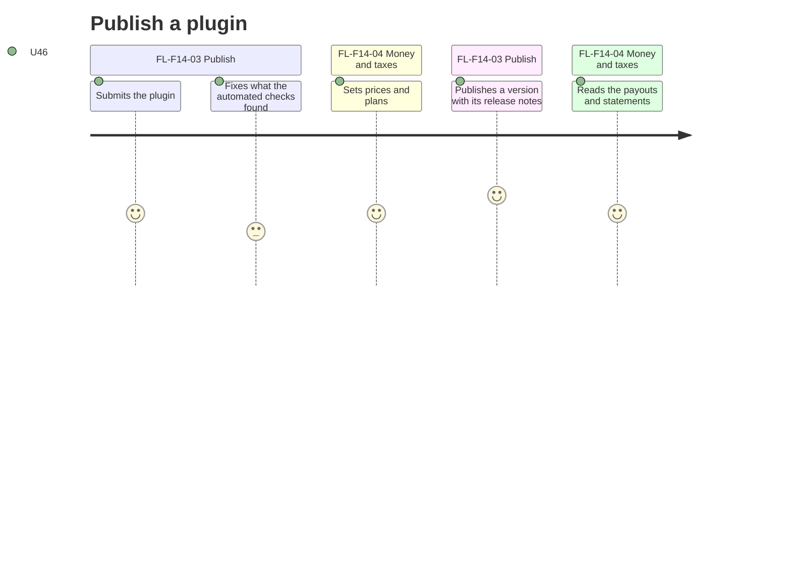
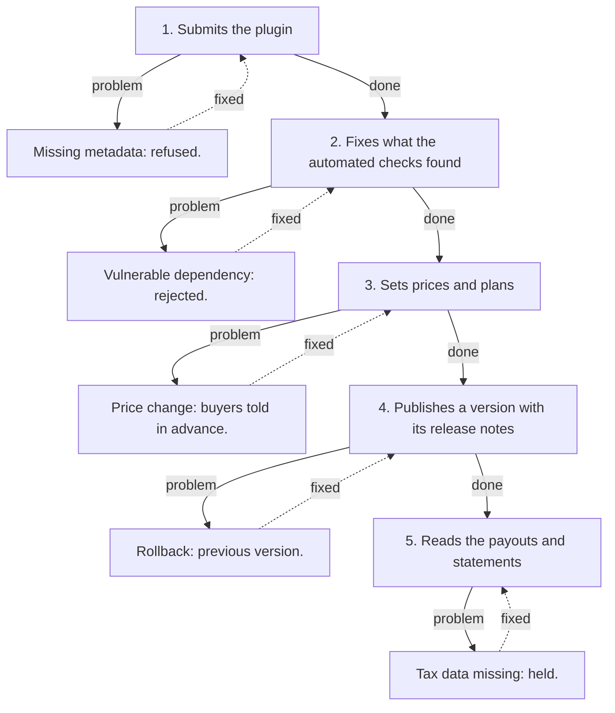

🏠 [Specs](../../../../README.md) › 🎨 [UX](../../../README.md) › 🪟 [Views](../../README.md) ›
🧩 [Plugin publisher: app shell and home](../README.md) › 🧭 [Journeys](README.md) › 🧭 J-U46-01 Publish a plugin

# 🧭 J-U46-01 Publish a plugin

**Status:** 🔄 waiting for the owner

## Persona

[U46 Plugin publisher](../../../../01-users/personas/u46-plugin-publisher.md)

## Goal

Get plugins approved fast, reach customers and get paid on time.

## Journey

Satisfaction at each step, from 1 (painful) to 5 (effortless): these scores are a proposal (Proposed), drawn from the
specs, for the owner to confirm.

## Flowchart

The same steps; each problem is the first error flow of the step's use case (once per use case), shown with the error
message pattern ([D122](../../../../06-decisions/ux/d122-error-message-standard.md)).

## Steps

| Step | Screen | Use case | What the persona does | What the system does |
|---|---|---|---|---|
| 1 | [S-F14-08 Submission](../../../../02-functional/f14-plugin-store/screens/03-publish/s-f14-08-submission.md) | [UC-F14-08 Submit a plugin](../../../../02-functional/f14-plugin-store/use-cases/03-publish/uc-f14-08-submit-a-plugin.md) | Submits the plugin | Creates the listing and takes the version; refuses missing metadata. |
| 2 | [S-F14-09 Automated checks](../../../../02-functional/f14-plugin-store/screens/03-publish/s-f14-09-automated-checks.md) | [UC-F14-09 Pass automated checks](../../../../02-functional/f14-plugin-store/use-cases/03-publish/uc-f14-09-pass-automated-checks.md) | Fixes what the automated checks found | Runs the checks and gives the report; rejects vulnerable dependencies. |
| 3 | [S-F14-12 Pricing](../../../../02-functional/f14-plugin-store/screens/04-money-and-taxes/s-f14-12-pricing.md) | [UC-F14-12 Set prices and plans](../../../../02-functional/f14-plugin-store/use-cases/04-money-and-taxes/uc-f14-12-set-prices-and-plans.md) | Sets prices and plans | Publishes the plans; tells buyers of a price change in advance. |
| 4 | [S-F14-11 Releases](../../../../02-functional/f14-plugin-store/screens/03-publish/s-f14-11-releases.md) | [UC-F14-11 Publish versions and release notes](../../../../02-functional/f14-plugin-store/use-cases/03-publish/uc-f14-11-publish-versions-and-release-notes.md) | Publishes a version with its release notes | Notifies installers and monitors; rolls back to the previous version if needed. |
| 5 | [S-F14-13 Payouts](../../../../02-functional/f14-plugin-store/screens/04-money-and-taxes/s-f14-13-payouts.md) | [UC-F14-13 Receive payouts and statements](../../../../02-functional/f14-plugin-store/use-cases/04-money-and-taxes/uc-f14-13-receive-payouts-and-statements.md) | Reads the payouts and statements | Closes the period, issues the statement and pays out; holds it if tax data is missing. |

This persona's images of these flows (D120):
[FL-F14-03 Publish](../../../../02-functional/f14-plugin-store/images/03-publish/u46-plugin-publisher/README.md),
[FL-F14-04 Money and taxes](../../../../02-functional/f14-plugin-store/images/04-money-and-taxes/u46-plugin-publisher/README.md).

## Open questions

None.

---

⬆️ [Up](README.md)
