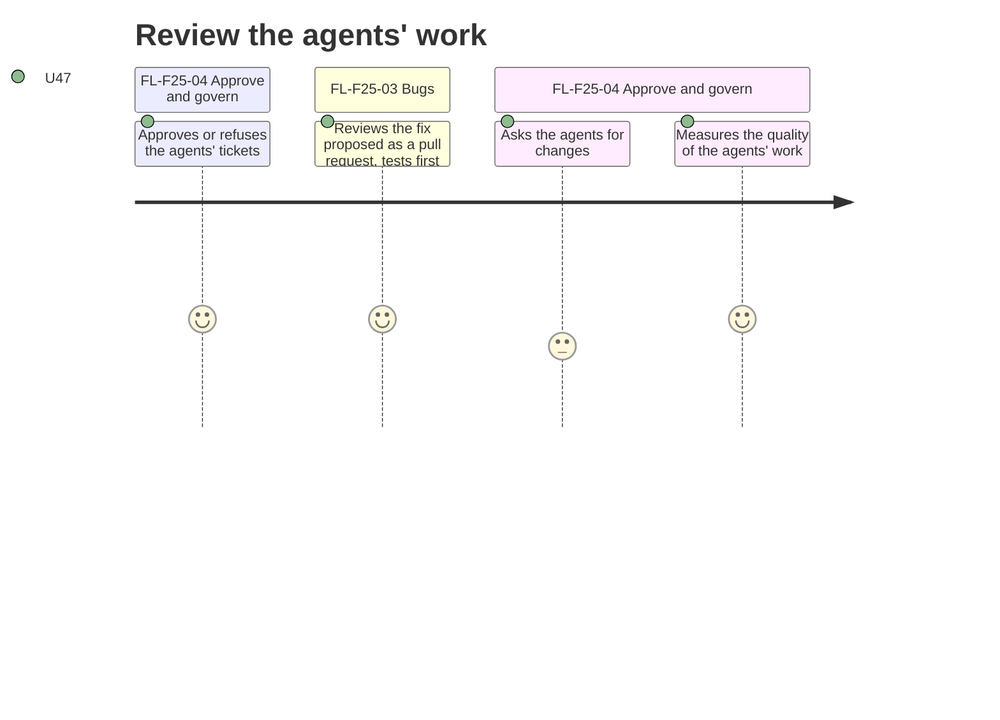
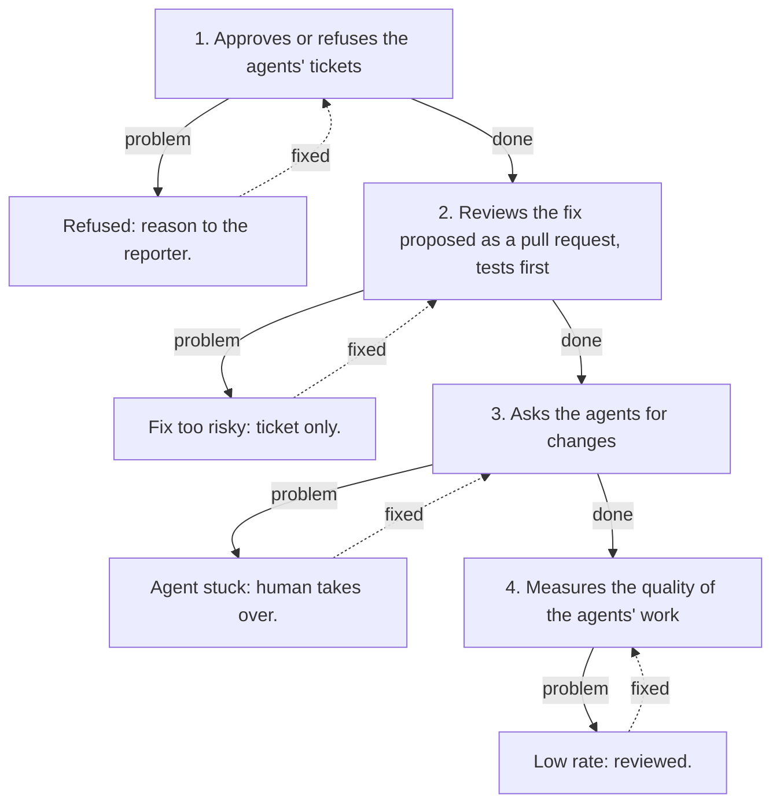

🏠 [Specs](../../../../README.md) › 🎨 [UX](../../../README.md) › 🪟 [Views](../../README.md) ›
🛠️ [SimpleERP maintainer: app shell and home](../README.md) › 🧭 [Journeys](README.md) ›
🧭 J-U47-01 Review the agents' work

# 🧭 J-U47-01 Review the agents' work

**Status:** 🔄 waiting for the owner

## Persona

[U47 SimpleERP maintainer](../../../../01-users/personas/u47-simpleerp-maintainer.md)

## Goal

Merge only reviewed, tested changes and keep the agents' work useful and safe.

## Journey

Satisfaction at each step, from 1 (painful) to 5 (effortless): these scores are a proposal (Proposed), drawn from the
specs, for the owner to confirm.

## Flowchart

The same steps; each problem is the first error flow of the step's use case (once per use case), shown with the error
message pattern ([D122](../../../../06-decisions/ux/d122-error-message-standard.md)).

## Steps

| Step | Screen | Use case | What the persona does | What the system does |
|---|---|---|---|---|
| 1 | [S-F25-12 Approvals](../../../../02-functional/f25-devops-agents/screens/04-approve-and-govern/s-f25-12-approvals.md) | [UC-F25-12 Approve or refuse agents' tickets](../../../../02-functional/f25-devops-agents/use-cases/04-approve-and-govern/uc-f25-12-approve-or-refuse-agents-tickets.md) | Approves or refuses the agents' tickets | Moves an approved ticket to Ready; sends the reason of a refusal to the reporter. |
| 2 | [S-F25-10 Fix pull request](../../../../02-functional/f25-devops-agents/screens/03-bugs/s-f25-10-fix-pull-request.md) | [UC-F25-10 Propose the fix as a pull request, tests first](../../../../02-functional/f25-devops-agents/use-cases/03-bugs/uc-f25-10-propose-the-fix-as-a-pull-request-tests-first.md) | Reviews the fix proposed as a pull request, tests first | The agent writes the failing test, then the fix, as a pull request. |
| 3 | [S-F25-13 Revisions](../../../../02-functional/f25-devops-agents/screens/04-approve-and-govern/s-f25-13-revisions.md) | [UC-F25-13 Ask the agents for changes](../../../../02-functional/f25-devops-agents/use-cases/04-approve-and-govern/uc-f25-13-ask-the-agents-for-changes.md) | Asks the agents for changes | The agent revises and asks for a new review; a person takes over a stuck agent. |
| 4 | [S-F25-19 Agent quality](../../../../02-functional/f25-devops-agents/screens/04-approve-and-govern/s-f25-19-agent-quality.md) | [UC-F25-19 Measure the quality of the agents' work](../../../../02-functional/f25-devops-agents/use-cases/04-approve-and-govern/uc-f25-19-measure-the-quality-of-the-agents-work.md) | Measures the quality of the agents' work | Shows the agents' quality figures to improve prompts and tools. |

This persona's images of these flows (D120):
[FL-F25-04 Approve and govern](../../../../02-functional/f25-devops-agents/images/04-approve-and-govern/u47-simpleerp-maintainer/README.md),
[FL-F25-03 Bugs](../../../../02-functional/f25-devops-agents/images/03-bugs/u47-simpleerp-maintainer/README.md).

## Open questions

None.

---

⬆️ [Up](README.md)
