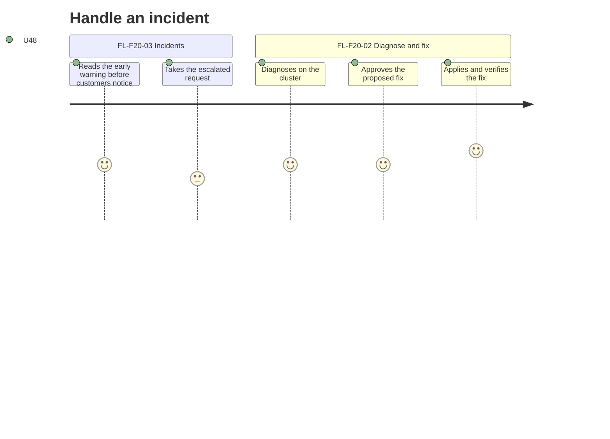
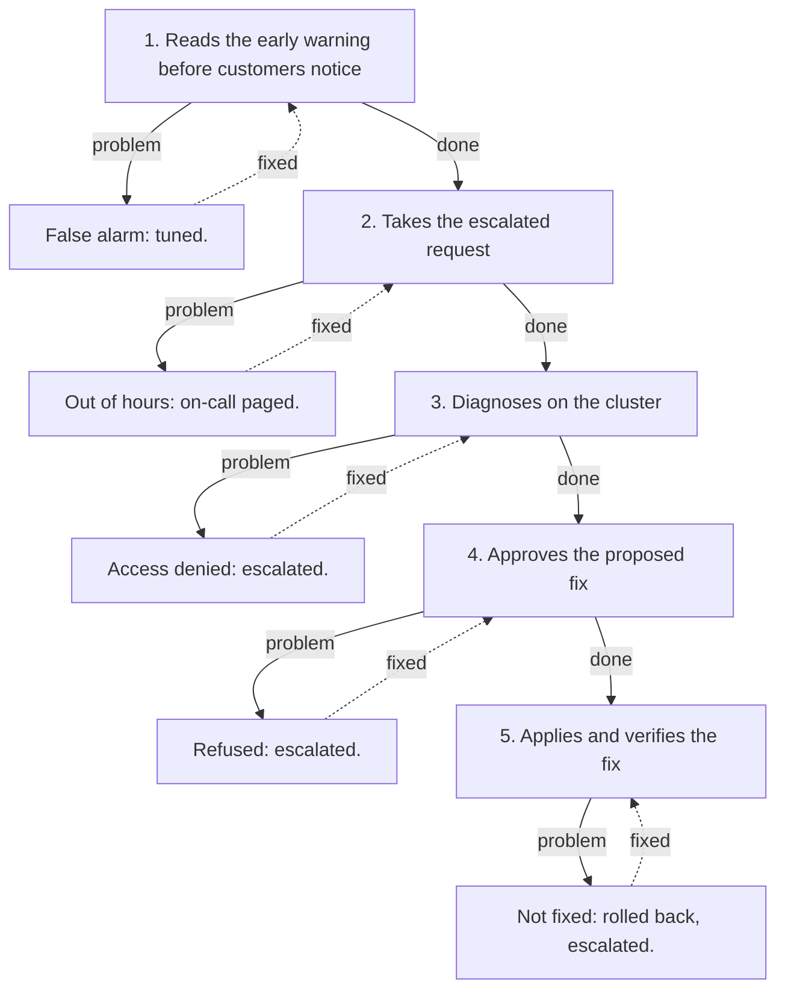

🏠 [Specs](../../../../README.md) › 🎨 [UX](../../../README.md) › 🪟 [Views](../../README.md) ›
🧑‍🔧 [Hosting engineer: app shell and home](../README.md) › 🧭 [Journeys](README.md) › 🧭 J-U48-01 Handle an incident

# 🧭 J-U48-01 Handle an incident

**Status:** ✅ specified

## Persona

[U48 Hosting engineer](../../../../01-users/personas/u48-hosting-engineer.md)

## Goal

Keep every hosted customer running and approve safe fixes fast.

## Journey

Satisfaction at each step, from 1 (painful) to 5 (effortless): these scores are drawn from the
specs and confirmed by the owner (D572).

## Flowchart

The same steps; each problem is the first error flow of the step's use case (once per use case), shown with the error
message pattern ([D122](../../../../06-decisions/ux/d122-error-message-standard.md)).

## Steps

| Step | Screen | Use case | What the persona does | What the system does |
|---|---|---|---|---|
| 1 | [S-F20-11 Proactive alerts](../../../../02-functional/f20-hosted-support-assistant/screens/03-incidents/s-f20-11-proactive-alerts.md) | [UC-F20-11 Warn before customers notice](../../../../02-functional/f20-hosted-support-assistant/use-cases/03-incidents/uc-f20-11-warn-before-customers-notice.md) | Reads the early warning before customers notice | Detects the problem, proposes a fix and tells the customer. |
| 2 | [S-F20-08 Escalation](../../../../02-functional/f20-hosted-support-assistant/screens/03-incidents/s-f20-08-escalation.md) | [UC-F20-08 Escalate to an engineer](../../../../02-functional/f20-hosted-support-assistant/use-cases/03-incidents/uc-f20-08-escalate-to-an-engineer.md) | Takes the escalated request | Brings the engineer in and tells the customer; pages on-call out of hours. |
| 3 | [S-F20-04 Diagnosis](../../../../02-functional/f20-hosted-support-assistant/screens/02-diagnose-and-fix/s-f20-04-diagnosis.md) | [UC-F20-04 Diagnose on the cluster](../../../../02-functional/f20-hosted-support-assistant/use-cases/02-diagnose-and-fix/uc-f20-04-diagnose-on-the-cluster.md) | Diagnoses on the cluster | Reads and correlates the cluster's signals to find the cause. |
| 4 | [S-F20-06 Fix approval](../../../../02-functional/f20-hosted-support-assistant/screens/02-diagnose-and-fix/s-f20-06-fix-approval.md) | [UC-F20-06 Propose a fix for a maintainer's yes](../../../../02-functional/f20-hosted-support-assistant/use-cases/02-diagnose-and-fix/uc-f20-06-propose-a-fix-for-a-maintainer-s-yes.md) | Approves the proposed fix | Waits for the maintainer's yes before anything changes. |
| 5 | [S-F20-07 Fix result](../../../../02-functional/f20-hosted-support-assistant/screens/02-diagnose-and-fix/s-f20-07-fix-result.md) | [UC-F20-07 Apply and verify the fix](../../../../02-functional/f20-hosted-support-assistant/use-cases/02-diagnose-and-fix/uc-f20-07-apply-and-verify-the-fix.md) | Applies and verifies the fix | Verifies the fix and tells the customer; rolls back and escalates if not fixed. |

This persona's images of these flows (D120):
[FL-F20-03 Incidents](../../../../02-functional/f20-hosted-support-assistant/images/03-incidents/u48-hosting-engineer/README.md),
[FL-F20-02 Diagnose and fix](../../../../02-functional/f20-hosted-support-assistant/images/02-diagnose-and-fix/u48-hosting-engineer/README.md).

## Open questions

None.

---

⬆️ [Up](README.md)
