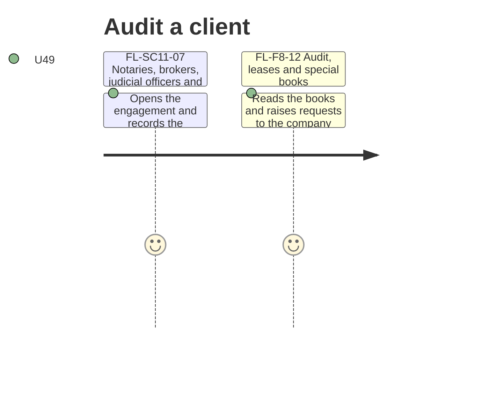
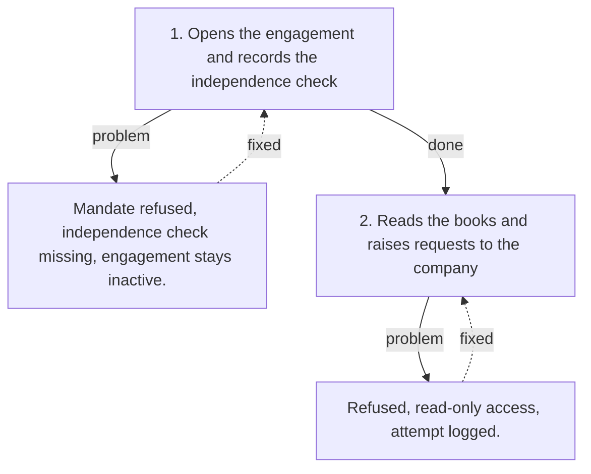

🏠 [Specs](../../../../README.md) › 🎨 [UX](../../../README.md) › 🪟 [Views](../../README.md) ›
🔎 [Statutory auditor: app shell and home](../README.md) › 🧭 J-U49-01 Audit a client

# 🧭 J-U49-01 Audit a client

**Status:** ✅ specified

## Persona

[U49 Statutory auditor](../../../../01-users/personas/u49-statutory-auditor.md)

## Goal

Reach the books and the documents the audit needs, ask the company for the rest, and prove nothing was changed.

## Journey

Satisfaction at each step, from 1 (painful) to 5 (effortless): these scores are drawn from the
specs and confirmed by the owner (D572).

## Flowchart

The same steps; each problem is the first error flow of the step's use case (once per use case), shown with the error
message pattern ([D122](../../../../06-decisions/ux/d122-error-message-standard.md)).

## Steps

| Step | Screen | Use case | What the persona does | What the system does |
|---|---|---|---|---|
| 1 | [S-SC11-24 Audit firm](../../../../08-sectors/sc11-professional-firms/screens/07-notaries-brokers-officers-and-auditors/s-sc11-24-audit-firm.md) | [UC-SC11-24 Run a statutory audit firm](../../../../08-sectors/sc11-professional-firms/use-cases/07-notaries-brokers-officers-and-auditors/uc-sc11-24-run-a-statutory-audit-firm.md) | Opens the engagement and records the independence check | Creates the engagement, the team and the signing partner, and keeps the work and the opinion. |
| 2 | [S-F8-35 Auditor workspace](../../../../02-functional/f08-accounting/screens/12-audit-leases-and-special-books/s-f08-35-auditor-workspace.md) | [UC-F8-36 Open the books to the statutory auditor](../../../../02-functional/f08-accounting/use-cases/12-audit-leases-and-special-books/uc-f08-36-open-the-books-to-the-statutory-auditor.md) | Reads the books and raises requests to the company | Shows the ledgers, the entries and the documents read-only, logs every view and records each request and answer. |

This persona's images of these flows (D120) are drawn in the image round; the pages are named by the plan: FL-SC11-07
Notaries, brokers, judicial officers and audit firms
`images/07-notaries-brokers-officers-and-auditors/u49-statutory-auditor/README.md`, FL-F8-12 Audit, leases and special
books `images/12-audit-leases-and-special-books/u49-statutory-auditor/README.md`.

## Open questions

None.

---

⬆️ [Up](README.md)
