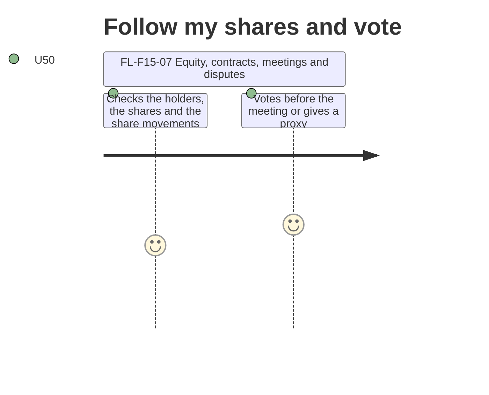
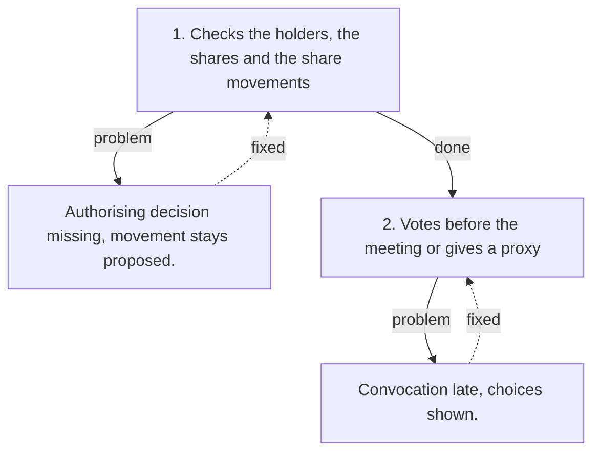

🏠 [Specs](../../../../README.md) › 🎨 [UX](../../../README.md) › 🪟 [Views](../../README.md) ›
📈 [Shareholder: app shell and home](../README.md) › 🧭 J-U50-01 Follow my shares and vote

# 🧭 J-U50-01 Follow my shares and vote

**Status:** ✅ specified

## Persona

[U50 Shareholder](../../../../01-users/personas/u50-shareholder.md)

## Goal

Know what I hold, see every movement of the company's shares, and vote at the general meeting without travelling.

## Journey

Satisfaction at each step, from 1 (painful) to 5 (effortless): these scores are a proposal, drawn from the
specs, for the owner to confirm.

## Flowchart

The same steps; each problem is the first error flow of the step's use case (once per use case), shown with the error
message pattern ([D122](../../../../06-decisions/ux/d122-error-message-standard.md)).

## Steps

| Step | Screen | Use case | What the persona does | What the system does |
|---|---|---|---|---|
| 1 | [S-F15-12 Cap table](../../../../02-functional/f15-legal-assistant/screens/07-equity-contracts-and-disputes/s-f15-12-cap-table.md) | [UC-F15-14 Keep the cap table and share movements](../../../../02-functional/f15-legal-assistant/use-cases/07-equity-contracts-and-disputes/uc-f15-14-keep-the-cap-table-and-share-movements.md) | Checks the holders, the shares and the share movements | Shows the cap table, lists what each movement needs and keeps the register of movements. |
| 2 | [S-F15-16 Shareholder meetings](../../../../02-functional/f15-legal-assistant/screens/07-equity-contracts-and-disputes/s-f15-16-shareholder-meetings.md) | [UC-F15-18 Run a shareholders' general meeting](../../../../02-functional/f15-legal-assistant/use-cases/07-equity-contracts-and-disputes/uc-f15-18-run-a-shareholders-general-meeting.md) | Votes before the meeting or gives a proxy | Sends the convocation in time with the documents, counts the votes against the majority each resolution needs and keeps the minutes. |

This persona's images of these flows (D120) are drawn in the image round; the pages are named by the plan: FL-F15-07
Equity, contracts, meetings and disputes `images/07-equity-contracts-and-disputes/u50-shareholder/README.md`.

## Open questions

None.

---

⬆️ [Up](README.md)
