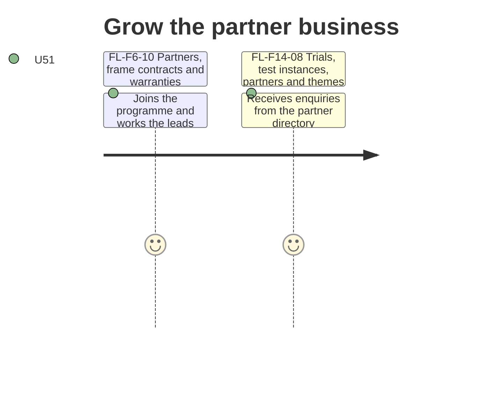
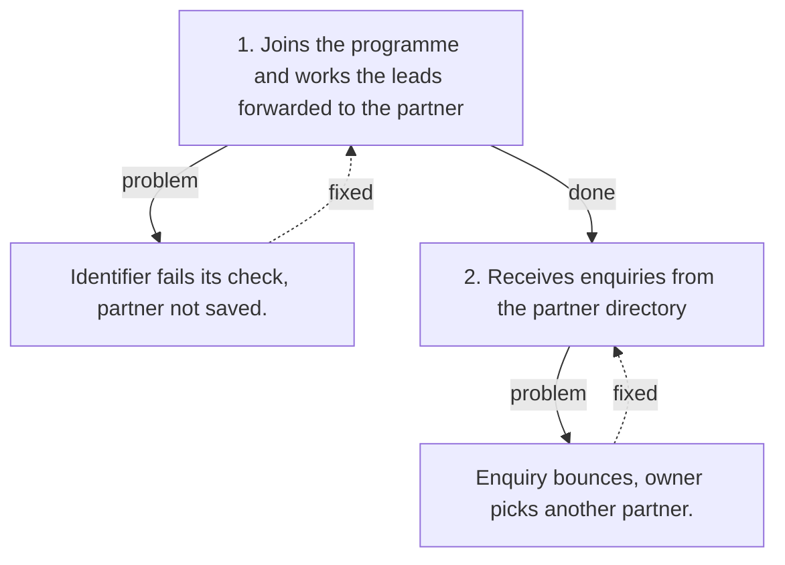

🏠 [Specs](../../../../README.md) › 🎨 [UX](../../../README.md) › 🪟 [Views](../../README.md) ›
🤝 [Reseller partner: app shell and home](../README.md) › 🧭 J-U51-01 Grow the partner business

# 🧭 J-U51-01 Grow the partner business

**Status:** ✅ specified

## Persona

[U51 Reseller partner](../../../../01-users/personas/u51-reseller-partner.md)

## Goal

Win customers through the vendor's programme and be found by companies that look for an implementation partner.

## Journey

Satisfaction at each step, from 1 (painful) to 5 (effortless): these scores are a proposal, drawn from the
specs, for the owner to confirm.

## Flowchart

The same steps; each problem is the first error flow of the step's use case (once per use case), shown with the error
message pattern ([D122](../../../../06-decisions/ux/d122-error-message-standard.md)).

## Steps

| Step | Screen | Use case | What the persona does | What the system does |
|---|---|---|---|---|
| 1 | [S-F6-24 Partner programme](../../../../02-functional/f06-customers-and-sales/screens/10-partners-contracts-and-warranties/s-f06-24-partner-programme.md) | [UC-F6-27 Run a partner programme](../../../../02-functional/f06-customers-and-sales/use-cases/10-partners-contracts-and-warranties/uc-f06-27-run-a-partner-programme.md) | Joins the programme and works the leads forwarded to the partner | Approves the partner, gives it a commission plan, forwards leads and computes the commission. |
| 2 | [S-F14-29 Partner directory](../../../../02-functional/f14-plugin-store/screens/08-trials-instances-and-partners/s-f14-29-partner-directory.md) | [UC-F14-31 Find an implementation partner](../../../../02-functional/f14-plugin-store/use-cases/08-trials-instances-and-partners/uc-f14-31-find-an-implementation-partner.md) | Receives enquiries from the partner directory | Lists the partners by ranking and factors, shows the listing and delivers the enquiry. |

This persona's images of these flows (D120) are drawn in the image round; the pages are named by the plan: FL-F6-10
Partners, frame contracts and warranties `images/10-partners-contracts-and-warranties/u51-reseller-partner/README.md`,
FL-F14-08 Trials, test instances, partners and themes
`images/08-trials-instances-and-partners/u51-reseller-partner/README.md`.

## Open questions

None.

---

⬆️ [Up](README.md)
