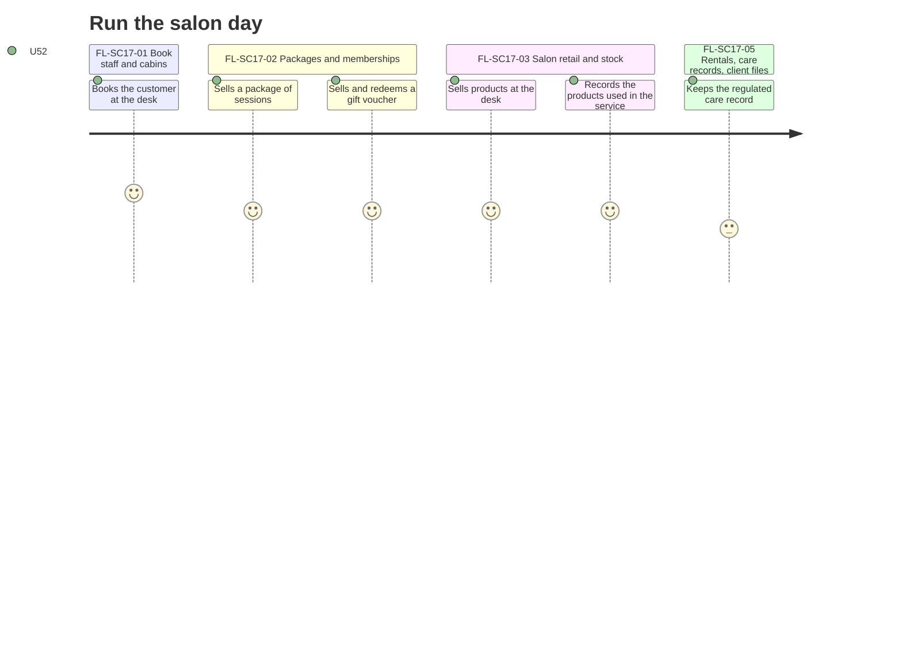
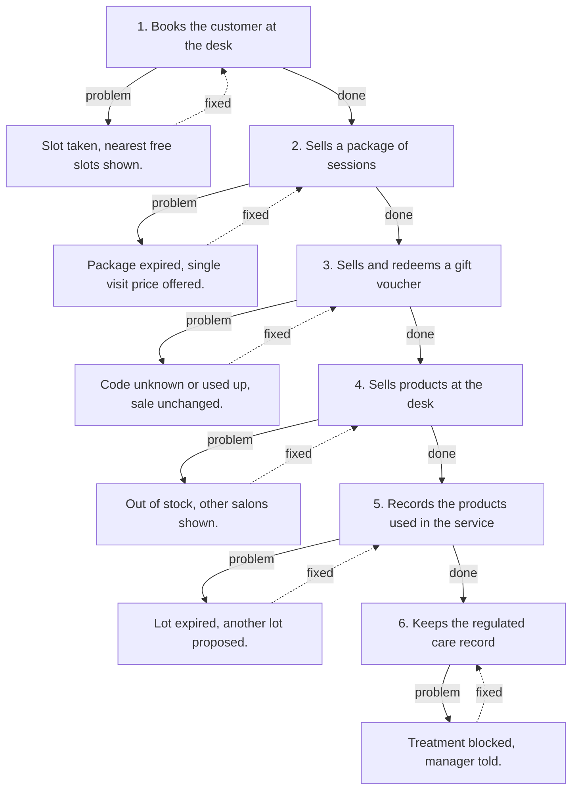

🏠 [Specs](../../../../README.md) › 🎨 [UX](../../../README.md) › 🪟 [Views](../../README.md) ›
💅 [Beautician: app shell and home](../README.md) › 🧭 J-U52-01 Run the salon day

# 🧭 J-U52-01 Run the salon day

**Status:** ✅ specified

## Persona

[U52 Beautician](../../../../01-users/personas/u52-beautician.md)

## Goal

Fill every cabin, sell more than the service itself and keep every treatment safe and traceable.

## Journey

Satisfaction at each step, from 1 (painful) to 5 (effortless): these scores are a proposal, drawn from the
specs, for the owner to confirm.

## Flowchart

The same steps; each problem is the first error flow of the step's use case (once per use case), shown with the error
message pattern ([D122](../../../../06-decisions/ux/d122-error-message-standard.md)).

## Steps

| Step | Screen | Use case | What the persona does | What the system does |
|---|---|---|---|---|
| 1 | [S-SC17-03 Desk booking](../../../../08-sectors/sc17-beauty-and-wellness/screens/01-book-staff-and-cabins/s-sc17-03-desk-booking.md) | [UC-SC17-03 Book at the desk](../../../../08-sectors/sc17-beauty-and-wellness/use-cases/01-book-staff-and-cabins/uc-sc17-03-book-at-the-desk.md) | Books the customer at the desk | Shows the free staff and cabins with the online rule and holds the slot until the deposit is paid. |
| 2 | [S-SC17-05 Packages](../../../../08-sectors/sc17-beauty-and-wellness/screens/02-packages-and-memberships/s-sc17-05-packages.md) | [UC-SC17-05 Sell packages and prepaid sessions](../../../../08-sectors/sc17-beauty-and-wellness/use-cases/02-packages-and-memberships/uc-sc17-05-sell-packages-and-prepaid-sessions.md) | Sells a package of sessions | Shows the price, the sessions and the end date, then takes one session at each visit. |
| 3 | [S-SC17-07 Gift vouchers](../../../../08-sectors/sc17-beauty-and-wellness/screens/02-packages-and-memberships/s-sc17-07-gift-vouchers.md) | [UC-SC17-07 Sell and redeem gift vouchers](../../../../08-sectors/sc17-beauty-and-wellness/use-cases/02-packages-and-memberships/uc-sc17-07-sell-and-redeem-gift-vouchers.md) | Sells and redeems a gift voucher | Fills the validity from the legal period and refuses an unknown, used up or expired code. |
| 4 | [S-SC17-09 Salon retail](../../../../08-sectors/sc17-beauty-and-wellness/screens/03-salon-retail-and-stock/s-sc17-09-salon-retail.md) | [UC-SC17-09 Sell products at the desk](../../../../08-sectors/sc17-beauty-and-wellness/use-cases/03-salon-retail-and-stock/uc-sc17-09-sell-products-at-the-desk.md) | Sells products at the desk | Adds the retail to the visit, applies the package, voucher or deposit and sells through the certified till. |
| 5 | [S-SC17-10 Back bar](../../../../08-sectors/sc17-beauty-and-wellness/screens/03-salon-retail-and-stock/s-sc17-10-back-bar.md) | [UC-SC17-10 Record products used in services](../../../../08-sectors/sc17-beauty-and-wellness/use-cases/03-salon-retail-and-stock/uc-sc17-10-record-products-used-in-services.md) | Records the products used in the service | Proposes the recipe, takes the stock down and attaches the lot to the client file. |
| 6 | [S-SC17-18 Regulated care](../../../../08-sectors/sc17-beauty-and-wellness/screens/05-rentals-care-records-and-loyalty/s-sc17-18-regulated-care.md) | [UC-SC17-18 Keep regulated care records](../../../../08-sectors/sc17-beauty-and-wellness/use-cases/05-rentals-care-records-and-loyalty/uc-sc17-18-keep-regulated-care-records.md) | Keeps the regulated care record | Checks the declared activity and the hygiene training, then keeps the signed consent and the lots. |

This persona's images of these flows (D120) are drawn in the image round; the pages are named by the plan: FL-SC17-01
Book staff and cabins `images/01-book-staff-and-cabins/u52-beautician/README.md`, FL-SC17-02 Packages and memberships
`images/02-packages-and-memberships/u52-beautician/README.md`, FL-SC17-03 Salon retail and stock
`images/03-salon-retail-and-stock/u52-beautician/README.md`, FL-SC17-05 Rentals, care records, client files and loyalty
`images/05-rentals-care-records-and-loyalty/u52-beautician/README.md`.

## Open questions

None.

---

⬆️ [Up](README.md)
