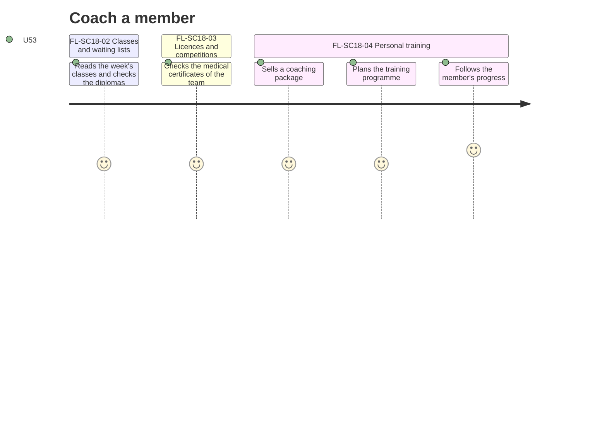
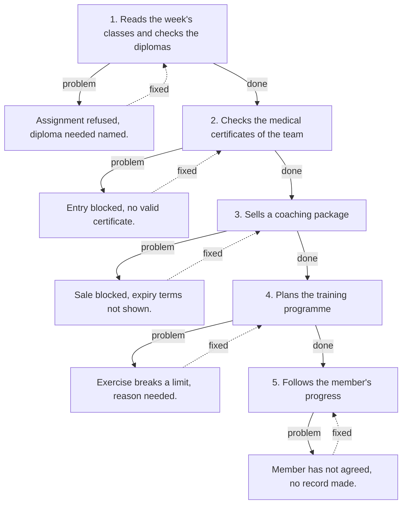

🏠 [Specs](../../../../README.md) › 🎨 [UX](../../../README.md) › 🪟 [Views](../../README.md) ›
🏋️ [Coach: app shell and home](../README.md) › 🧭 J-U53-01 Coach a member

# 🧭 J-U53-01 Coach a member

**Status:** ✅ specified

## Persona

[U53 Coach](../../../../01-users/personas/u53-coach.md)

## Goal

Keep every class staffed by a qualified coach and bring each member to their goal safely.

## Journey

Satisfaction at each step, from 1 (painful) to 5 (effortless): these scores are a proposal, drawn from the
specs, for the owner to confirm.

## Flowchart

The same steps; each problem is the first error flow of the step's use case (once per use case), shown with the error
message pattern ([D122](../../../../06-decisions/ux/d122-error-message-standard.md)).

## Steps

| Step | Screen | Use case | What the persona does | What the system does |
|---|---|---|---|---|
| 1 | [S-SC18-08 Coach planning](../../../../08-sectors/sc18-sports-and-fitness/screens/02-classes-and-waiting-lists/s-sc18-08-coach-planning.md) | [UC-SC18-08 Plan coaches](../../../../08-sectors/sc18-sports-and-fitness/use-cases/02-classes-and-waiting-lists/uc-sc18-08-plan-coaches.md) | Reads the week's classes and checks the diplomas | Checks each coach's diploma and hours against the rules. |
| 2 | [S-SC18-10 Medical certificates](../../../../08-sectors/sc18-sports-and-fitness/screens/03-licences-and-competitions/s-sc18-10-medical-certificates.md) | [UC-SC18-10 Check medical certificates](../../../../08-sectors/sc18-sports-and-fitness/use-cases/03-licences-and-competitions/uc-sc18-10-check-medical-certificates.md) | Checks the medical certificates of the team | Shows fit or not fit only and blocks entries without a valid certificate. |
| 3 | [S-SC18-13 Coaching packages](../../../../08-sectors/sc18-sports-and-fitness/screens/04-personal-training/s-sc18-13-coaching-packages.md) | [UC-SC18-13 Sell coaching packages](../../../../08-sectors/sc18-sports-and-fitness/use-cases/04-personal-training/uc-sc18-13-sell-coaching-packages.md) | Sells a coaching package | Shows the price, the sessions and the expiry terms and activates the package on payment. |
| 4 | [S-SC18-14 Training programme](../../../../08-sectors/sc18-sports-and-fitness/screens/04-personal-training/s-sc18-14-training-programme.md) | [UC-SC18-14 Plan a training programme](../../../../08-sectors/sc18-sports-and-fitness/use-cases/04-personal-training/uc-sc18-14-plan-a-training-programme.md) | Plans the training programme | Checks each exercise against the declared health limits and flags any that breaks one. |
| 5 | [S-SC18-15 Progress](../../../../08-sectors/sc18-sports-and-fitness/screens/04-personal-training/s-sc18-15-progress.md) | [UC-SC18-15 Follow progress](../../../../08-sectors/sc18-sports-and-fitness/use-cases/04-personal-training/uc-sc18-15-follow-progress.md) | Follows the member's progress | Shows the evolution against the goal to the member and the coach only. |

This persona's images of these flows (D120) are drawn in the image round; the pages are named by the plan: FL-SC18-02
Classes and waiting lists `images/02-classes-and-waiting-lists/u53-coach/README.md`, FL-SC18-03 Licences and
competitions `images/03-licences-and-competitions/u53-coach/README.md`, FL-SC18-04 Personal training
`images/04-personal-training/u53-coach/README.md`.

## Open questions

None.

---

⬆️ [Up](README.md)
