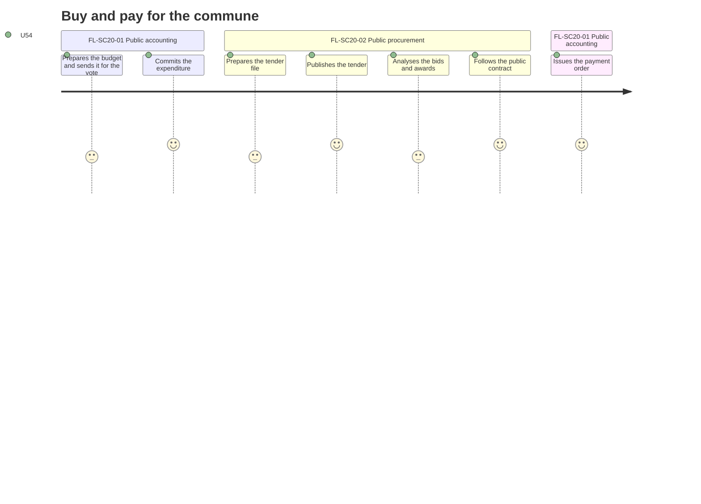
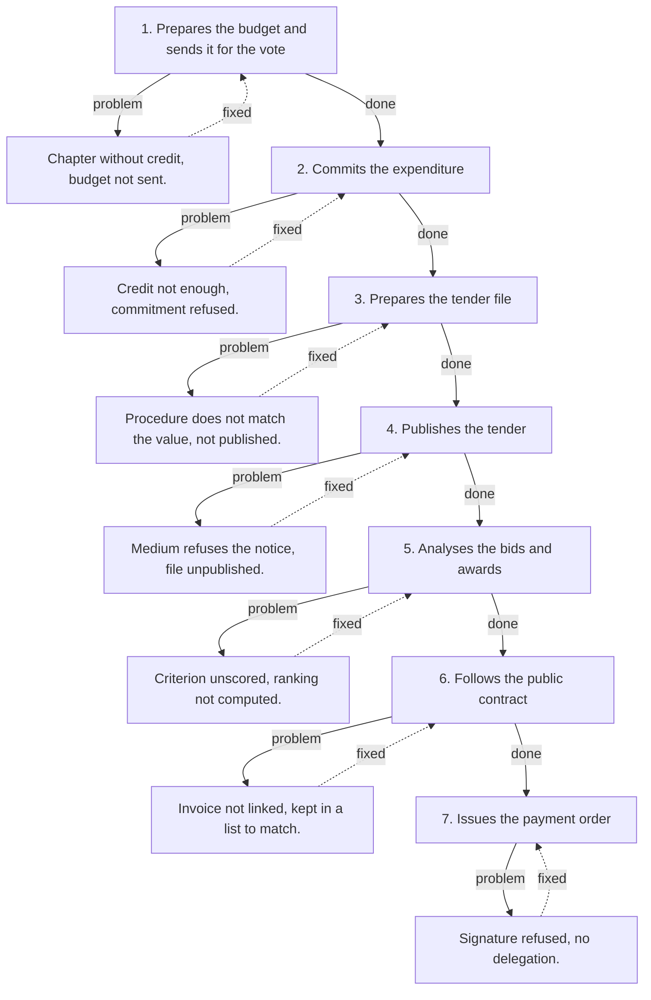

🏠 [Specs](../../../../README.md) › 🎨 [UX](../../../README.md) › 🪟 [Views](../../README.md) ›
🏛️ [Public finance officer: app shell and home](../README.md) › 🧭 J-U54-01 Buy and pay for the commune

# 🧭 J-U54-01 Buy and pay for the commune

**Status:** ✅ specified

## Persona

[U54 Public finance officer](../../../../01-users/personas/u54-public-finance-officer.md)

## Goal

Spend the voted budget inside the rules of public accounting and public procurement, and pay on time.

## Journey

Satisfaction at each step, from 1 (painful) to 5 (effortless): these scores are a proposal, drawn from the
specs, for the owner to confirm.

## Flowchart

The same steps; each problem is the first error flow of the step's use case (once per use case), shown with the error
message pattern ([D122](../../../../06-decisions/ux/d122-error-message-standard.md)).

## Steps

| Step | Screen | Use case | What the persona does | What the system does |
|---|---|---|---|---|
| 1 | [S-SC20-01 Budget vote](../../../../08-sectors/sc20-public-bodies/screens/01-public-accounting/s-sc20-01-budget-vote.md) | [UC-SC20-01 Prepare and vote the budget](../../../../08-sectors/sc20-public-bodies/use-cases/01-public-accounting/uc-sc20-01-prepare-and-vote-the-budget.md) | Prepares the budget and sends it for the vote | Checks that operation and investment are each balanced and transmits the voted budget. |
| 2 | [S-SC20-02 Commitments](../../../../08-sectors/sc20-public-bodies/screens/01-public-accounting/s-sc20-02-commitments.md) | [UC-SC20-02 Commit expenditure](../../../../08-sectors/sc20-public-bodies/use-cases/01-public-accounting/uc-sc20-02-commit-expenditure.md) | Commits the expenditure | Checks the credit left on the chapter and numbers the commitment. |
| 3 | [S-SC20-05 Tender file](../../../../08-sectors/sc20-public-bodies/screens/02-public-procurement/s-sc20-05-tender-file.md) | [UC-SC20-05 Prepare a tender file](../../../../08-sectors/sc20-public-bodies/use-cases/02-public-procurement/uc-sc20-05-prepare-a-tender-file.md) | Prepares the tender file | Shows the procedure the thresholds require and checks the criteria weights. |
| 4 | [S-SC20-06 Tender publication](../../../../08-sectors/sc20-public-bodies/screens/02-public-procurement/s-sc20-06-tender-publication.md) | [UC-SC20-06 Publish the tender](../../../../08-sectors/sc20-public-bodies/use-cases/02-public-procurement/uc-sc20-06-publish-the-tender.md) | Publishes the tender | Lists the media and the minimum deadline and opens the document pack. |
| 5 | [S-SC20-07 Bid analysis](../../../../08-sectors/sc20-public-bodies/screens/02-public-procurement/s-sc20-07-bid-analysis.md) | [UC-SC20-07 Analyse bids and award](../../../../08-sectors/sc20-public-bodies/use-cases/02-public-procurement/uc-sc20-07-analyse-bids-and-award.md) | Analyses the bids and awards | Sets late bids aside, ranks the scored bids and prepares the award. |
| 6 | [S-SC20-08 Public contract](../../../../08-sectors/sc20-public-bodies/screens/02-public-procurement/s-sc20-08-public-contract.md) | [UC-SC20-08 Follow the public contract](../../../../08-sectors/sc20-public-bodies/use-cases/02-public-procurement/uc-sc20-08-follow-the-public-contract.md) | Follows the public contract | Links each invoice to its contract and computes the payment deadline. |
| 7 | [S-SC20-03 Orders and titles](../../../../08-sectors/sc20-public-bodies/screens/01-public-accounting/s-sc20-03-orders-and-titles.md) | [UC-SC20-03 Issue payment orders and revenue titles](../../../../08-sectors/sc20-public-bodies/use-cases/01-public-accounting/uc-sc20-03-issue-payment-orders-and-revenue-titles.md) | Issues the payment order | Drafts the order from the commitment and refuses a signer without delegation. |

This persona's images of these flows (D120) are drawn in the image round; the pages are named by the plan: FL-SC20-01
Public accounting `images/01-public-accounting/u54-public-finance-officer/README.md`, FL-SC20-02 Public procurement
`images/02-public-procurement/u54-public-finance-officer/README.md`.

## Open questions

None.

---

⬆️ [Up](README.md)
