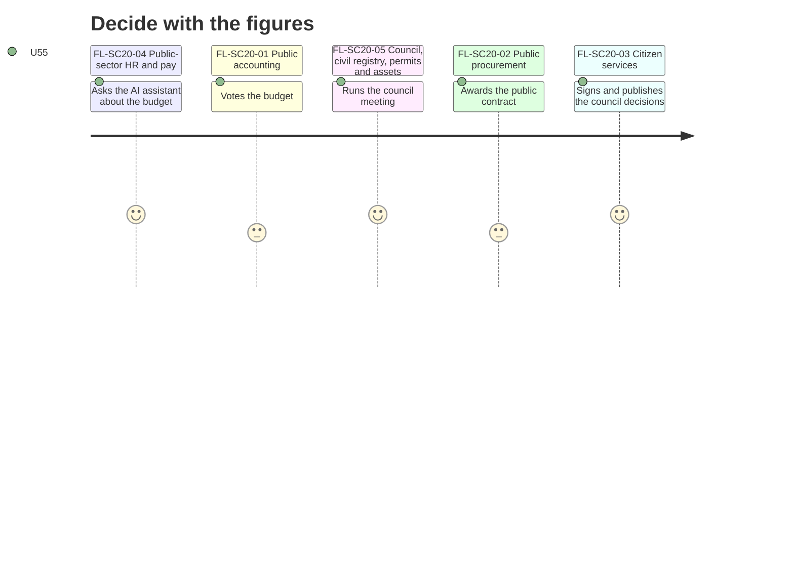
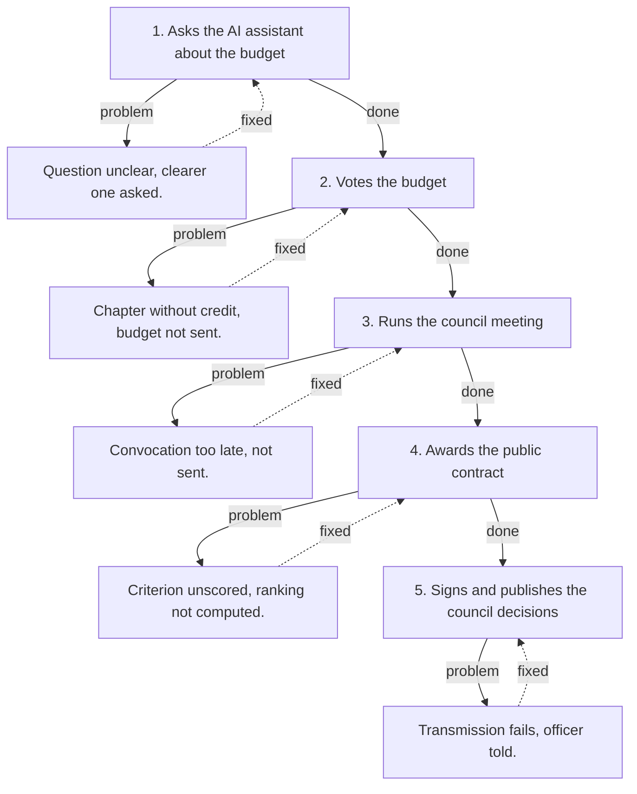

🏠 [Specs](../../../../README.md) › 🎨 [UX](../../../README.md) › 🪟 [Views](../../README.md) ›
🗳️ [Elected official: app shell and home](../README.md) › 🧭 J-U55-01 Decide with the figures

# 🧭 J-U55-01 Decide with the figures

**Status:** ✅ specified

## Persona

[U55 Elected official](../../../../01-users/personas/u55-elected-official.md)

## Goal

Vote the budget and the decisions of the council on figures I can check, and see them published.

## Journey

Satisfaction at each step, from 1 (painful) to 5 (effortless): these scores are drawn from the
specs and confirmed by the owner (D572).

## Flowchart

The same steps; each problem is the first error flow of the step's use case (once per use case), shown with the error
message pattern ([D122](../../../../06-decisions/ux/d122-error-message-standard.md)).

## Steps

| Step | Screen | Use case | What the persona does | What the system does |
|---|---|---|---|---|
| 1 | [S-SC20-16 Budget assistant](../../../../08-sectors/sc20-public-bodies/screens/04-public-hr-and-pay/s-sc20-16-budget-assistant.md) | [UC-SC20-16 Ask the AI assistant about the budget](../../../../08-sectors/sc20-public-bodies/use-cases/04-public-hr-and-pay/uc-sc20-16-ask-the-assistant-about-the-budget.md) | Asks the AI assistant about the budget | Answers with the figure, the period and the chapter, with its sources, and refuses what the official may not read. |
| 2 | [S-SC20-01 Budget vote](../../../../08-sectors/sc20-public-bodies/screens/01-public-accounting/s-sc20-01-budget-vote.md) | [UC-SC20-01 Prepare and vote the budget](../../../../08-sectors/sc20-public-bodies/use-cases/01-public-accounting/uc-sc20-01-prepare-and-vote-the-budget.md) | Votes the budget | Shows the budget to review, then opens the credits after the vote. |
| 3 | [S-SC20-17 Council meetings](../../../../08-sectors/sc20-public-bodies/screens/05-council-registry-permits-and-assets/s-sc20-17-council-meetings.md) | [UC-SC20-17 Run council meetings and deliberations](../../../../08-sectors/sc20-public-bodies/use-cases/05-council-registry-permits-and-assets/uc-sc20-17-run-council-meetings-and-deliberations.md) | Runs the council meeting | Sends the convocation within the legal delay, records the attendance and the deliberations. |
| 4 | [S-SC20-07 Bid analysis](../../../../08-sectors/sc20-public-bodies/screens/02-public-procurement/s-sc20-07-bid-analysis.md) | [UC-SC20-07 Analyse bids and award](../../../../08-sectors/sc20-public-bodies/use-cases/02-public-procurement/uc-sc20-07-analyse-bids-and-award.md) | Awards the public contract | Shows the ranking and records the approved award. |
| 5 | [S-SC20-12 Council decisions](../../../../08-sectors/sc20-public-bodies/screens/03-citizen-services/s-sc20-12-council-decisions.md) | [UC-SC20-12 Publish council decisions](../../../../08-sectors/sc20-public-bodies/use-cases/03-citizen-services/uc-sc20-12-publish-council-decisions.md) | Signs and publishes the council decisions | Posts the decision on the website and the register and transmits it to the prefecture. |

This persona's images of these flows (D120) are drawn in the image round; the pages are named by the plan: FL-SC20-04
Public-sector HR and pay `images/04-public-hr-and-pay/u55-elected-official/README.md`, FL-SC20-01 Public accounting
`images/01-public-accounting/u55-elected-official/README.md`, FL-SC20-05 Council, civil registry, permits and assets
`images/05-council-registry-permits-and-assets/u55-elected-official/README.md`, FL-SC20-02 Public procurement
`images/02-public-procurement/u55-elected-official/README.md`, FL-SC20-03 Citizen services
`images/03-citizen-services/u55-elected-official/README.md`.

## Open questions

None.

---

⬆️ [Up](README.md)
