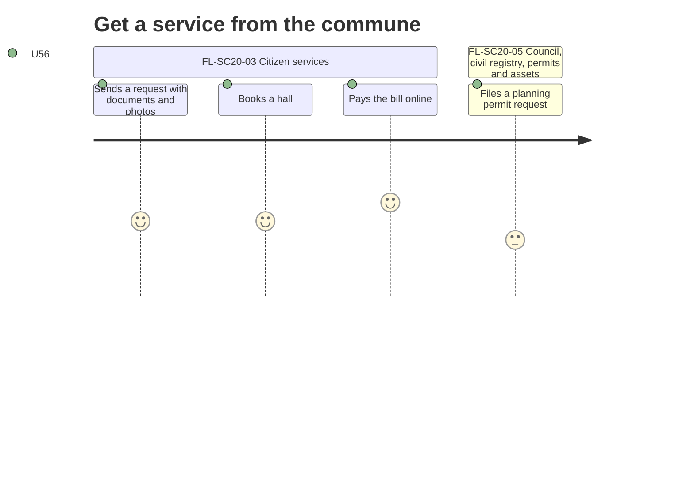
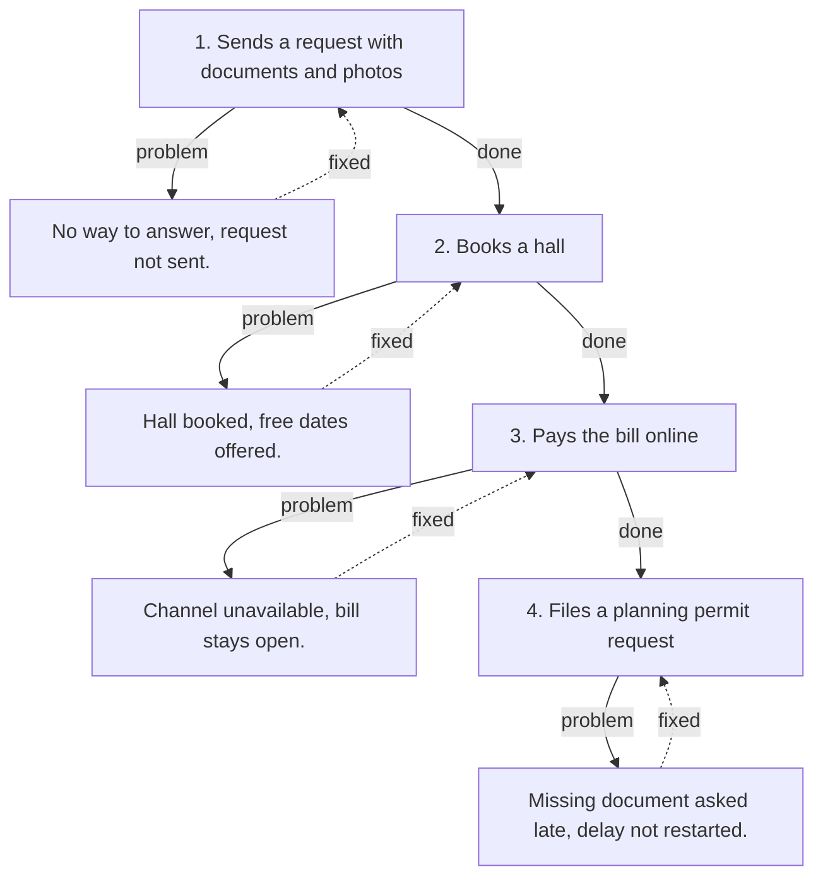

🏠 [Specs](../../../../README.md) › 🎨 [UX](../../../README.md) › 🪟 [Views](../../README.md) ›
🏘️ [Citizen: app shell and home](../README.md) › 🧭 J-U56-01 Get a service from the commune

# 🧭 J-U56-01 Get a service from the commune

**Status:** ✅ specified

## Persona

[U56 Citizen](../../../../01-users/personas/u56-citizen.md)

## Goal

Ask, book and pay on the phone without queuing, and know when the answer is due.

## Journey

Satisfaction at each step, from 1 (painful) to 5 (effortless): these scores are drawn from the
specs and confirmed by the owner (D572).

## Flowchart

The same steps; each problem is the first error flow of the step's use case (once per use case), shown with the error
message pattern ([D122](../../../../06-decisions/ux/d122-error-message-standard.md)).

## Steps

| Step | Screen | Use case | What the persona does | What the system does |
|---|---|---|---|---|
| 1 | [S-SC20-09 Citizen request](../../../../08-sectors/sc20-public-bodies/screens/03-citizen-services/s-sc20-09-citizen-request.md) | [UC-SC20-09 Receive a citizen's request](../../../../08-sectors/sc20-public-bodies/use-cases/03-citizen-services/uc-sc20-09-receive-a-citizens-request.md) | Sends a request with documents and photos | Checks completeness and sends the acknowledgement with the deadline. |
| 2 | [S-SC20-10 Hall booking](../../../../08-sectors/sc20-public-bodies/screens/03-citizen-services/s-sc20-10-hall-booking.md) | [UC-SC20-10 Book halls and equipment](../../../../08-sectors/sc20-public-bodies/use-cases/03-citizen-services/uc-sc20-10-book-halls-and-equipment.md) | Books a hall | Shows the rate and the deposit for the citizen's class and checks the safety capacity. |
| 3 | [S-SC20-11 Public payments](../../../../08-sectors/sc20-public-bodies/screens/03-citizen-services/s-sc20-11-public-payments.md) | [UC-SC20-11 Take online payments](../../../../08-sectors/sc20-public-bodies/use-cases/03-citizen-services/uc-sc20-11-take-online-payments.md) | Pays the bill online | Shows the amount and the options and matches the payment to the title. |
| 4 | [S-SC20-19 Planning permits](../../../../08-sectors/sc20-public-bodies/screens/05-council-registry-permits-and-assets/s-sc20-19-planning-permits.md) | [UC-SC20-19 Instruct planning permits](../../../../08-sectors/sc20-public-bodies/use-cases/05-council-registry-permits-and-assets/uc-sc20-19-instruct-planning-permits.md) | Files a planning permit request | Starts the clock with the acknowledgement and follows the instruction to the decision. |

This persona's images of these flows (D120) are drawn in the image round; the pages are named by the plan: FL-SC20-03
Citizen services `images/03-citizen-services/u56-citizen/README.md`, FL-SC20-05 Council, civil registry, permits and
assets `images/05-council-registry-permits-and-assets/u56-citizen/README.md`.

## Open questions

None.

---

⬆️ [Up](README.md)
