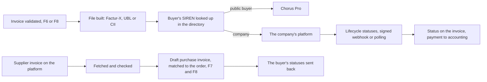

🏠 [Specs](../README.md) › 📏 [Non-functional requirements](README.md) › 🧾 E-invoicing platforms

# 🧾 E-invoicing platforms

**Status:** ✅ decided on 2026-11-12
([D454](../06-decisions/f08-accounting/d454-e-invoicing-platforms.md)); benchmark of 2026-11-10

The owner asked for a benchmark of the tools whose API submits invoices automatically
([D118](../06-decisions/f02-no-code-configuration/d118-document-template-features.md)). This page holds the research of
2026-11-10, with its sources; what could not be checked is said so. The registered list changes: check it again before
choosing.

## Requirement

SimpleERP issues invoices as Factur-X, UBL and CII itself (BR-F2-11) and sends and receives them through one or more
registered platforms (PA), by API. A self-hosted ERP cannot be a platform itself: registration needs a DGFiP application
with security checks and interoperability tests; SimpleERP is a "compatible solution" connected to at least one
platform.

## Rules in force

| Rule | Date | Source |
|---|---|---|
| Every company must be able to receive e-invoices, micro-enterprises included | 1 September 2026 | [DGFiP, fiche 1](https://www.impots.gouv.fr/sites/default/files/media/1_metier/2_professionnel/EV/2_gestion/290_facturation_electronique/fiche-1_que-va-t-il-se-passer-pour-mon-entreprise.pdf) |
| Large and mid-size companies must issue them | 1 September 2026 | same |
| Small and micro companies must issue them | 1 September 2027 | same |
| E-reporting (B2C, international, payment data) | same timetable as issuing | [DGFiP FAQ, version of 1 September 2026](https://www.impots.gouv.fr/sites/default/files/media/1_metier/2_professionnel/EV/2_gestion/290_facturation_electronique/faq---fe_je-decouvre-la-facturation-electronique.pdf), section 8.1 |
| Mandatory invoice fields: 26 in 2026, 34 from 2027 | - | same FAQ |

- The public platform (PPF) keeps two roles: the directory of which platform each SIREN uses, and passing data to the
  tax administration; platforms exchange invoices between themselves
  ([AIFE](https://aife.economie.gouv.fr/nos-applications/facturation-electronique-b2b/)).
- Chorus Pro stays the channel for invoices to the public sector.
- The DGFiP is the Peppol authority for France
  ([impots.gouv.fr](https://www.impots.gouv.fr/rejoindre-le-reseau-peppol)).
- **A company chooses its platform freely**, may use several (one to issue, one to receive), and may change at any time
  (DGFiP FAQ, sections 2.1 and 2.2).
- AFNOR XP Z12-013 defines a standard platform API (flows and directory); it is still experimental and not every
  platform follows it.

## Registered platforms

The [official list](https://www.impots.gouv.fr/node/27127), updated 9 November 2026: 159 platforms on the first list
(152 with a registration date, 7 waiting), 6 on the second list (registration subject to interoperability tests). A
version enriched by FNAE is on
[data.gouv.fr](https://www.data.gouv.fr/datasets/liste-des-plateformes-agreees-pour-la-facturation-electronique).

## Benchmark

Platforms with a public, documented API (registration dates from the DGFiP list):

| Platform | Registered | API | Formats | Supplier invoices by API | Statuses, webhooks | E-reporting | Peppol | Documentation, sandbox | Pricing | Notes |
|---|---|---|---|---|---|---|---|---|---|---|
| Iopole | 11/12/2025 | REST, Swagger | CII, Factur-X, JSON (UBL not stated) | Yes | Lifecycle tracked; webhooks not verified | not verified | not verified | [docs](https://docs.ppd.iopole.fr), sandbox | not verified | Built for software publishers, client portfolios |
| Super PDP | 22/12/2025 | REST JSON, OAuth, OpenAPI | JSON, Factur-X, CII, UBL | Yes | Mandatory and optional statuses, webhooks | Yes | Yes | [docs](https://www.superpdp.tech/documentation), sandbox | Free up to 1,000 invoices a month; API 0.0025 EUR an invoice | Paris, ISO 27001 |
| B2Brouter | 12/12/2025 | REST JSON, OpenAPI, webhooks | JSON, Factur-X, UBL, CII | Yes | Lifecycle statuses, webhooks | Documented, French settings in beta | Yes | [docs](https://docs.b2brouter.net/en/developers/guides-by-country/france/dgfip-e-invoicing-and-e-reporting/), sandbox and DGFiP test staging | not verified | White-label mode: many client companies under one API key |
| Storecove | 28/04/2026 | REST | Factur-X, UBL, CII | not verified | not verified | not verified | Yes (vendor) | sandbox (42 of 44 French cases) | not verified | Many countries |
| Seqino | 15/01/2026 | REST, SDKs | not verified | not verified | not verified | not verified | not verified | developer portal, sandbox | not verified | White-label, SecNumCloud hosting |
| Qonto | 18/12/2025 | REST, OAuth2 (not AFNOR XP Z12-013) | Factur-X, UBL, CII | Yes | Some statuses; lifecycle webhooks announced | not documented | not verified | [docs](https://docs.qonto.com/qonto-embed/plateforme-agreee-as-a-service) | Account free | "Platform as a service" for publishers, one account per end user |
| Pennylane | 11/12/2025 | REST | Factur-X (UBL, CII import in alpha) | not verified | Polling, no webhooks seen | not verified | not verified | [docs](https://pennylane.readme.io) | not verified | API mainly for its own customers |
| Invopop | 15/01/2026 | REST, workflows, webhooks | UBL, CII, Factur-X | Yes | Statuses sent and imported | In development | Yes | [docs](https://docs.invopop.com/apps/france), sandbox | Per merchant (pops) | Registers each party's SIREN; several SIRENs |
| Generix | 11/12/2025 | AFNOR XP Z12-013 (flows, directory) | Factur-X, UBL, CII (third-party source) | not verified | not verified | not verified | not verified | OpenAPI on SwaggerHub | not public | Large companies |
| A-Cube | 21/07/2026 | REST, webhooks | not verified for France | not verified | not verified | not verified | Yes | [docs](https://docs.acubeapi.com), free sandbox | not verified | Milan; French endpoints not verified |
| Chorus Pro (public sector, not a platform) | - | REST through PISTE, OAuth2 | not verified | Yes | Yes | - | - | [data.gouv.fr](https://www.data.gouv.fr/dataservices/api-chorus-pro) | Free | Needed for public-sector customers |

Registered, but no public API documentation found: Cegid, Sage, Esker, Docoon, Tiime, jefacture.com, Axonaut, Dougs,
Indy, Yooz, Basware, Pagero. Libeo is on neither list.

## Open source

- No open-source registered platform was found.
- Odoo's platform is built into its ERP and run by Odoo; whether its module's source is open was not verified.
- Open-source libraries to build the files: [factur-x](https://github.com/akretion/factur-x) (Python, BSD),
  [drafthorse](https://github.com/pretix/python-drafthorse) (Python, Apache-2.0),
  [Mustangproject](https://github.com/ZUGFeRD/mustangproject) (Java, Apache-2.0).
- Open-source Peppol access points ([phase4](https://github.com/phax/phase4),
  [Oxalis](https://github.com/OxalisCommunity/oxalis)) do not replace platform registration.
- Because choice is free, SimpleERP can connect each client company to its own platform: one standard connector (AFNOR
  XP Z12-013 where offered) plus one adapter per platform.

## Measures

What SimpleERP's platform connector requires (criteria, not a choice):

1. A documented REST API with an OpenAPI file, ideally AFNOR XP Z12-013, so that a company can change platform.
2. Accepts SimpleERP's Factur-X, UBL and CII files as they are, and returns validation errors.
3. Receives supplier invoices through the API.
4. Lifecycle statuses (codes 200 to 213, payment) by signed webhooks, with polling as a fallback, and a way to send the
   buyer's own statuses.
5. E-reporting through the API.
6. A sandbox, and a test environment connected to the DGFiP's.
7. Several companies: one access for an IT provider hosting several SIRENs, onboarding through the API, data kept apart.
8. Directory lookup and Peppol for routing.
9. Registered on the DGFiP list (checked again), hosted in France or the EU, ISO 27001, a status page, published
   pricing.
10. Leaving a platform must be possible at any time.

## Not verified

Webhooks, e-reporting and Peppol for Iopole, Storecove and Seqino; Seqino's formats; pricing of Iopole, B2Brouter,
Storecove, Seqino and A-Cube; whether Pennylane exposes received invoices; the Pennylane and Qonto sandboxes; A-Cube's
French endpoints; Generix's sandbox; the Chorus Pro sandbox address; which other platforms follow AFNOR XP Z12-013.

## How SimpleERP connects

**Decided:** [D454](../06-decisions/f08-accounting/d454-e-invoicing-platforms.md). The owner's words: "Super PDP +
B2BRouter, then more + Any platform through the AFNOR standards. Document all of that very well."

### Adapters

| Platform | When | API | What SimpleERP uses |
|---|---|---|---|
| Super PDP | First, in the pilot of D451 | REST JSON, OAuth, OpenAPI | Issue, receive, statuses by webhook, e-reporting, Peppol |
| B2Brouter | First, in the pilot of D451 | REST JSON, OpenAPI, webhooks | The same, and its white-label mode for a provider hosting several companies |
| Any platform offering AFNOR XP Z12-013 | Once its contract tests pass in its sandbox | The standard's flows and directory API | Issue, receive, statuses, directory lookup, through one generic adapter |
| Other platforms of the benchmark | On demand | Their own API | One adapter each |
| Chorus Pro | With the first two | REST through PISTE, OAuth2 | Invoices to public buyers ([CR-FR-091](../10-country-packs/france/invoicing/cr-fr-091-public-contracts-payment-and-chorus-pro.md)) |

Every adapter implements the one contract
[I-T12-06](../03-technical/t12-connectors-and-scrapers/interfaces/i-t12-06-e-invoicing-platform-connector.md), so the
rest of SimpleERP never knows which platform
a company uses. The requirement is
[REQ-T12-19](../03-technical/t12-connectors-and-scrapers/requirements/req-t12-19-e-invoicing-platforms.md).

### Flows

- **Issuing:** a validated invoice is built as Factur-X, UBL or CII (BR-F2-11), the buyer's SIREN is looked up in the
  directory, and the file goes to the company's platform, or to Chorus Pro for a public buyer. The platform's id and its
  validation answer are kept on the invoice; a rejection shows the platform's message and the invoice is not marked
  sent.
- **Receiving:** the platform's signed webhook, or polling when no webhook arrives, brings each supplier invoice. It is
  fetched, checked and imported as a draft purchase invoice, matched to its order and receipt, and the buyer's statuses
  (approved, disputed, paid) go back through the platform.
- **Statuses:** the lifecycle codes 200 to 213 and the payment status are shown on the invoice and in the reports.
- **E-reporting:** B2C and international sales and the payment data are sent through the platform on the timetable of
  the rules above.

### Connecting a company

In the fewest steps ([REQ-T12-14](../03-technical/t12-connectors-and-scrapers/requirements/req-t12-14-fewest-steps.md)):

1. (Proposed) The administrator picks the platform in the connector catalogue.
2. (Proposed) They sign in on the platform (OAuth) or paste its API key; the secret goes to the vault
   ([REQ-T12-08](../03-technical/t12-connectors-and-scrapers/requirements/req-t12-08-credential-vault.md)), never to the
   configuration or the logs.
3. (Proposed) SimpleERP registers the company's SIREN and the SIRETs of its sites (D453) with the platform and checks
   the directory entry.
4. (Proposed) A test invoice goes through the platform's sandbox before the first real one.

A company may use one platform to issue and another to receive, and change at any time (DGFiP FAQ, sections 2.1 and
2.2): new flows go to the new platform, invoices in flight finish on the old one, and the history stays in SimpleERP.
A provider hosting several companies gives each its own platform account, or uses a platform's multi-company mode where
it offers one (B2Brouter's white-label mode).

### Failures and tests

- A platform that does not answer: the invoice waits in the outbox and is sent again; its user sees "waiting to send".
- A webhook that does not arrive: polling picks the status up.
- Each adapter's contract tests run daily against the platform's sandbox
  ([REQ-T12-17](../03-technical/t12-connectors-and-scrapers/requirements/req-t12-17-contract-tests-daily.md)), and the
  pilot goes through B2Brouter's test staging connected to the DGFiP's before going live.

### Still to check

B2Brouter's pricing, Super PDP's multi-company access, and which other platforms follow AFNOR XP Z12-013 (see "Not
verified" above).

## Country pack

The legal values this page relies on, from the France country pack (D293):

- [CR-FR-016 Electronic invoicing](../10-country-packs/france/invoicing/cr-fr-016-electronic-invoicing.md)

## Open questions

- [Q13 E-invoicing platforms](../07-questions/q13-e-invoicing-platforms.md): answered by
  [D454](../06-decisions/f08-accounting/d454-e-invoicing-platforms.md).

---

⬆️ [Up](README.md)
