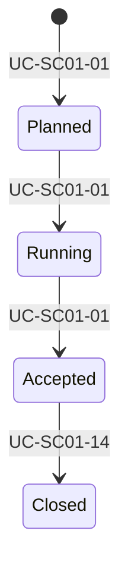

🏠 [Specs](../../../README.md) › 🏷️ [Sectors](../../README.md) › 🏗️ [SC01 Construction](../README.md) ›
🗃️ [Data](README.md) › 🗃️ E-SC01-01 Construction site

# 🗃️ E-SC01-01 Construction site

**Status:** 🔄 waiting for the owner

## Purpose

A construction site.

## Fields

| Name | Type | Required | Validation | Default | Example | Personal data | Custom fields |
|---|---|---|---|---|---|---|---|
| reference, name | text | yes | unique | auto | S-14, Villa Martin | no | no |
| customer, address | contact, address | yes | - | - | J. Martin, Lyon | yes | no |
| lots, budget | list, amount | yes | - | - | 4 lots, 182 000 EUR | no | yes |
| state | planned, running, accepted, closed | yes | - | planned | running | no | no |

## Relations

(Proposed) As its use cases.

## Lifecycle

## Indexes and search

(Proposed) By number, date, partner.

## Retention

Kept for the period of its kind of record in the country pack (D293), or else its kind's default in the
[retention schedule](../../../05-non-functional/data-retention.md).

## Audit

Every change.

## Import and export

(Proposed) CSV, FEC where relevant.

## Used by

- [UC-SC01-01](../use-cases/01-win-the-work/uc-sc01-01-open-a-site.md)
- [UC-SC01-14](../use-cases/04-bill-and-subcontract/uc-sc01-14-follow-site-profitability.md)
- [UC-SC01-15](../use-cases/03-run-the-site/uc-sc01-15-ask-the-assistant-about-a-site.md)

## Open questions

None.

---

⬆️ [Up](README.md) · ➡️ [E-SC01-02 Quote lot](e-sc01-02-quote-lot.md)
