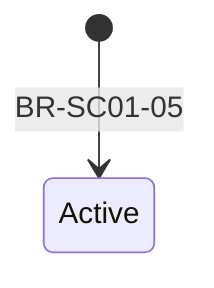

🏠 [Specs](../../../README.md) › 🏷️ [Sectors](../../README.md) › 🏗️ [SC01 Construction](../README.md) ›
🗃️ [Data](README.md) › 🗃️ E-SC01-02 Quote lot

# 🗃️ E-SC01-02 Quote lot

**Status:** ✅ specified

## Purpose

A lot of a quote with its unit-price lines.

## Fields

| Name | Type | Required | Validation | Default | Example | Personal data | Custom fields |
|---|---|---|---|---|---|---|---|
| quote, lot | quote, number | yes | - | - | Q-221, 2 | no | no |
| lines | item, unit, quantity, unit price | yes | - | - | concrete m3, 18, 140 | no | no |
| VAT rate | rate | yes | BR-SC01-05 | 20 % | 10 % | no | no |
| certificate | file | no | - | - | attestation.pdf | no | no |

## Relations

As its use cases.

## Lifecycle

## Indexes and search

By number, date, partner.

## Retention

Certificates kept with the accounts:
[CR-FR-084 Reduced VAT on housing renovation](../../../10-country-packs/france/tax-and-vat/cr-fr-084-renovation-reduced-vat.md).

## Audit

Every change.

## Import and export

CSV, FEC where relevant.

## Used by

- [UC-SC01-02](../use-cases/01-win-the-work/uc-sc01-02-quote-by-lots-and-unit-price-schedules.md)
- [UC-SC01-12](../use-cases/01-win-the-work/uc-sc01-12-sell-renovation-to-consumers.md)

## Open questions

None.

---

⬅️ [E-SC01-01 Construction site](e-sc01-01-construction-site.md) · ⬆️ [Up](README.md) ·
➡️ [E-SC01-03 Site phase](e-sc01-03-site-phase.md)
