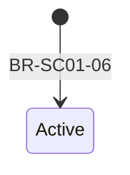

🏠 [Specs](../../../README.md) › 🏷️ [Sectors](../../README.md) › 🏗️ [SC01 Construction](../README.md) ›
🗃️ [Data](README.md) › 🗃️ E-SC01-03 Site phase

# 🗃️ E-SC01-03 Site phase

**Status:** ✅ specified

## Purpose

A planned phase of a site.

## Fields

| Name | Type | Required | Validation | Default | Example | Personal data | Custom fields |
|---|---|---|---|---|---|---|---|
| site, name | site, text | yes | - | - | S-14, foundations | no | no |
| dates | start, end | yes | - | - | 2 to 20 Dec | no | no |
| crew, equipment, subcontractor | lists | no | BR-SC01-06, BR-SC01-07 | - | 4 workers, digger | no | no |

## Relations

As its use cases.

## Lifecycle

## Indexes and search

By number, date, partner.

## Retention

Kept for the period of its kind of record in the country pack (D293), or else its kind's default in the
[retention schedule](../../../05-non-functional/data-retention.md).

## Audit

Every change.

## Import and export

CSV, FEC where relevant.

## Used by

- [UC-SC01-03](../use-cases/02-prepare-the-site/uc-sc01-03-plan-the-site.md)

## Open questions

None.

---

⬅️ [E-SC01-02 Quote lot](e-sc01-02-quote-lot.md) · ⬆️ [Up](README.md) ·
➡️ [E-SC01-04 Site time and material entry](e-sc01-04-site-time-and-material-entry.md)
