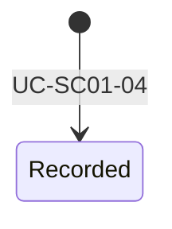

🏠 [Specs](../../../README.md) › 🏷️ [Sectors](../../README.md) › 🏗️ [SC01 Construction](../README.md) ›
🗃️ [Data](README.md) › 🗃️ E-SC01-04 Site time and material entry

# 🗃️ E-SC01-04 Site time and material entry

**Status:** 🔄 waiting for the owner

## Purpose

Hours or materials charged to a site.

## Fields

| Name | Type | Required | Validation | Default | Example | Personal data | Custom fields |
|---|---|---|---|---|---|---|---|
| site, lot | records | yes | BR-SC01-09 | - | S-14, 2 | no | no |
| person or item | record | yes | - | - | P. L., concrete | yes | no |
| quantity | hours or units | yes | > 0 | - | 8 h | no | no |
| entered offline | yes, no | yes | - | no | yes | no | no |

## Relations

(Proposed) As its use cases.

## Lifecycle

## Indexes and search

(Proposed) By number, date, partner.

## Retention

As an accounting record:
[CR-FR-002 Accounting records kept 10 years](../../../10-country-packs/france/accounting/cr-fr-002-accounting-records-kept-ten-years.md).

## Audit

Every change.

## Import and export

(Proposed) CSV, FEC where relevant.

## Used by

- [UC-SC01-04](../use-cases/03-run-the-site/uc-sc01-04-record-time-and-materials-per-site.md)

## Open questions

None.

---

⬅️ [E-SC01-03 Site phase](e-sc01-03-site-phase.md) · ⬆️ [Up](README.md) ·
➡️ [E-SC01-05 Site diary entry](e-sc01-05-site-diary-entry.md)
