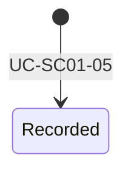

🏠 [Specs](../../../README.md) › 🏷️ [Sectors](../../README.md) › 🏗️ [SC01 Construction](../README.md) ›
🗃️ [Data](README.md) › 🗃️ E-SC01-05 Site diary entry

# 🗃️ E-SC01-05 Site diary entry

**Status:** 🔄 waiting for the owner

## Purpose

A day of a site's diary.

## Fields

| Name | Type | Required | Validation | Default | Example | Personal data | Custom fields |
|---|---|---|---|---|---|---|---|
| site, date | site, date | yes | unique pair | - | S-14, 2 Dec | no | no |
| weather, events | text | no | - | - | rain, delivery late | no | no |
| photos | files | no | - | - | 6 | no | no |

## Relations

(Proposed) As its use cases.

## Lifecycle

## Indexes and search

(Proposed) By number, date, partner.

## Retention

Kept for the period of its kind of record in the country pack (D293), or else its kind's default in the
[retention schedule](../../../05-non-functional/data-retention.md).

## Audit

Every change.

## Import and export

(Proposed) CSV, FEC where relevant.

## Used by

- [UC-SC01-05](../use-cases/03-run-the-site/uc-sc01-05-keep-the-site-diary.md)
- [UC-SC01-15](../use-cases/03-run-the-site/uc-sc01-15-ask-the-assistant-about-a-site.md)

## Open questions

None.

---

⬅️ [E-SC01-04 Site time and material entry](e-sc01-04-site-time-and-material-entry.md) · ⬆️ [Up](README.md) ·
➡️ [E-SC01-06 Progress bill](e-sc01-06-progress-bill.md)
