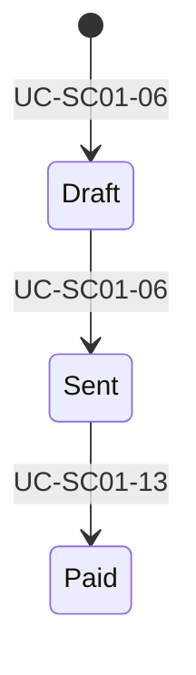

🏠 [Specs](../../../README.md) › 🏷️ [Sectors](../../README.md) › 🏗️ [SC01 Construction](../README.md) ›
🗃️ [Data](README.md) › 🗃️ E-SC01-06 Progress bill

# 🗃️ E-SC01-06 Progress bill

**Status:** 🔄 waiting for the owner

## Purpose

A cumulative bill of a site's progress.

## Fields

| Name | Type | Required | Validation | Default | Example | Personal data | Custom fields |
|---|---|---|---|---|---|---|---|
| site, number | site, number | yes | unique | auto | S-14, 3 | no | no |
| progress per lot | percent | yes | 0 to 100 | - | lot 2: 60 % | no | no |
| earlier bills, retention | amounts | yes | BR-SC01-03 | - | 72 000, 5 % | no | no |
| state | draft, sent, paid | yes | - | draft | sent | no | no |

## Relations

(Proposed) As its use cases.

## Lifecycle

## Indexes and search

(Proposed) By number, date, partner.

## Retention

As an accounting record:
[CR-FR-002 Accounting records kept 10 years](../../../10-country-packs/france/accounting/cr-fr-002-accounting-records-kept-ten-years.md).

## Audit

Every change.

## Import and export

(Proposed) CSV, FEC where relevant.

## Used by

- [UC-SC01-06](../use-cases/04-bill-and-subcontract/uc-sc01-06-bill-progress-with-the-retention-guarantee.md)
- [UC-SC01-14](../use-cases/04-bill-and-subcontract/uc-sc01-14-follow-site-profitability.md)

## Open questions

None.

---

⬅️ [E-SC01-05 Site diary entry](e-sc01-05-site-diary-entry.md) · ⬆️ [Up](README.md) ·
➡️ [E-SC01-07 Subcontract](e-sc01-07-subcontract.md)
