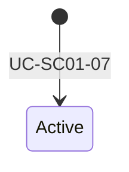

🏠 [Specs](../../../README.md) › 🏷️ [Sectors](../../README.md) › 🏗️ [SC01 Construction](../README.md) ›
🗃️ [Data](README.md) › 🗃️ E-SC01-07 Subcontract

# 🗃️ E-SC01-07 Subcontract

**Status:** 🔄 waiting for the owner

## Purpose

A subcontract on a site.

## Fields

| Name | Type | Required | Validation | Default | Example | Personal data | Custom fields |
|---|---|---|---|---|---|---|---|
| site, subcontractor | records | yes | - | - | S-14, Elec Pro | no | no |
| amount, payment | amount, direct or not | yes | - | - | 24 000, direct | no | no |
| acceptance, vigilance date | date | no | BR-SC01-06 | - | 2026-11-02 | no | no |

## Relations

(Proposed) As its use cases.

## Lifecycle

## Indexes and search

(Proposed) By number, date, partner.

## Retention

As an accounting record:
[CR-FR-002 Accounting records kept 10 years](../../../10-country-packs/france/accounting/cr-fr-002-accounting-records-kept-ten-years.md).

## Audit

Every change.

## Import and export

(Proposed) CSV, FEC where relevant.

## Used by

- [UC-SC01-07](../use-cases/04-bill-and-subcontract/uc-sc01-07-subcontract.md)

## Open questions

None.

---

⬅️ [E-SC01-06 Progress bill](e-sc01-06-progress-bill.md) · ⬆️ [Up](README.md) ·
➡️ [E-SC01-08 Equipment assignment](e-sc01-08-equipment-assignment.md)
