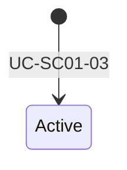

🏠 [Specs](../../../README.md) › 🏷️ [Sectors](../../README.md) › 🏗️ [SC01 Construction](../README.md) ›
🗃️ [Data](README.md) › 🗃️ E-SC01-08 Equipment assignment

# 🗃️ E-SC01-08 Equipment assignment

**Status:** 🔄 waiting for the owner

## Purpose

Equipment on a site for a period: a booking of the shared booking engine
([E-F2-18 Resource booking](../../../02-functional/f02-no-code-configuration/data/e-f02-18-resource-booking.md)) on the
equipment as a bookable resource, with the site, lot and daily cost construction adds.

## Fields

| Name | Type | Required | Validation | Default | Example | Personal data | Custom fields |
|---|---|---|---|---|---|---|---|
| equipment, site | records | yes | no overlap | - | digger D2, S-14 | no | no |
| dates | start, end | yes | - | - | 2 to 6 Dec | no | no |
| owned or rented | kind, cost | yes | - | owned | rented, 320/day | no | no |

## Relations

(Proposed) As its use cases.

## Lifecycle

## Indexes and search

(Proposed) By number, date, partner.

## Retention

Kept for the period of its kind of record in the country pack (D293), or else its kind's default in the
[retention schedule](../../../05-non-functional/data-retention.md).

## Audit

Every change.

## Import and export

(Proposed) CSV, FEC where relevant.

## Used by

- [UC-SC01-08](../use-cases/02-prepare-the-site/uc-sc01-08-rent-and-track-equipment-on-sites.md)

## Open questions

None.

---

⬅️ [E-SC01-07 Subcontract](e-sc01-07-subcontract.md) · ⬆️ [Up](README.md) ·
➡️ [E-SC01-09 Works declaration](e-sc01-09-works-declaration.md)
