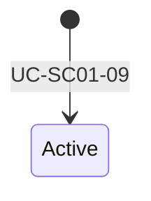

🏠 [Specs](../../../README.md) › 🏷️ [Sectors](../../README.md) › 🏗️ [SC01 Construction](../README.md) ›
🗃️ [Data](README.md) › 🗃️ E-SC01-09 Works declaration

# 🗃️ E-SC01-09 Works declaration

**Status:** ✅ specified

## Purpose

A declaration before works near networks.

## Fields

| Name | Type | Required | Validation | Default | Example | Personal data | Custom fields |
|---|---|---|---|---|---|---|---|
| site, kind | site, DT or DICT | yes | BR-SC01-08 | - | S-14, DICT | no | no |
| sent, answers | dates, files | no | - | - | 20 Nov, 3 of 4 | no | no |

## Relations

As its use cases.

## Lifecycle

## Indexes and search

By number, date, partner.

## Retention

Kept for the period of its kind of record in the country pack (D293), or else its kind's default in the
[retention schedule](../../../05-non-functional/data-retention.md).

## Audit

Every change.

## Import and export

CSV, FEC where relevant.

## Used by

- [UC-SC01-09](../use-cases/02-prepare-the-site/uc-sc01-09-declare-works-near-networks-and-keep-the-safety-documents.md)

## Open questions

None.

---

⬅️ [E-SC01-08 Equipment assignment](e-sc01-08-equipment-assignment.md) · ⬆️ [Up](README.md) ·
➡️ [E-SC01-10 Acceptance record](e-sc01-10-acceptance-record.md)
