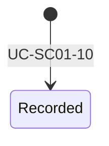

🏠 [Specs](../../../README.md) › 🏷️ [Sectors](../../README.md) › 🏗️ [SC01 Construction](../README.md) ›
🗃️ [Data](README.md) › 🗃️ E-SC01-10 Acceptance record

# 🗃️ E-SC01-10 Acceptance record

**Status:** ✅ specified

## Purpose

The acceptance of the works.

## Fields

| Name | Type | Required | Validation | Default | Example | Personal data | Custom fields |
|---|---|---|---|---|---|---|---|
| site, date | site, date | yes | BR-SC01-10 | - | S-14, 12 Dec | no | no |
| reservations | list, photos, state | no | - | - | 3, 1 lifted | no | no |
| signatures | customer, company | yes | - | - | both | yes | no |

## Relations

As its use cases.

## Lifecycle

## Indexes and search

By number, date, partner.

## Retention

Ten years after acceptance at least, the length of the warranties:
[CR-FR-090 Builders' warranties and acceptance](../../../10-country-packs/france/construction/cr-fr-090-builders-warranties.md).

## Audit

Every change.

## Import and export

CSV, FEC where relevant.

## Used by

- [UC-SC01-10](../use-cases/05-hand-over-and-follow-up/uc-sc01-10-accept-the-works-with-reservations-and-lift-them.md)

## Open questions

None.

---

⬅️ [E-SC01-09 Works declaration](e-sc01-09-works-declaration.md) · ⬆️ [Up](README.md) ·
➡️ [E-SC01-11 Warranty](e-sc01-11-warranty.md)
