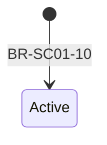

🏠 [Specs](../../../README.md) › 🏷️ [Sectors](../../README.md) › 🏗️ [SC01 Construction](../README.md) ›
🗃️ [Data](README.md) › 🗃️ E-SC01-11 Warranty

# 🗃️ E-SC01-11 Warranty

**Status:** 🔄 waiting for the owner

## Purpose

A builder's warranty running on a site.

## Fields

| Name | Type | Required | Validation | Default | Example | Personal data | Custom fields |
|---|---|---|---|---|---|---|---|
| site, kind | site, 1 / 2 / 10 years | yes | - | - | S-14, 10 years | no | no |
| from, to | dates | yes | BR-SC01-10 | - | 2026-12-12 to 2036-12-12 | no | no |
| claims | list | no | - | - | 0 | no | no |

## Relations

(Proposed) As its use cases.

## Lifecycle

## Indexes and search

(Proposed) By number, date, partner.

## Retention

Ten years after acceptance at least, the length of the warranties:
[CR-FR-090 Builders' warranties and acceptance](../../../10-country-packs/france/construction/cr-fr-090-builders-warranties.md).

## Audit

Every change.

## Import and export

(Proposed) CSV, FEC where relevant.

## Used by

- [UC-SC01-11](../use-cases/05-hand-over-and-follow-up/uc-sc01-11-hand-over-the-as-built-file-and-follow-the-warranties.md)

## Open questions

None.

---

⬅️ [E-SC01-10 Acceptance record](e-sc01-10-acceptance-record.md) · ⬆️ [Up](README.md) ·
➡️ [E-SC01-12 Public tender](e-sc01-12-public-tender.md)
