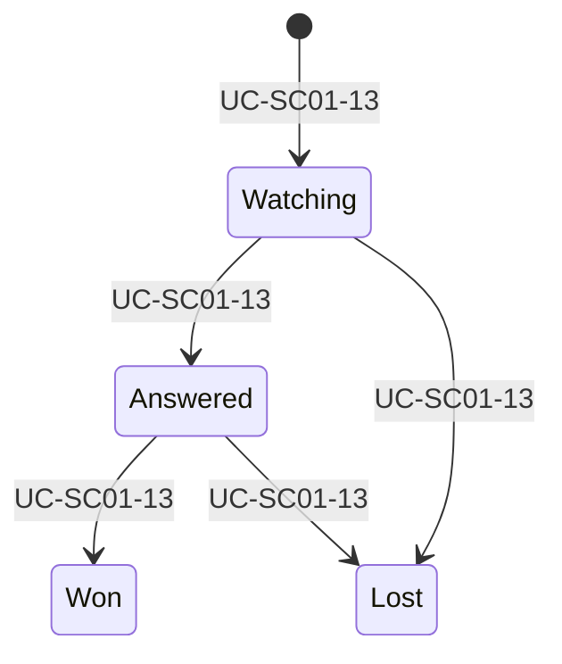

🏠 [Specs](../../../README.md) › 🏷️ [Sectors](../../README.md) › 🏗️ [SC01 Construction](../README.md) ›
🗃️ [Data](README.md) › 🗃️ E-SC01-12 Public tender

# 🗃️ E-SC01-12 Public tender

**Status:** ✅ specified

## Purpose

A public buyer's tender followed.

## Fields

| Name | Type | Required | Validation | Default | Example | Personal data | Custom fields |
|---|---|---|---|---|---|---|---|
| buyer, reference | text | yes | - | - | Town of Lyon, 2026-118 | no | no |
| deadline | date | yes | - | - | 15 Dec | no | no |
| state | watching, answered, won, lost | yes | - | watching | won | no | no |

## Relations

As its use cases.

## Lifecycle

## Indexes and search

By number, date, partner.

## Retention

Kept for the period of its kind of record in the country pack (D293), or else its kind's default in the
[retention schedule](../../../05-non-functional/data-retention.md).

## Audit

Every change.

## Import and export

CSV, FEC where relevant.

## Used by

- [UC-SC01-13](../use-cases/01-win-the-work/uc-sc01-13-answer-public-tenders-and-invoice-through-chorus-pro.md)

## Open questions

None.

---

⬅️ [E-SC01-11 Warranty](e-sc01-11-warranty.md) · ⬆️ [Up](README.md) ·
➡️ [E-SC01-13 As-built file](e-sc01-13-as-built-file.md)
