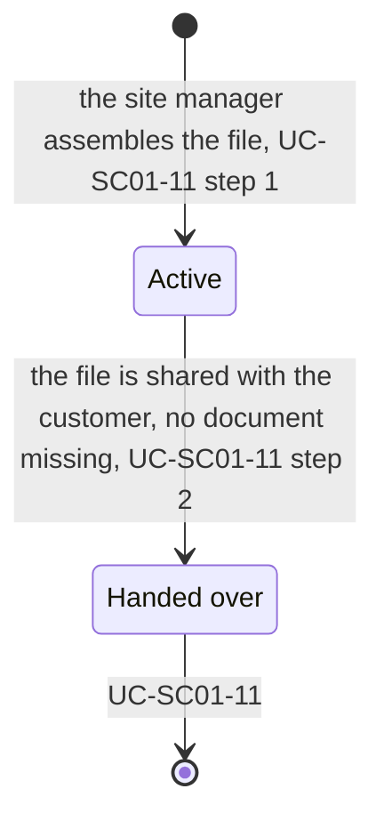

🏠 [Specs](../../../README.md) › 🏷️ [Sectors](../../README.md) › 🏗️ [SC01 Construction](../README.md) ›
🗃️ [Data](README.md) › 🗃️ E-SC01-13 As-built file

# 🗃️ E-SC01-13 As-built file

**Status:** ✅ specified

## Purpose

The as-built file the flow charts name with the words "As-built file"
([FL-SC01-05](../flows/fl-sc01-05-hand-over-and-follow-up.md)). The owner decided to create it
([D516](../../../06-decisions/foundations/d516-naming-rules-and-the-seven-classes-of-names.md)); its fields are derived
from the specifications and confirmed by the owner (D572).

## Fields

| Name | Type | Required | Validation | Default | Example | Personal data | Custom fields |
|---|---|---|---|---|---|---|---|
| title | text | yes | not empty | - | As-built file, S-14 Villa Martin | no | no |
| site | construction site (E-SC01-01) | yes | a site of the company | - | S-14 | no | no |
| customer | customer (E-F6-01) | yes | the site's customer | the site's customer | J. Martin | yes | no |
| acceptance | acceptance record (E-SC01-10) | yes | a signed acceptance of the site | - | acceptance of 12 Dec | no | no |
| documents | list of plans, technical notices and guarantees, each received or missing | yes | all received to hand over | - | plans, 6 notices, 3 guarantees | no | no |
| handed over on | date | no | set at hand-over, once no document is missing | - | 2026-12-19 | no | no |
| state | Active, Handed over | yes | the lifecycle below | Active | Handed over | no | no |

The site manager assembles the plans, technical notices and guarantees, shares the file with the customer on the portal
and cannot hand it over while a document is missing
([UC-SC01-11](../use-cases/05-hand-over-and-follow-up/uc-sc01-11-hand-over-the-as-built-file-and-follow-the-warranties.md)
steps 1 and 2, error 1e); the acceptance comes first (its precondition). The title and the state are the columns of
[S-SC01-L13 As-built files](../screens/00-lists/s-sc01-l13-as-built-files.md); the file shows on
[S-SC01-11 Warranties](../screens/05-hand-over-and-follow-up/s-sc01-11-warranties.md) next to the warranties.

## Relations

```mermaid
erDiagram
  AS_BUILT_FILE }o--|| CONSTRUCTION_SITE : documents
  AS_BUILT_FILE }o--|| CUSTOMER_RECORD : handed to
  AS_BUILT_FILE }o--|| ACCEPTANCE_RECORD : follows
  CONSTRUCTION_SITE ||--o{ WARRANTY : runs
```

- [E-SC01-01 Construction site](e-sc01-01-construction-site.md)
- [E-F6-01 Customer record](../../../02-functional/f06-customers-and-sales/data/e-f06-01-customer-record.md)
- [E-SC01-10 Acceptance record](e-sc01-10-acceptance-record.md)
- [E-SC01-11 Warranty](e-sc01-11-warranty.md): the warranties and their claims, followed next to the file
- [UC-F6-11 Use the customer portal](../../../02-functional/f06-customers-and-sales/use-cases/02-quote-to-order/uc-f06-11-use-the-customer-portal.md):
  where the customer reads the file

## Lifecycle



## Indexes and search

By title and state, the sort and facet of
[S-SC01-L13 As-built files](../screens/00-lists/s-sc01-l13-as-built-files.md); searched by title, site and customer.

## Retention

As the other records of its capability.

## Audit

Every change, as the other records of its capability.

## Import and export

CSV or XLSX export of the rows and columns the user may see, from
[S-SC01-L13 As-built files](../screens/00-lists/s-sc01-l13-as-built-files.md), audited (T3); no import.

## Used by

- [UC-SC01-11 Hand over the as-built file and follow the warranties](../use-cases/05-hand-over-and-follow-up/uc-sc01-11-hand-over-the-as-built-file-and-follow-the-warranties.md)

## Open questions

None.

---

⬅️ [E-SC01-12 Public tender](e-sc01-12-public-tender.md) · ⬆️ [Up](README.md) ·
➡️ [E-SC01-14 Site safety document](e-sc01-14-site-safety-document.md)
