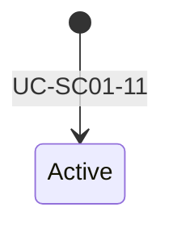

🏠 [Specs](../../../README.md) › 🏷️ [Sectors](../../README.md) › 🏗️ [SC01 Construction](../README.md) ›
🗃️ [Data](README.md) › 🗃️ E-SC01-13 As-built file

# 🗃️ E-SC01-13 As-built file

**Status:** 🔄 waiting for the owner

## Purpose

(Proposed) The as-built file the flow charts name with the words "As-built file"
([FL-SC01-05](../flows/fl-sc01-05-hand-over-and-follow-up.md)). The owner decided to create it
([D516](../../../06-decisions/foundations/d516-naming-rules-and-the-seven-classes-of-names.md)); what it holds waits for
the owner's confirmation.

## Fields

(Proposed) To define with the owner: the flow charts name the record, not its fields.

## Relations

(Proposed) To define with the owner, from the use cases below.

## Lifecycle

## Indexes and search

(Proposed) To define with the owner.

## Retention

(Proposed) As the other records of its capability, to confirm with the owner.

## Audit

(Proposed) Every change, as the other records of its capability.

## Import and export

(Proposed) To define with the owner.

## Used by

- [UC-SC01-11 Hand over the as-built file and follow the warranties](../use-cases/05-hand-over-and-follow-up/uc-sc01-11-hand-over-the-as-built-file-and-follow-the-warranties.md)

## Open questions

(Proposed) Its fields, relations and states wait for the owner (waiting list, step 36e).

---

⬅️ [E-SC01-12 Public tender](e-sc01-12-public-tender.md) · ⬆️ [Up](README.md) ·
➡️ [E-SC01-14 Site safety document](e-sc01-14-site-safety-document.md)
