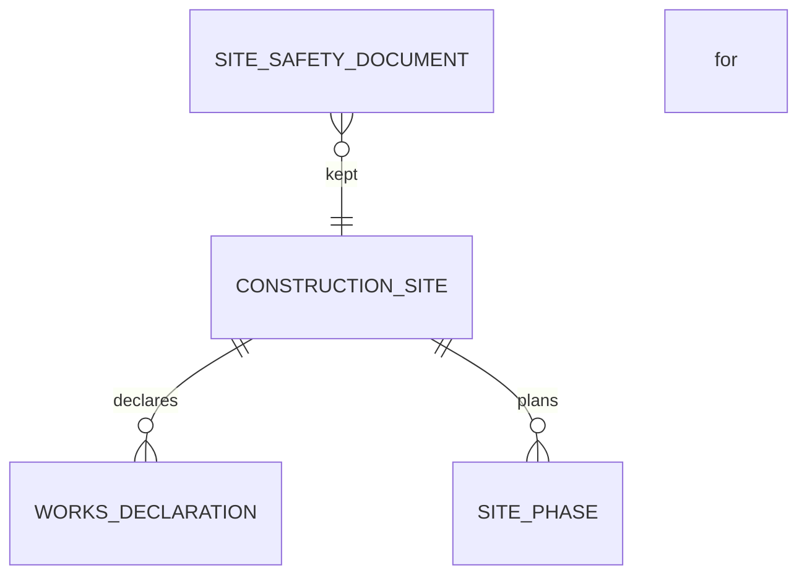
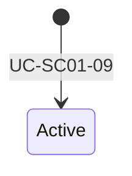

🏠 [Specs](../../../README.md) › 🏷️ [Sectors](../../README.md) › 🏗️ [SC01 Construction](../README.md) ›
🗃️ [Data](README.md) › 🗃️ E-SC01-14 Site safety document

# 🗃️ E-SC01-14 Site safety document

**Status:** ✅ specified

## Purpose

The site safety document the flow charts name with the words "safety"
([FL-SC01-02](../flows/fl-sc01-02-prepare-the-site.md)). The owner decided to create it
([D516](../../../06-decisions/foundations/d516-naming-rules-and-the-seven-classes-of-names.md)); its fields are derived
from the specifications and confirmed by the owner (D572).

## Fields

| Name | Type | Required | Validation | Default | Example | Personal data | Custom fields |
|---|---|---|---|---|---|---|---|
| title | text | yes | not empty | - | Safety plan v2 | no | no |
| site | construction site (E-SC01-01) | yes | a site of the company | - | S-14 | no | no |
| kind | safety plan, site register | yes | one of the list | - | safety plan | no | no |
| version | text | no | - | - | v2 | no | no |
| file | file | yes | one file attached | - | safety-plan-v2.pdf | no | no |
| state | Active | yes | the lifecycle below | Active | Active | no | no |

The site manager attaches the safety plan and the site register to the site folder before a digging phase starts
([UC-SC01-09](../use-cases/02-prepare-the-site/uc-sc01-09-declare-works-near-networks-and-keep-the-safety-documents.md)
step 3 and its goal); the works declarations' mock-up shows them as "Safety plan v2 · site register" on
[S-SC01-09 Works declarations](../screens/02-prepare-the-site/s-sc01-09-works-declarations.md). The title and the state
are the columns of [S-SC01-L14 Site safety documents](../screens/00-lists/s-sc01-l14-site-safety-documents.md).

## Relations

- [E-SC01-01 Construction site](e-sc01-01-construction-site.md): the site folder that keeps the document
- [E-SC01-09 Works declaration](e-sc01-09-works-declaration.md): filed on the same screen, before the same digging phase
- [E-SC01-03 Site phase](e-sc01-03-site-phase.md): the digging phase that waits for the answers and the safety
  documents ([BR-SC01-08](../business-rules/br-sc01-08-declarations-before-digging.md))

## Lifecycle

## Indexes and search

By title and state, the sort and facet of
[S-SC01-L14 Site safety documents](../screens/00-lists/s-sc01-l14-site-safety-documents.md); searched by title, site and
kind.

## Retention

As the other records of its capability.

## Audit

Every change, as the other records of its capability.

## Import and export

CSV or XLSX export of the rows and columns the user may see, from
[S-SC01-L14 Site safety documents](../screens/00-lists/s-sc01-l14-site-safety-documents.md), audited (T3); no import.

## Used by

- [UC-SC01-09 Declare works near networks and keep the safety documents](../use-cases/02-prepare-the-site/uc-sc01-09-declare-works-near-networks-and-keep-the-safety-documents.md)

## Open questions

None.

---

⬅️ [E-SC01-13 As-built file](e-sc01-13-as-built-file.md) · ⬆️ [Up](README.md) ·
➡️ [E-SC01-15 Revision formula](e-sc01-15-revision-formula.md)
