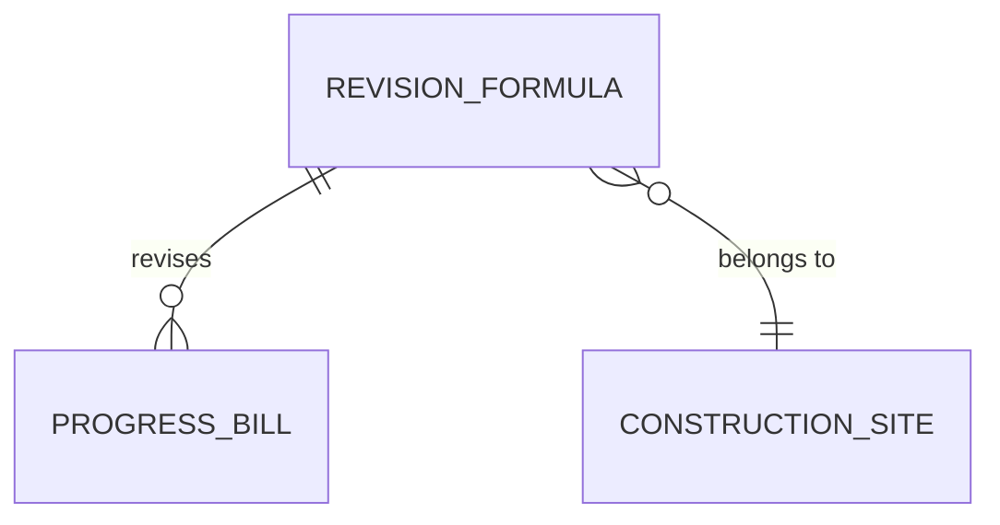
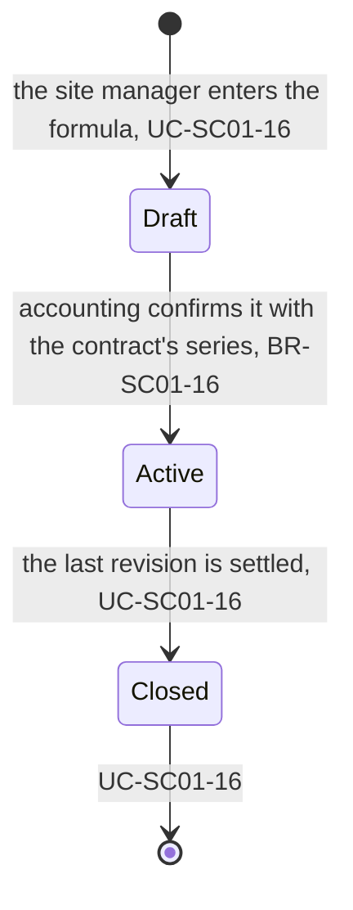

🏠 [Specs](../../../README.md) › 🏷️ [Sectors](../../README.md) › 🏗️ [SC01 Construction](../README.md) ›
🗃️ [Data](README.md) › 🗃️ E-SC01-15 Revision formula

# 🗃️ E-SC01-15 Revision formula

**Status:** ✅ specified

## Purpose

The price revision clause of a works contract: its index series, base month, weights and limits, used to revise every
progress bill ([D545](../../../06-decisions/sectors/d545-benchmark-gaps-sc01-construction.md)). It is the contract's
clause; the revision it produces is a line of the progress bill ([E-SC01-06 Progress bill](e-sc01-06-progress-bill.md)).

## Fields

| Name | Type | Required | Validation | Default | Example | Personal data | Custom fields |
|---|---|---|---|---|---|---|---|
| site | site (E-SC01-01) | yes | a site of the company | - | S-14 | no | no |
| index series | series code | yes | a BT or TP series of the country pack | - | BT01 | no | no |
| kind | revision, update | yes | one of the two | revision | revision | no | no |
| base month | month | yes | not after the contract date | - | 2025-10 | no | no |
| base index | number | yes | above 0 | from the series | 130.4 | no | no |
| fixed part | percentage | yes | 0 to 100, weights add up to 100 | 15 | 15 % | no | no |
| weights | percentages per series | yes | add up to 100 with the fixed part | - | 85 % BT01 | no | no |
| cap | percentage | no | above 0 | none | 8 % | no | no |
| bills revised | number | yes | 0 or more | 0 | 3 | no | no |
| provisional bills | number | yes | 0 or more | 0 | 1 | no | no |
| state | Draft, Active, Closed | yes | the lifecycle below | Draft | Active | no | no |
| owner | user | yes | a user of the company | the creator | Claire P. | yes | no |

## Relations

- [E-SC01-01 Construction site](e-sc01-01-construction-site.md)
- [E-SC01-06 Progress bill](e-sc01-06-progress-bill.md)
- [E-SC01-02 Quote lot](e-sc01-02-quote-lot.md)

## Lifecycle

## Indexes and search

By site, index series, state and base month.

## Retention

Kept with the contract and its bills for ten years, as accounting records
([CR-FR-002](../../../10-country-packs/france/accounting/cr-fr-002-accounting-records-kept-ten-years.md)).

## Audit

Every change of series, base, weights and cap, with who, when and the old and new value.

## Import and export

CSV import of index values entered by hand with their source; export of the revisions of a site.

## Used by

- [UC-SC01-16](../use-cases/06-revision-developers-bim-and-grants/uc-sc01-16-revise-prices-with-the-bt-and-tp-indices.md)
- [UC-SC01-06](../use-cases/04-bill-and-subcontract/uc-sc01-06-bill-progress-with-the-retention-guarantee.md)

## Open questions

None.

---

⬅️ [E-SC01-14 Site safety document](e-sc01-14-site-safety-document.md) · ⬆️ [Up](README.md) ·
➡️ [E-SC01-16 Off-plan lot](e-sc01-16-off-plan-lot.md)
