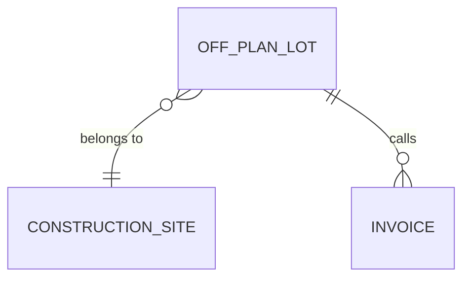
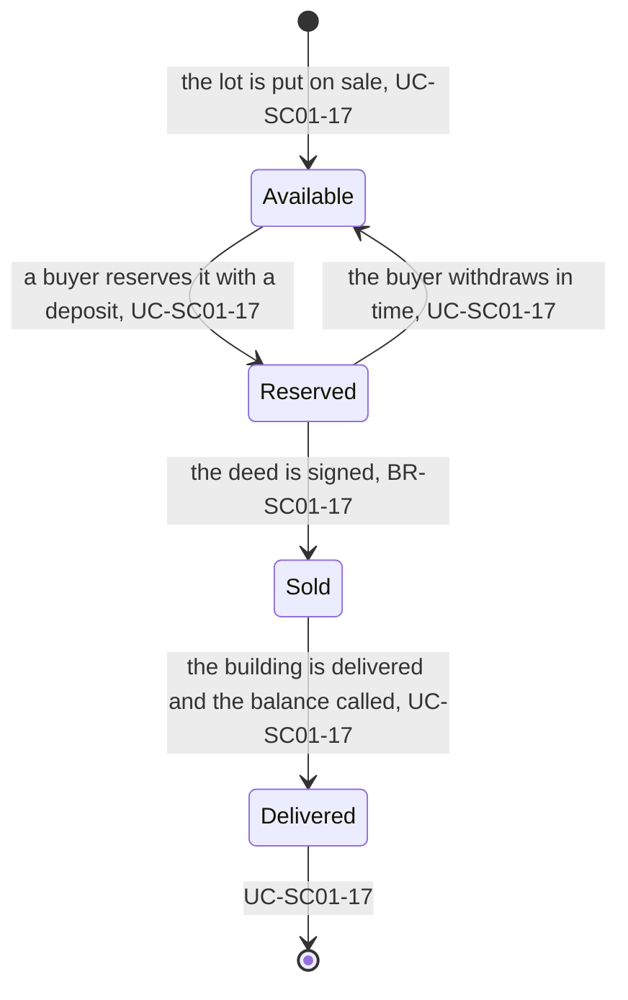

🏠 [Specs](../../../README.md) › 🏷️ [Sectors](../../README.md) › 🏗️ [SC01 Construction](../README.md) ›
🗃️ [Data](README.md) › 🗃️ E-SC01-16 Off-plan lot

# 🗃️ E-SC01-16 Off-plan lot

**Status:** ✅ specified

## Purpose

A home or lot sold off-plan: its programme, price, buyer, deed and schedule of calls for funds
([D545](../../../06-decisions/sectors/d545-benchmark-gaps-sc01-construction.md)). The buyer is a customer
([E-F6-01](../../../02-functional/f06-customers-and-sales/data/e-f06-01-customer-record.md)); the calls are invoices
([E-F6-05 Invoice](../../../02-functional/f06-customers-and-sales/data/e-f06-05-invoice.md)).

## Fields

| Name | Type | Required | Validation | Default | Example | Personal data | Custom fields |
|---|---|---|---|---|---|---|---|
| lot | text | yes | unique in the programme | - | A-12 | no | no |
| programme | site (E-SC01-01) | yes | a site of the company | - | Les Tilleuls | no | no |
| price | amount | yes | above 0 | - | 300,000.00 EUR | no | no |
| buyer | customer (E-F6-01) | no | required to leave Available | - | Amir K. | yes | no |
| reservation deposit | amount | no | held aside until the deed | 0 | 3,000.00 EUR | no | no |
| deed date | date | no | needs the completion guarantee | - | 2026-09-15 | no | no |
| stage schedule | stages with caps | yes | caps never above the pack's ceilings | from the pack | foundations 35 % | no | no |
| called | amount | yes | not above the cap of the stage | 0 | 105,000.00 EUR | no | no |
| paid | amount | yes | not above called | 0 | 105,000.00 EUR | no | no |
| delivery date | date | no | - | - | 2027-06-30 | no | no |
| state | Available, Reserved, Sold, Delivered | yes | the lifecycle below | Available | Reserved | no | no |
| owner | user | yes | a user of the company | the creator | Claire P. | yes | no |

## Relations

- [E-SC01-01 Construction site](e-sc01-01-construction-site.md)
- [E-SC01-03 Site phase](e-sc01-03-site-phase.md)
- [E-F6-01](../../../02-functional/f06-customers-and-sales/data/e-f06-01-customer-record.md)
- [E-F6-05 Invoice](../../../02-functional/f06-customers-and-sales/data/e-f06-05-invoice.md)

## Lifecycle

## Indexes and search

By programme, buyer, state and deed date.

## Retention

Kept ten years after delivery, with the sale file and the warranties
([CR-FR-090](../../../10-country-packs/france/construction/cr-fr-090-builders-warranties.md)).

## Audit

Every reservation, deed, call and payment, with who, when and the amounts.

## Import and export

Export of the lots of a programme and of the calls for funds as a CSV for the notary.

## Used by

- [UC-SC01-17](../use-cases/06-revision-developers-bim-and-grants/uc-sc01-17-sell-off-plan-homes.md)
- [UC-SC01-16](../use-cases/06-revision-developers-bim-and-grants/uc-sc01-16-revise-prices-with-the-bt-and-tp-indices.md)

## Open questions

None.

---

⬅️ [E-SC01-15 Revision formula](e-sc01-15-revision-formula.md) · ⬆️ [Up](README.md) ·
➡️ [E-SC01-17 BIM import](e-sc01-17-bim-import.md)
