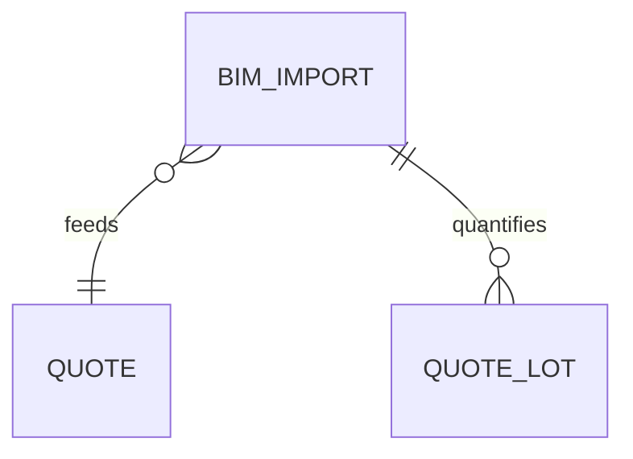
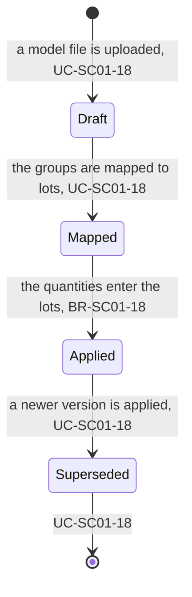

🏠 [Specs](../../../README.md) › 🏷️ [Sectors](../../README.md) › 🏗️ [SC01 Construction](../README.md) ›
🗃️ [Data](README.md) › 🗃️ E-SC01-17 BIM import

# 🗃️ E-SC01-17 BIM import

**Status:** ✅ specified

## Purpose

An import of a building model: its file, version, groups mapped to quote lots and the quantities taken, with the changes
against the previous version ([D545](../../../06-decisions/sectors/d545-benchmark-gaps-sc01-construction.md)). It feeds
the quote lots ([E-SC01-02 Quote lot](e-sc01-02-quote-lot.md)), which keep the link.

## Fields

| Name | Type | Required | Validation | Default | Example | Personal data | Custom fields |
|---|---|---|---|---|---|---|---|
| quote | quote (E-F6-03) | yes | a quote of the site | - | Q-2026-118 | no | no |
| file | file | yes | an open exchange model | - | tilleuls-v4.ifc | no | no |
| version | text | yes | unique for the quote | - | 4 | no | no |
| imported on | date and time | yes | set by the system | now | 2026-11-14 10:12 | no | no |
| groups | groups with lot and unit | yes | every group mapped or listed unmapped | - | slabs, 03.01, m2 | no | no |
| quantities | numbers per group | yes | 0 or more | - | 428.1 | no | no |
| changes | old, new, difference | no | against the previous version | - | +15.5 | no | no |
| unmapped elements | number | yes | 0 or more | 0 | 5 | no | no |
| state | Draft, Mapped, Applied, Superseded | yes | the lifecycle below | Draft | Mapped | no | no |
| owner | user | yes | a user of the company | the creator | Claire P. | yes | no |

## Relations

- [E-SC01-02 Quote lot](e-sc01-02-quote-lot.md)
- [E-SC01-01 Construction site](e-sc01-01-construction-site.md)
- [E-F6-03 Quote](../../../02-functional/f06-customers-and-sales/data/e-f06-03-quote.md)

## Lifecycle

## Indexes and search

By quote, site, version and state.

## Retention

Kept with the quote and the site for ten years, as the basis of the price.

## Audit

Every upload, mapping, acceptance and refusal, with who, when and the quantities before and after.

## Import and export

The model file is stored as uploaded; the quantities are exported as a CSV.

## Used by

- [UC-SC01-18](../use-cases/06-revision-developers-bim-and-grants/uc-sc01-18-take-quantities-from-a-bim-model.md)
- [UC-SC01-02](../use-cases/01-win-the-work/uc-sc01-02-quote-by-lots-and-unit-price-schedules.md)

## Open questions

None.

---

⬅️ [E-SC01-16 Off-plan lot](e-sc01-16-off-plan-lot.md) · ⬆️ [Up](README.md) ·
➡️ [E-SC01-18 Grant file](e-sc01-18-grant-file.md)
