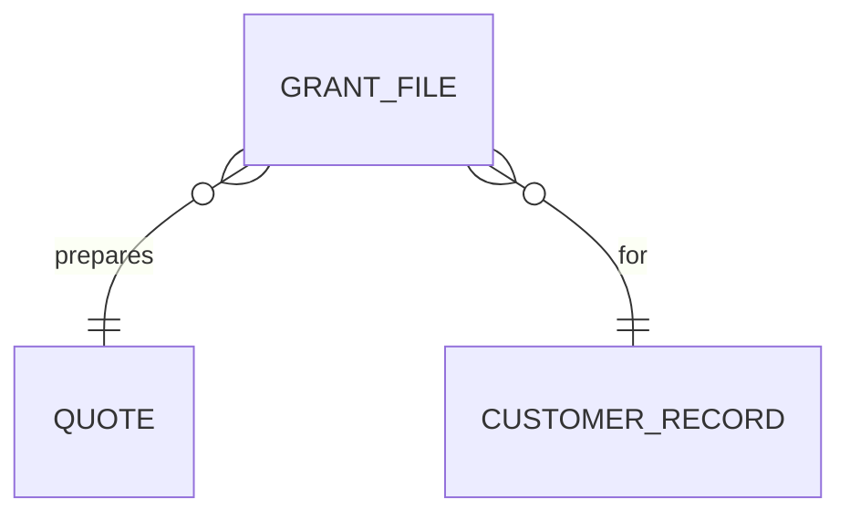
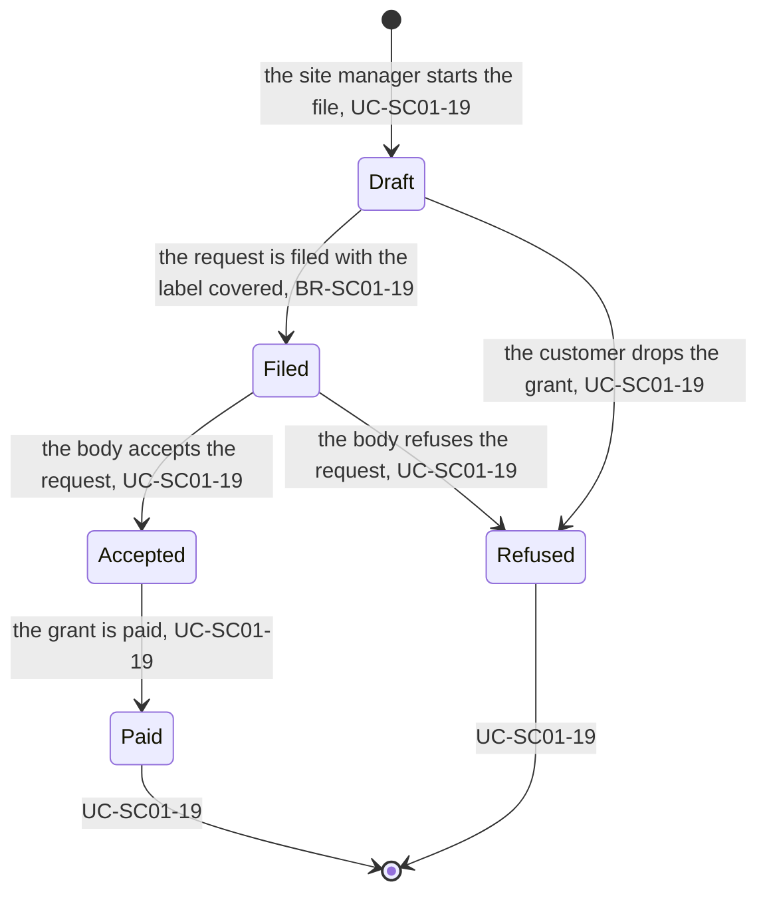

🏠 [Specs](../../../README.md) › 🏷️ [Sectors](../../README.md) › 🏗️ [SC01 Construction](../README.md) ›
🗃️ [Data](README.md) › 🗃️ E-SC01-18 Grant file

# 🗃️ E-SC01-18 Grant file

**Status:** ✅ specified

## Purpose

The grant file of one renovation quote: its works, the grants they open, the label check, the documents and the filing
([D545](../../../06-decisions/sectors/d545-benchmark-gaps-sc01-construction.md)). The quote
([E-F6-03 Quote](../../../02-functional/f06-customers-and-sales/data/e-f06-03-quote.md)) holds the price; the file holds
the grant side.

## Fields

| Name | Type | Required | Validation | Default | Example | Personal data | Custom fields |
|---|---|---|---|---|---|---|---|
| quote | quote (E-F6-03) | yes | a quote of the company | - | Q-2026-131 | no | no |
| customer | customer (E-F6-01) | yes | the quote's customer | - | Nadia B. | yes | no |
| works | works with grant and domain | yes | at least one | - | loft insulation | no | no |
| label check | domain, end date, covered | yes | on the signature date | - | insulation, 2027-03-31, yes | no | no |
| household resources | amount per year | no | from the tax notice | - | 24,000.00 EUR | yes | no |
| documents | list with status | yes | all received to file | - | tax notice received | no | no |
| filing number | text | no | set at filing | - | MPR-26-004512 | no | no |
| filing date | date | no | before the works start | - | 2026-12-05 | no | no |
| grant amount | amount | no | 0 or more | 0 | 3,400.00 EUR | no | no |
| state | Draft, Filed, Accepted, Refused, Paid | yes | the lifecycle below | Draft | Filed | no | no |
| owner | user | yes | a user of the company | the creator | Claire P. | yes | no |

## Relations

- [E-F6-03 Quote](../../../02-functional/f06-customers-and-sales/data/e-f06-03-quote.md)
- [E-F6-01](../../../02-functional/f06-customers-and-sales/data/e-f06-01-customer-record.md)
- [E-SC01-01 Construction site](e-sc01-01-construction-site.md)

## Lifecycle

## Indexes and search

By quote, customer, state and filing date.

## Retention

Kept with the invoices of the works for ten years, as proof of the grant paid
([CR-FR-002](../../../10-country-packs/france/accounting/cr-fr-002-accounting-records-kept-ten-years.md)).

## Audit

Every label check, document, filing and payment, with who, when and the result.

## Import and export

The file's documents are exported as one archive for the body that asks.

## Used by

- [UC-SC01-19](../use-cases/06-revision-developers-bim-and-grants/uc-sc01-19-prepare-renovation-grant-files.md)
- [UC-SC01-12](../use-cases/01-win-the-work/uc-sc01-12-sell-renovation-to-consumers.md)

## Open questions

None.

---

⬅️ [E-SC01-17 BIM import](e-sc01-17-bim-import.md) · ⬆️ [Up](README.md)
