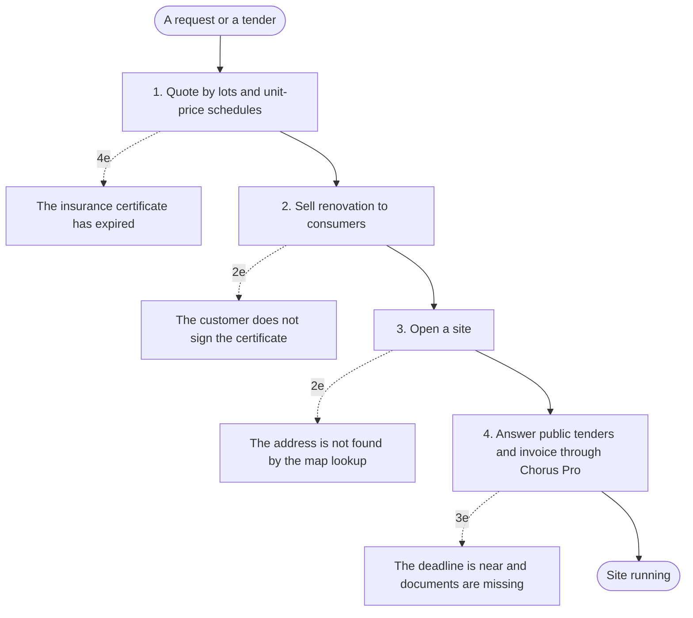

🏠 [Specs](../../../README.md) › 🏷️ [Sectors](../../README.md) › 🏗️ [SC01 Construction](../README.md) ›
🔀 [Flows](README.md) › 🔀 FL-SC01-01 Win the work

# 🔀 FL-SC01-01 Win the work

**Status:** ✅ specified

## Summary

From a customer's request or a public tender to a signed quote and an opened site. It covers
[UC-SC01-02 Quote by lots and unit-price schedules](../use-cases/01-win-the-work/uc-sc01-02-quote-by-lots-and-unit-price-schedules.md),
[UC-SC01-12 Sell renovation to consumers](../use-cases/01-win-the-work/uc-sc01-12-sell-renovation-to-consumers.md),
[UC-SC01-01 Open a site](../use-cases/01-win-the-work/uc-sc01-01-open-a-site.md),
[UC-SC01-13 Answer public tenders and invoice through Chorus Pro](../use-cases/01-win-the-work/uc-sc01-13-answer-public-tenders-and-invoice-through-chorus-pro.md).

## Personas

- [U03 Sales](../../../01-users/personas/u03-sales.md)
- [U05 Accounting](../../../01-users/personas/u05-accounting.md)
- [U09 Customer](../../../01-users/personas/u09-customer.md)
- [U22 Site manager](../../../01-users/personas/u22-site-manager.md)

## Flowchart

## Sequence diagram

See each use case.

## Steps

| Step | Persona | Screen | Use case | What happens |
|---|---|---|---|---|
| 1 | U03, U22, U09 | [S-SC01-02](../screens/01-win-the-work/s-sc01-02-quote-by-lots.md) | [UC-SC01-02](../use-cases/01-win-the-work/uc-sc01-02-quote-by-lots-and-unit-price-schedules.md) | Sales and the site manager build a works quote split into lots, each with unit-price lines and quantities, with the ten-year insurance certificate attached, and send it for signature |
| 2 | U03, U09 | [S-SC01-12](../screens/01-win-the-work/s-sc01-12-renovation-sale.md) | [UC-SC01-12](../use-cases/01-win-the-work/uc-sc01-12-sell-renovation-to-consumers.md) | Sales visits a private customer's home, quotes the renovation with the reduced VAT certificate, and schedules the works after the consumer's withdrawal period |
| 3 | U22, U03 | [S-SC01-02](../screens/01-win-the-work/s-sc01-02-quote-by-lots.md), [S-SC01-01](../screens/01-win-the-work/s-sc01-01-site.md) | [UC-SC01-01](../use-cases/01-win-the-work/uc-sc01-01-open-a-site.md) | The site manager opens a site from a signed quote, with its customer, address, lots, budget, team and documents, so that every hour, purchase and bill can be charged to it |
| 4 | U03, U05 | [S-SC01-13](../screens/01-win-the-work/s-sc01-13-public-tenders.md) | [UC-SC01-13](../use-cases/01-win-the-work/uc-sc01-13-answer-public-tenders-and-invoice-through-chorus-pro.md) | Sales follows public tenders with their documents and deadlines, answers them, and once won, accounting invoices the public buyer through Chorus Pro and follows the payment period |

### Entities and screens

| Entity | States in this flow | Shown at step and screen | Aggregated view |
|---|---|---|---|
| [E-F16-01 Customer request](../../../02-functional/f16-customer-support-agents/data/e-f16-01-customer-request.md) | New | Shown elsewhere: [S-F16-11 My requests](../../../02-functional/f16-customer-support-agents/screens/05-customer-side/s-f16-11-my-requests.md) | Customer requests |
| [E-F6-03 Quote](../../../02-functional/f06-customers-and-sales/data/e-f06-03-quote.md) | Refused, Sent, Expired | Shown elsewhere: [S-F6-03 Quote editor](../../../02-functional/f06-customers-and-sales/screens/01-lead-to-quote/s-f06-03-quote-editor.md) | Quotes |
| [E-SC01-02 Quote lot](../data/e-sc01-02-quote-lot.md) | Active | 1, 3 [S-SC01-02](../screens/01-win-the-work/s-sc01-02-quote-by-lots.md); 2 [S-SC01-12](../screens/01-win-the-work/s-sc01-12-renovation-sale.md); 3 [S-SC01-01](../screens/01-win-the-work/s-sc01-01-site.md) | Quote lots |
| [E-SC01-10 Acceptance record](../data/e-sc01-10-acceptance-record.md) | Recorded | Shown elsewhere: [S-SC01-10 Acceptance](../screens/05-hand-over-and-follow-up/s-sc01-10-acceptance.md) | Acceptance records |
| [E-SC01-01 Construction site](../data/e-sc01-01-construction-site.md) | Planned, Running | 1, 3 [S-SC01-02](../screens/01-win-the-work/s-sc01-02-quote-by-lots.md); 3 [S-SC01-01](../screens/01-win-the-work/s-sc01-01-site.md) | Construction sites |
| [E-SC01-12 Public tender](../data/e-sc01-12-public-tender.md) | Watching, Answered, Won | 4 [S-SC01-13](../screens/01-win-the-work/s-sc01-13-public-tenders.md) | Public tenders |
| [E-F6-05 Invoice](../../../02-functional/f06-customers-and-sales/data/e-f06-05-invoice.md) | Sent, Refused | Shown elsewhere: [S-F6-06 Invoice](../../../02-functional/f06-customers-and-sales/screens/03-invoice-and-get-paid/s-f06-06-invoice.md) | Invoices |
| [E-F2-13 Document](../../../02-functional/f02-no-code-configuration/data/e-f02-13-document.md) | To sort, To validate, Done | Shown elsewhere: [S-F2-13 Documents workspace](../../../02-functional/f02-no-code-configuration/screens/07-benchmark-additions/s-f02-13-documents-workspace.md) | Documents |

## Errors

- [UC-SC01-02](../use-cases/01-win-the-work/uc-sc01-02-quote-by-lots-and-unit-price-schedules.md) 4e. The insurance
  certificate has expired: the quote is not sent and the administrator is told to upload the new one
  ([BR-SC01-02](../business-rules/br-sc01-02-insurance-certificate-on-quotes-and-invoices.md)).
- [UC-SC01-02](../use-cases/01-win-the-work/uc-sc01-02-quote-by-lots-and-unit-price-schedules.md) 3e. A reduced VAT rate
  without the customer's certificate: the line is set back to the normal rate until the certificate is attached.
- [UC-SC01-12](../use-cases/01-win-the-work/uc-sc01-12-sell-renovation-to-consumers.md) 2e. The customer does not sign
  the certificate: the lines go to the normal VAT rate and the total is shown again before signing.
- [UC-SC01-12](../use-cases/01-win-the-work/uc-sc01-12-sell-renovation-to-consumers.md) 4e. A start date inside the
  withdrawal period without an express request: the date is refused with the first possible date.
- [UC-SC01-01](../use-cases/01-win-the-work/uc-sc01-01-open-a-site.md) 2e. The address is not found by the map lookup:
  the site manager types it by hand or places a pin; the site is not opened without an address.
- [UC-SC01-01](../use-cases/01-win-the-work/uc-sc01-01-open-a-site.md) 3e. A crew member has no construction
  identification card: the site can run but that person cannot be assigned until the card is declared
  ([BR-SC01-07](../business-rules/br-sc01-07-site-workers-have-their-card.md)).
- [UC-SC01-13](../use-cases/01-win-the-work/uc-sc01-13-answer-public-tenders-and-invoice-through-chorus-pro.md) 3e. The
  deadline is near and documents are missing: the tender is flagged and sales is reminded.
- [UC-SC01-13](../use-cases/01-win-the-work/uc-sc01-13-answer-public-tenders-and-invoice-through-chorus-pro.md) 5e. The
  buyer pays after the legal period: late-payment interest and the fixed indemnity are computed and proposed for
  invoicing ([BR-SC01-12](../business-rules/br-sc01-12-public-invoices-through-chorus-pro.md)).

## Images

Every step and error, for each persona taking part, in light and dark mode (D120). Steps are numbered as in the Steps
table; E rows are the error cases.

| Step | Persona | Device | Light | Dark |
|---|---|---|---|---|
| 1 | U03 | desktop | [light](../images/01-win-the-work/u03-sales/1-quote-by-lots-desktop-light.png) | [dark](../images/01-win-the-work/u03-sales/1-quote-by-lots-desktop-dark.png) |
| 1 | U03 | phone | [light](../images/01-win-the-work/u03-sales/1-quote-by-lots-phone-light.png) | [dark](../images/01-win-the-work/u03-sales/1-quote-by-lots-phone-dark.png) |
| 1 | U03 | tablet | [light](../images/01-win-the-work/u03-sales/1-quote-by-lots-tablet-light.png) | [dark](../images/01-win-the-work/u03-sales/1-quote-by-lots-tablet-dark.png) |
| 1 | U09 | phone | [light](../images/01-win-the-work/u09-customer/1-quote-by-lots-phone-light.png) | [dark](../images/01-win-the-work/u09-customer/1-quote-by-lots-phone-dark.png) |
| 1 | U22 | desktop | [light](../images/01-win-the-work/u22-site-manager/1-quote-by-lots-desktop-light.png) | [dark](../images/01-win-the-work/u22-site-manager/1-quote-by-lots-desktop-dark.png) |
| 1 | U22 | phone | [light](../images/01-win-the-work/u22-site-manager/1-quote-by-lots-phone-light.png) | [dark](../images/01-win-the-work/u22-site-manager/1-quote-by-lots-phone-dark.png) |
| 1 | U22 | tablet | [light](../images/01-win-the-work/u22-site-manager/1-quote-by-lots-tablet-light.png) | [dark](../images/01-win-the-work/u22-site-manager/1-quote-by-lots-tablet-dark.png) |
| 2 | U03 | phone | [light](../images/01-win-the-work/u03-sales/2-renovation-phone-light.png) | [dark](../images/01-win-the-work/u03-sales/2-renovation-phone-dark.png) |
| 2 | U03 | desktop | [light](../images/01-win-the-work/u03-sales/2-renovation-desktop-light.png) | [dark](../images/01-win-the-work/u03-sales/2-renovation-desktop-dark.png) |
| 2 | U03 | tablet | [light](../images/01-win-the-work/u03-sales/2-renovation-tablet-light.png) | [dark](../images/01-win-the-work/u03-sales/2-renovation-tablet-dark.png) |
| 2 | U09 | phone | [light](../images/01-win-the-work/u09-customer/2-renovation-phone-light.png) | [dark](../images/01-win-the-work/u09-customer/2-renovation-phone-dark.png) |
| 3 | U22 | desktop | [light](../images/01-win-the-work/u22-site-manager/3-open-site-desktop-light.png) | [dark](../images/01-win-the-work/u22-site-manager/3-open-site-desktop-dark.png) |
| 3 | U22 | phone | [light](../images/01-win-the-work/u22-site-manager/3-open-site-phone-light.png) | [dark](../images/01-win-the-work/u22-site-manager/3-open-site-phone-dark.png) |
| 3 | U22 | tablet | [light](../images/01-win-the-work/u22-site-manager/3-open-site-tablet-light.png) | [dark](../images/01-win-the-work/u22-site-manager/3-open-site-tablet-dark.png) |
| 3 | U03 | desktop | [light](../images/01-win-the-work/u03-sales/3-open-site-desktop-light.png) | [dark](../images/01-win-the-work/u03-sales/3-open-site-desktop-dark.png) |
| 3 | U03 | phone | [light](../images/01-win-the-work/u03-sales/3-open-site-phone-light.png) | [dark](../images/01-win-the-work/u03-sales/3-open-site-phone-dark.png) |
| 3 | U03 | tablet | [light](../images/01-win-the-work/u03-sales/3-open-site-tablet-light.png) | [dark](../images/01-win-the-work/u03-sales/3-open-site-tablet-dark.png) |
| 4 | U05 | desktop | [light](../images/01-win-the-work/u05-accounting/4-public-tender-desktop-light.png) | [dark](../images/01-win-the-work/u05-accounting/4-public-tender-desktop-dark.png) |
| 4 | U03 | desktop | [light](../images/01-win-the-work/u03-sales/4-public-tender-desktop-light.png) | [dark](../images/01-win-the-work/u03-sales/4-public-tender-desktop-dark.png) |
| 4 | U03 | phone | [light](../images/01-win-the-work/u03-sales/4-public-tender-phone-light.png) | [dark](../images/01-win-the-work/u03-sales/4-public-tender-phone-dark.png) |
| 4 | U03 | tablet | [light](../images/01-win-the-work/u03-sales/4-public-tender-tablet-light.png) | [dark](../images/01-win-the-work/u03-sales/4-public-tender-tablet-dark.png) |
| E1 | U03 | desktop | [light](../images/01-win-the-work/u03-sales/e1-certificate-expired-desktop-light.png) | [dark](../images/01-win-the-work/u03-sales/e1-certificate-expired-desktop-dark.png) |
| E1 | U03 | phone | [light](../images/01-win-the-work/u03-sales/e1-certificate-expired-phone-light.png) | [dark](../images/01-win-the-work/u03-sales/e1-certificate-expired-phone-dark.png) |
| E1 | U03 | tablet | [light](../images/01-win-the-work/u03-sales/e1-certificate-expired-tablet-light.png) | [dark](../images/01-win-the-work/u03-sales/e1-certificate-expired-tablet-dark.png) |

## Open questions

None.

---

⬆️ [Up](README.md) · ➡️ [FL-SC01-02 Prepare the site](fl-sc01-02-prepare-the-site.md)
