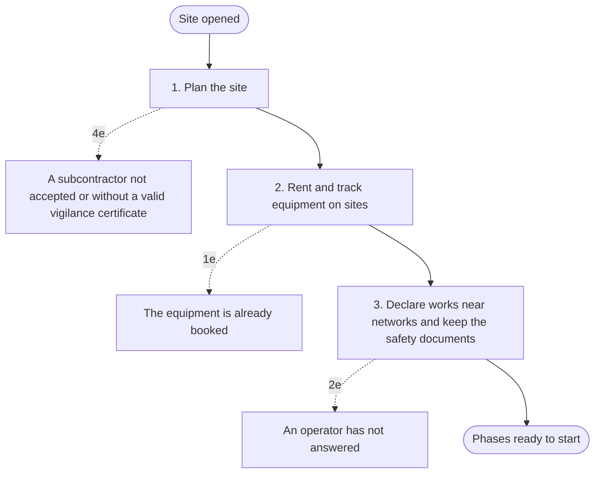

🏠 [Specs](../../../README.md) › 🏷️ [Sectors](../../README.md) › 🏗️ [SC01 Construction](../README.md) ›
🔀 [Flows](README.md) › 🔀 FL-SC01-02 Prepare the site

# 🔀 FL-SC01-02 Prepare the site

**Status:** ✅ specified

## Summary

Before work starts: phases, crews, equipment and the declarations before digging. It covers
[UC-SC01-03 Plan the site](../use-cases/02-prepare-the-site/uc-sc01-03-plan-the-site.md),
[UC-SC01-08 Rent and track equipment on sites](../use-cases/02-prepare-the-site/uc-sc01-08-rent-and-track-equipment-on-sites.md),
[UC-SC01-09 Declare works near networks and keep the safety documents](../use-cases/02-prepare-the-site/uc-sc01-09-declare-works-near-networks-and-keep-the-safety-documents.md).

## Personas

- [U04 Purchasing and stock](../../../01-users/personas/u04-purchasing.md)
- [U22 Site manager](../../../01-users/personas/u22-site-manager.md)

## Flowchart

## Sequence diagram

See each use case.

## Steps

| Step | Persona | Screen | Use case | What happens |
|---|---|---|---|---|
| 1 | U22 | [S-SC01-03](../screens/02-prepare-the-site/s-sc01-03-site-planning.md) | [UC-SC01-03](../use-cases/02-prepare-the-site/uc-sc01-03-plan-the-site.md) | The site manager splits the site into phases and puts crews, equipment and subcontractors on a timeline, then publishes the plan to the team |
| 2 | U22, U04 | [S-SC01-08](../screens/02-prepare-the-site/s-sc01-08-equipment.md) | [UC-SC01-08](../use-cases/02-prepare-the-site/uc-sc01-08-rent-and-track-equipment-on-sites.md) | The site manager books the company's own or rented equipment for a site's phase through the booking engine, purchasing rents from outside firms, each day of use is charged to the site |
| 3 | U22 | [S-SC01-09](../screens/02-prepare-the-site/s-sc01-09-works-declarations.md), [S-SC01-03](../screens/02-prepare-the-site/s-sc01-03-site-planning.md) | [UC-SC01-09](../use-cases/02-prepare-the-site/uc-sc01-09-declare-works-near-networks-and-keep-the-safety-documents.md) | Before digging, the site manager files the works declarations with the network operators, records their answers, and keeps the safety plan and documents in the site folder |

### Entities and screens

| Entity | States in this flow | Shown at step and screen | Aggregated view |
|---|---|---|---|
| [E-SC01-01 Construction site](../data/e-sc01-01-construction-site.md) | Planned, Accepted | Shown elsewhere: [S-SC01-01 Site](../screens/01-win-the-work/s-sc01-01-site.md) | Construction sites |
| [E-SC01-08 Equipment assignment](../data/e-sc01-08-equipment-assignment.md) | Active | 1, 3 [S-SC01-03](../screens/02-prepare-the-site/s-sc01-03-site-planning.md); 2 [S-SC01-08](../screens/02-prepare-the-site/s-sc01-08-equipment.md) | Equipment assignments |
| [E-F1-02 Company site](../../../02-functional/f01-administration/data/e-f01-02-company-site.md) | Open, Closed | Shown elsewhere: [S-F1-02 Sites](../../../02-functional/f01-administration/screens/02-manage-sites/s-f01-02-sites.md) | Company sites |
| [E-SC01-09 Works declaration](../data/e-sc01-09-works-declaration.md) | Active | 1, 3 [S-SC01-03](../screens/02-prepare-the-site/s-sc01-03-site-planning.md); 3 [S-SC01-09](../screens/02-prepare-the-site/s-sc01-09-works-declarations.md) | Works declarations |
| [E-SC01-14 Site safety document](../data/e-sc01-14-site-safety-document.md) | Active | 1, 3 [S-SC01-03](../screens/02-prepare-the-site/s-sc01-03-site-planning.md); 3 [S-SC01-09](../screens/02-prepare-the-site/s-sc01-09-works-declarations.md) | Site safety documents |
| [E-SC01-03 Site phase](../data/e-sc01-03-site-phase.md) | Active | 1, 3 [S-SC01-03](../screens/02-prepare-the-site/s-sc01-03-site-planning.md) | Site phases |

## Errors

- [UC-SC01-03](../use-cases/02-prepare-the-site/uc-sc01-03-plan-the-site.md) 4e. A subcontractor not accepted or without
  a valid vigilance certificate: it cannot be planned and is flagged
  ([BR-SC01-06](../business-rules/br-sc01-06-subcontractor-documents-before-work.md)).
- [UC-SC01-03](../use-cases/02-prepare-the-site/uc-sc01-03-plan-the-site.md) 2e. A worker without a construction
  identification card: the assignment is refused
  ([BR-SC01-07](../business-rules/br-sc01-07-site-workers-have-their-card.md)).
- [UC-SC01-08](../use-cases/02-prepare-the-site/uc-sc01-08-rent-and-track-equipment-on-sites.md) 1e. The equipment is
  already booked: the booking is refused with the free dates,
  [BR-F2-18](../../../02-functional/f02-no-code-configuration/business-rules/br-f02-18-one-booking-per-resource-and-slot.md).
- [UC-SC01-08](../use-cases/02-prepare-the-site/uc-sc01-08-rent-and-track-equipment-on-sites.md) 4e. A rented item is
  not returned at the end date: purchasing is told and the extra days are charged to the site.
- [UC-SC01-09](../use-cases/02-prepare-the-site/uc-sc01-09-declare-works-near-networks-and-keep-the-safety-documents.md)
  2e. An operator has not answered: the phase stays blocked and the site manager is reminded
  ([BR-SC01-08](../business-rules/br-sc01-08-declarations-before-digging.md)).
- [UC-SC01-09](../use-cases/02-prepare-the-site/uc-sc01-09-declare-works-near-networks-and-keep-the-safety-documents.md)
  1e. The one-stop service is unreachable: the declaration is kept as a draft and sent again.

## Images

Every step and error, for each persona taking part, in light and dark mode (D120). Steps are numbered as in the Steps
table; E rows are the error cases.

| Step | Persona | Device | Light | Dark |
|---|---|---|---|---|
| 1 | U22 | desktop | [light](../images/02-prepare-the-site/u22-site-manager/1-planning-desktop-light.png) | [dark](../images/02-prepare-the-site/u22-site-manager/1-planning-desktop-dark.png) |
| 1 | U22 | phone | [light](../images/02-prepare-the-site/u22-site-manager/1-planning-phone-light.png) | [dark](../images/02-prepare-the-site/u22-site-manager/1-planning-phone-dark.png) |
| 1 | U22 | tablet | [light](../images/02-prepare-the-site/u22-site-manager/1-planning-tablet-light.png) | [dark](../images/02-prepare-the-site/u22-site-manager/1-planning-tablet-dark.png) |
| 2 | U22 | desktop | [light](../images/02-prepare-the-site/u22-site-manager/2-equipment-desktop-light.png) | [dark](../images/02-prepare-the-site/u22-site-manager/2-equipment-desktop-dark.png) |
| 2 | U22 | phone | [light](../images/02-prepare-the-site/u22-site-manager/2-equipment-phone-light.png) | [dark](../images/02-prepare-the-site/u22-site-manager/2-equipment-phone-dark.png) |
| 2 | U22 | tablet | [light](../images/02-prepare-the-site/u22-site-manager/2-equipment-tablet-light.png) | [dark](../images/02-prepare-the-site/u22-site-manager/2-equipment-tablet-dark.png) |
| 2 | U04 | desktop | [light](../images/02-prepare-the-site/u04-purchasing/2-equipment-desktop-light.png) | [dark](../images/02-prepare-the-site/u04-purchasing/2-equipment-desktop-dark.png) |
| 3 | U22 | desktop | [light](../images/02-prepare-the-site/u22-site-manager/3-declarations-desktop-light.png) | [dark](../images/02-prepare-the-site/u22-site-manager/3-declarations-desktop-dark.png) |
| 3 | U22 | phone | [light](../images/02-prepare-the-site/u22-site-manager/3-declarations-phone-light.png) | [dark](../images/02-prepare-the-site/u22-site-manager/3-declarations-phone-dark.png) |
| 3 | U22 | tablet | [light](../images/02-prepare-the-site/u22-site-manager/3-declarations-tablet-light.png) | [dark](../images/02-prepare-the-site/u22-site-manager/3-declarations-tablet-dark.png) |
| E1 | U22 | desktop | [light](../images/02-prepare-the-site/u22-site-manager/e1-no-answer-desktop-light.png) | [dark](../images/02-prepare-the-site/u22-site-manager/e1-no-answer-desktop-dark.png) |
| E1 | U22 | phone | [light](../images/02-prepare-the-site/u22-site-manager/e1-no-answer-phone-light.png) | [dark](../images/02-prepare-the-site/u22-site-manager/e1-no-answer-phone-dark.png) |
| E1 | U22 | tablet | [light](../images/02-prepare-the-site/u22-site-manager/e1-no-answer-tablet-light.png) | [dark](../images/02-prepare-the-site/u22-site-manager/e1-no-answer-tablet-dark.png) |

## Open questions

None.

---

⬅️ [FL-SC01-01 Win the work](fl-sc01-01-win-the-work.md) · ⬆️ [Up](README.md) ·
➡️ [FL-SC01-03 Run the site](fl-sc01-03-run-the-site.md)
