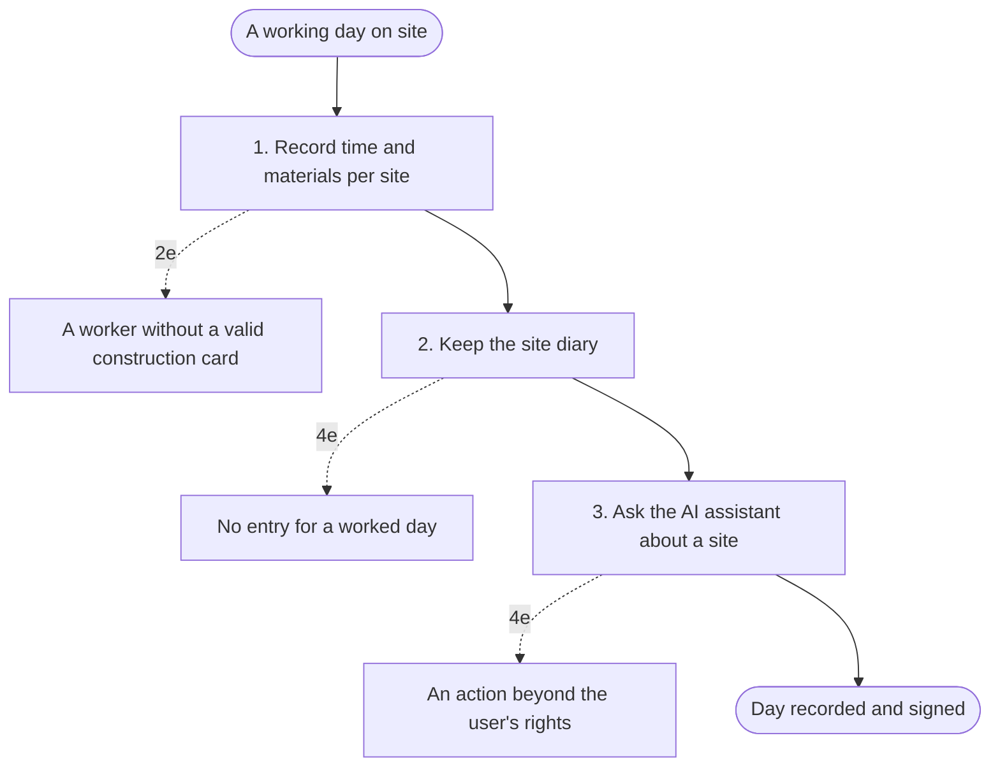

🏠 [Specs](../../../README.md) › 🏷️ [Sectors](../../README.md) › 🏗️ [SC01 Construction](../README.md) ›
🔀 [Flows](README.md) › 🔀 FL-SC01-03 Run the site

# 🔀 FL-SC01-03 Run the site

**Status:** ✅ specified

## Summary

Each day on site: time and materials, the diary, and questions to the AI assistant. It covers
[UC-SC01-04 Record time and materials per site](../use-cases/03-run-the-site/uc-sc01-04-record-time-and-materials-per-site.md),
[UC-SC01-05 Keep the site diary](../use-cases/03-run-the-site/uc-sc01-05-keep-the-site-diary.md),
[UC-SC01-15 Ask the AI assistant about a site](../use-cases/03-run-the-site/uc-sc01-15-ask-the-assistant-about-a-site.md).

## Personas

- [U14 Field worker](../../../01-users/personas/u14-field-worker.md)
- [U22 Site manager](../../../01-users/personas/u22-site-manager.md)

## Flowchart

## Sequence diagram

See each use case.

## Steps

| Step | Persona | Screen | Use case | What happens |
|---|---|---|---|---|
| 1 | U14, U22 | [S-SC01-04](../screens/03-run-the-site/s-sc01-04-site-time.md) | [UC-SC01-04](../use-cases/03-run-the-site/uc-sc01-04-record-time-and-materials-per-site.md) | Field workers record their hours, materials and photos per site and lot on the phone, offline when needed, through the offline phone forms, the site manager checks them |
| 2 | U14, U22 | [S-SC01-05](../screens/03-run-the-site/s-sc01-05-site-diary.md) | [UC-SC01-05](../use-cases/03-run-the-site/uc-sc01-05-keep-the-site-diary.md) | The site manager or foreman writes the site diary each worked day on the phone |
| 3 | U22, U14 | [S-SC01-15](../screens/03-run-the-site/s-sc01-15-site-assistant.md) | [UC-SC01-15](../use-cases/03-run-the-site/uc-sc01-15-ask-the-assistant-about-a-site.md) | The site manager or a field worker asks the AI assistant about a site, its progress, margin, next phase or missing documents, or asks it to prepare an action, within their role's rights |

### Entities and screens

| Entity | States in this flow | Shown at step and screen | Aggregated view |
|---|---|---|---|
| [E-SC01-01 Construction site](../data/e-sc01-01-construction-site.md) | Planned, Running, Accepted, Closed | 3 [S-SC01-15](../screens/03-run-the-site/s-sc01-15-site-assistant.md) | Construction sites |
| [E-SC01-04 Site time and material entry](../data/e-sc01-04-site-time-and-material-entry.md) | Recorded | 1 [S-SC01-04](../screens/03-run-the-site/s-sc01-04-site-time.md) | Site time and material entries |
| [E-SC01-05 Site diary entry](../data/e-sc01-05-site-diary-entry.md) | Recorded | 2 [S-SC01-05](../screens/03-run-the-site/s-sc01-05-site-diary.md); 3 [S-SC01-15](../screens/03-run-the-site/s-sc01-15-site-assistant.md) | Site diary entries |
| [E-F3-04 Assistant change batch](../../../02-functional/f03-assistant/data/e-f03-04-assistant-change-batch.md) | Proposed, Cancelled, Done, Partly done, Undone | Shown elsewhere: [S-F3-01 Assistant panel](../../../02-functional/f03-assistant/screens/01-ask-the-assistant/s-f03-01-assistant-panel.md) | Assistant change batches |
| [E-F1-03 User](../../../02-functional/f01-administration/data/e-f01-03-user.md) | Invited, Active, Deactivated | Shown elsewhere: [S-F1-03 Users](../../../02-functional/f01-administration/screens/03-user-lifecycle/s-f01-03-users.md) | Users |
| [E-F1-06 Role](../../../02-functional/f01-administration/data/e-f01-06-role.md) | Active | Shown elsewhere: [S-F1-06 Role editor](../../../02-functional/f01-administration/screens/04-edit-a-role/s-f01-06-role-editor.md) | Roles |

## Errors

- [UC-SC01-04](../use-cases/03-run-the-site/uc-sc01-04-record-time-and-materials-per-site.md) 2e. A worker without a
  valid construction card: the entry is kept but flagged to the site manager
  ([BR-SC01-07](../business-rules/br-sc01-07-site-workers-have-their-card.md)).
- [UC-SC01-04](../use-cases/03-run-the-site/uc-sc01-04-record-time-and-materials-per-site.md) 3e. The same entry changed
  on the phone and in the office: the conflict is shown to the site manager, who keeps one,
  [BR-F2-21](../../../02-functional/f02-no-code-configuration/business-rules/br-f02-21-offline-forms-keep-only-what-is-needed-and-sync-in-order.md).
- [UC-SC01-05](../use-cases/03-run-the-site/uc-sc01-05-keep-the-site-diary.md) 4e. No entry for a worked day: the site
  manager is reminded the next morning.
- [UC-SC01-05](../use-cases/03-run-the-site/uc-sc01-05-keep-the-site-diary.md) 4f. A correction after signature: a dated
  addition is added; the signed text is kept.
- [UC-SC01-15](../use-cases/03-run-the-site/uc-sc01-15-ask-the-assistant-about-a-site.md) 4e. An action beyond the
  user's rights: the AI assistant refuses and says which role can do it.
- [UC-SC01-15](../use-cases/03-run-the-site/uc-sc01-15-ask-the-assistant-about-a-site.md) 2e. No data to answer: the
  AI assistant says so and does not guess.

## Images

Every step and error, for each persona taking part, in light and dark mode (D120). Steps are numbered as in the Steps
table; E rows are the error cases.

| Step | Persona | Device | Light | Dark |
|---|---|---|---|---|
| 1 | U14 | phone | [light](../images/03-run-the-site/u14-field-worker/1-time-and-materials-phone-light.png) | [dark](../images/03-run-the-site/u14-field-worker/1-time-and-materials-phone-dark.png) |
| 1 | U22 | desktop | [light](../images/03-run-the-site/u22-site-manager/1-time-and-materials-desktop-light.png) | [dark](../images/03-run-the-site/u22-site-manager/1-time-and-materials-desktop-dark.png) |
| 1 | U22 | phone | [light](../images/03-run-the-site/u22-site-manager/1-time-and-materials-phone-light.png) | [dark](../images/03-run-the-site/u22-site-manager/1-time-and-materials-phone-dark.png) |
| 1 | U22 | tablet | [light](../images/03-run-the-site/u22-site-manager/1-time-and-materials-tablet-light.png) | [dark](../images/03-run-the-site/u22-site-manager/1-time-and-materials-tablet-dark.png) |
| 2 | U14 | phone | [light](../images/03-run-the-site/u14-field-worker/2-diary-phone-light.png) | [dark](../images/03-run-the-site/u14-field-worker/2-diary-phone-dark.png) |
| 2 | U22 | desktop | [light](../images/03-run-the-site/u22-site-manager/2-diary-desktop-light.png) | [dark](../images/03-run-the-site/u22-site-manager/2-diary-desktop-dark.png) |
| 2 | U22 | phone | [light](../images/03-run-the-site/u22-site-manager/2-diary-phone-light.png) | [dark](../images/03-run-the-site/u22-site-manager/2-diary-phone-dark.png) |
| 2 | U22 | tablet | [light](../images/03-run-the-site/u22-site-manager/2-diary-tablet-light.png) | [dark](../images/03-run-the-site/u22-site-manager/2-diary-tablet-dark.png) |
| 3 | U22 | phone | [light](../images/03-run-the-site/u22-site-manager/3-assistant-phone-light.png) | [dark](../images/03-run-the-site/u22-site-manager/3-assistant-phone-dark.png) |
| 3 | U22 | desktop | [light](../images/03-run-the-site/u22-site-manager/3-assistant-desktop-light.png) | [dark](../images/03-run-the-site/u22-site-manager/3-assistant-desktop-dark.png) |
| 3 | U22 | tablet | [light](../images/03-run-the-site/u22-site-manager/3-assistant-tablet-light.png) | [dark](../images/03-run-the-site/u22-site-manager/3-assistant-tablet-dark.png) |
| 3 | U14 | phone | [light](../images/03-run-the-site/u14-field-worker/3-assistant-phone-light.png) | [dark](../images/03-run-the-site/u14-field-worker/3-assistant-phone-dark.png) |
| E1 | U22 | desktop | [light](../images/03-run-the-site/u22-site-manager/e1-no-card-desktop-light.png) | [dark](../images/03-run-the-site/u22-site-manager/e1-no-card-desktop-dark.png) |
| E1 | U22 | phone | [light](../images/03-run-the-site/u22-site-manager/e1-no-card-phone-light.png) | [dark](../images/03-run-the-site/u22-site-manager/e1-no-card-phone-dark.png) |
| E1 | U22 | tablet | [light](../images/03-run-the-site/u22-site-manager/e1-no-card-tablet-light.png) | [dark](../images/03-run-the-site/u22-site-manager/e1-no-card-tablet-dark.png) |

## Open questions

None.

---

⬅️ [FL-SC01-02 Prepare the site](fl-sc01-02-prepare-the-site.md) · ⬆️ [Up](README.md) ·
➡️ [FL-SC01-04 Bill and subcontract](fl-sc01-04-bill-and-subcontract.md)
