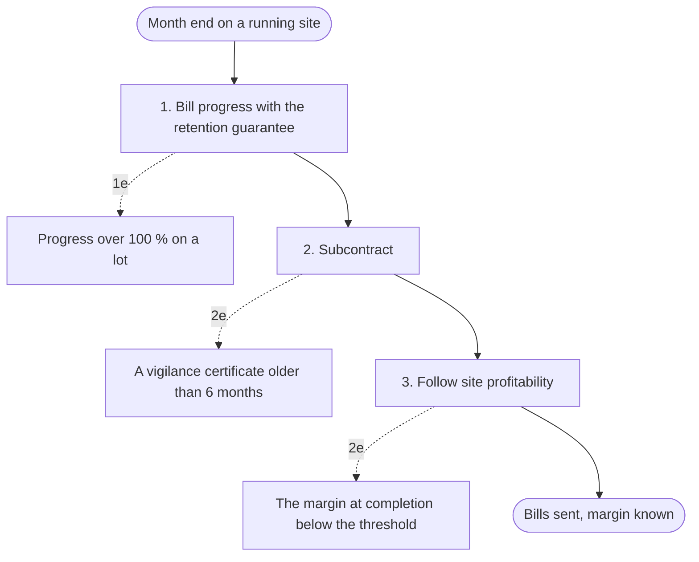

🏠 [Specs](../../../README.md) › 🏷️ [Sectors](../../README.md) › 🏗️ [SC01 Construction](../README.md) ›
🔀 [Flows](README.md) › 🔀 FL-SC01-04 Bill and subcontract

# 🔀 FL-SC01-04 Bill and subcontract

**Status:** ✅ specified

## Summary

Each month: progress bills, subcontractors' bills and the margin at completion. It covers
[UC-SC01-06 Bill progress with the retention guarantee](../use-cases/04-bill-and-subcontract/uc-sc01-06-bill-progress-with-the-retention-guarantee.md),
[UC-SC01-07 Subcontract](../use-cases/04-bill-and-subcontract/uc-sc01-07-subcontract.md),
[UC-SC01-14 Follow site profitability](../use-cases/04-bill-and-subcontract/uc-sc01-14-follow-site-profitability.md).

## Personas

- [U04 Purchasing and stock](../../../01-users/personas/u04-purchasing.md)
- [U05 Accounting](../../../01-users/personas/u05-accounting.md)
- [U13 Owner](../../../01-users/personas/u13-owner.md)
- [U22 Site manager](../../../01-users/personas/u22-site-manager.md)

## Flowchart

## Sequence diagram

See each use case.

## Steps

| Step | Persona | Screen | Use case | What happens |
|---|---|---|---|---|
| 1 | U22, U05 | [S-SC01-06](../screens/04-bill-and-subcontract/s-sc01-06-progress-bill.md) | [UC-SC01-06](../use-cases/04-bill-and-subcontract/uc-sc01-06-bill-progress-with-the-retention-guarantee.md) | The site manager enters the progress of each lot, accounting checks the cumulative progress bill, with earlier bills and deposits deducted and the retention held back, and sends it |
| 2 | U22, U04 | [S-SC01-07](../screens/04-bill-and-subcontract/s-sc01-07-subcontracts.md) | [UC-SC01-07](../use-cases/04-bill-and-subcontract/uc-sc01-07-subcontract.md) | The site manager and purchasing contract a subcontractor for a site, collect its documents, have it accepted by the project owner, and receive and pay its reverse-charge invoices |
| 3 | U22, U13 | [S-SC01-14](../screens/04-bill-and-subcontract/s-sc01-14-site-margin.md) | [UC-SC01-14](../use-cases/04-bill-and-subcontract/uc-sc01-14-follow-site-profitability.md) | The site manager and the owner follow each site's budget against actual costs, update the estimate to complete, and act when the margin at completion drops below the threshold |

### Entities and screens

| Entity | States in this flow | Shown at step and screen | Aggregated view |
|---|---|---|---|
| [E-SC01-01 Construction site](../data/e-sc01-01-construction-site.md) | Planned, Running, Accepted | 3 [S-SC01-14](../screens/04-bill-and-subcontract/s-sc01-14-site-margin.md) | Construction sites |
| [E-SC01-06 Progress bill](../data/e-sc01-06-progress-bill.md) | Draft, Sent | 1 [S-SC01-06](../screens/04-bill-and-subcontract/s-sc01-06-progress-bill.md); 3 [S-SC01-14](../screens/04-bill-and-subcontract/s-sc01-14-site-margin.md) | Progress bills |
| [E-SC01-02 Quote lot](../data/e-sc01-02-quote-lot.md) | Active | Shown elsewhere: [S-SC01-02 Quote by lots](../screens/01-win-the-work/s-sc01-02-quote-by-lots.md) | Quote lots |

## Errors

- [UC-SC01-06](../use-cases/04-bill-and-subcontract/uc-sc01-06-bill-progress-with-the-retention-guarantee.md) 1e.
  Progress over 100 % on a lot: the entry is refused.
- [UC-SC01-06](../use-cases/04-bill-and-subcontract/uc-sc01-06-bill-progress-with-the-retention-guarantee.md) 1f.
  Progress lower than the last bill: the site manager confirms it, and the bill becomes a credit for the difference,
  [UC-F6-09](../../../02-functional/f06-customers-and-sales/use-cases/03-invoice-and-get-paid/uc-f06-09-credit-note-and-refund.md).
- [UC-SC01-07](../use-cases/04-bill-and-subcontract/uc-sc01-07-subcontract.md) 2e. A vigilance certificate older than 6
  months: the subcontractor is flagged and cannot be planned
  ([BR-SC01-06](../business-rules/br-sc01-06-subcontractor-documents-before-work.md)).
- [UC-SC01-07](../use-cases/04-bill-and-subcontract/uc-sc01-07-subcontract.md) 4e. An invoice with VAT on
  reverse-charged works: the invoice is refused with the reason.
- [UC-SC01-14](../use-cases/04-bill-and-subcontract/uc-sc01-14-follow-site-profitability.md) 2e. The margin at
  completion below the threshold: the site manager and the owner are alerted.
- [UC-SC01-14](../use-cases/04-bill-and-subcontract/uc-sc01-14-follow-site-profitability.md) 1e. Costs not yet synced
  from phones: the screen says which days are missing.

## Images

Every step and error, for each persona taking part, in light and dark mode (D120). Steps are numbered as in the Steps
table; E rows are the error cases.

| Step | Persona | Device | Light | Dark |
|---|---|---|---|---|
| 1 | U22 | desktop | [light](../images/04-bill-and-subcontract/u22-site-manager/1-progress-bill-desktop-light.png) | [dark](../images/04-bill-and-subcontract/u22-site-manager/1-progress-bill-desktop-dark.png) |
| 1 | U22 | phone | [light](../images/04-bill-and-subcontract/u22-site-manager/1-progress-bill-phone-light.png) | [dark](../images/04-bill-and-subcontract/u22-site-manager/1-progress-bill-phone-dark.png) |
| 1 | U22 | tablet | [light](../images/04-bill-and-subcontract/u22-site-manager/1-progress-bill-tablet-light.png) | [dark](../images/04-bill-and-subcontract/u22-site-manager/1-progress-bill-tablet-dark.png) |
| 1 | U05 | desktop | [light](../images/04-bill-and-subcontract/u05-accounting/1-progress-bill-desktop-light.png) | [dark](../images/04-bill-and-subcontract/u05-accounting/1-progress-bill-desktop-dark.png) |
| 2 | U22 | desktop | [light](../images/04-bill-and-subcontract/u22-site-manager/2-subcontract-desktop-light.png) | [dark](../images/04-bill-and-subcontract/u22-site-manager/2-subcontract-desktop-dark.png) |
| 2 | U22 | phone | [light](../images/04-bill-and-subcontract/u22-site-manager/2-subcontract-phone-light.png) | [dark](../images/04-bill-and-subcontract/u22-site-manager/2-subcontract-phone-dark.png) |
| 2 | U22 | tablet | [light](../images/04-bill-and-subcontract/u22-site-manager/2-subcontract-tablet-light.png) | [dark](../images/04-bill-and-subcontract/u22-site-manager/2-subcontract-tablet-dark.png) |
| 2 | U04 | desktop | [light](../images/04-bill-and-subcontract/u04-purchasing/2-subcontract-desktop-light.png) | [dark](../images/04-bill-and-subcontract/u04-purchasing/2-subcontract-desktop-dark.png) |
| 3 | U13 | desktop | [light](../images/04-bill-and-subcontract/u13-owner/3-margin-desktop-light.png) | [dark](../images/04-bill-and-subcontract/u13-owner/3-margin-desktop-dark.png) |
| 3 | U13 | phone | [light](../images/04-bill-and-subcontract/u13-owner/3-margin-phone-light.png) | [dark](../images/04-bill-and-subcontract/u13-owner/3-margin-phone-dark.png) |
| 3 | U22 | desktop | [light](../images/04-bill-and-subcontract/u22-site-manager/3-margin-desktop-light.png) | [dark](../images/04-bill-and-subcontract/u22-site-manager/3-margin-desktop-dark.png) |
| 3 | U22 | phone | [light](../images/04-bill-and-subcontract/u22-site-manager/3-margin-phone-light.png) | [dark](../images/04-bill-and-subcontract/u22-site-manager/3-margin-phone-dark.png) |
| 3 | U22 | tablet | [light](../images/04-bill-and-subcontract/u22-site-manager/3-margin-tablet-light.png) | [dark](../images/04-bill-and-subcontract/u22-site-manager/3-margin-tablet-dark.png) |
| E1 | U22 | desktop | [light](../images/04-bill-and-subcontract/u22-site-manager/e1-progress-over-desktop-light.png) | [dark](../images/04-bill-and-subcontract/u22-site-manager/e1-progress-over-desktop-dark.png) |
| E1 | U22 | phone | [light](../images/04-bill-and-subcontract/u22-site-manager/e1-progress-over-phone-light.png) | [dark](../images/04-bill-and-subcontract/u22-site-manager/e1-progress-over-phone-dark.png) |
| E1 | U22 | tablet | [light](../images/04-bill-and-subcontract/u22-site-manager/e1-progress-over-tablet-light.png) | [dark](../images/04-bill-and-subcontract/u22-site-manager/e1-progress-over-tablet-dark.png) |

## Open questions

None.

---

⬅️ [FL-SC01-03 Run the site](fl-sc01-03-run-the-site.md) · ⬆️ [Up](README.md) ·
➡️ [FL-SC01-05 Hand over and follow up](fl-sc01-05-hand-over-and-follow-up.md)
