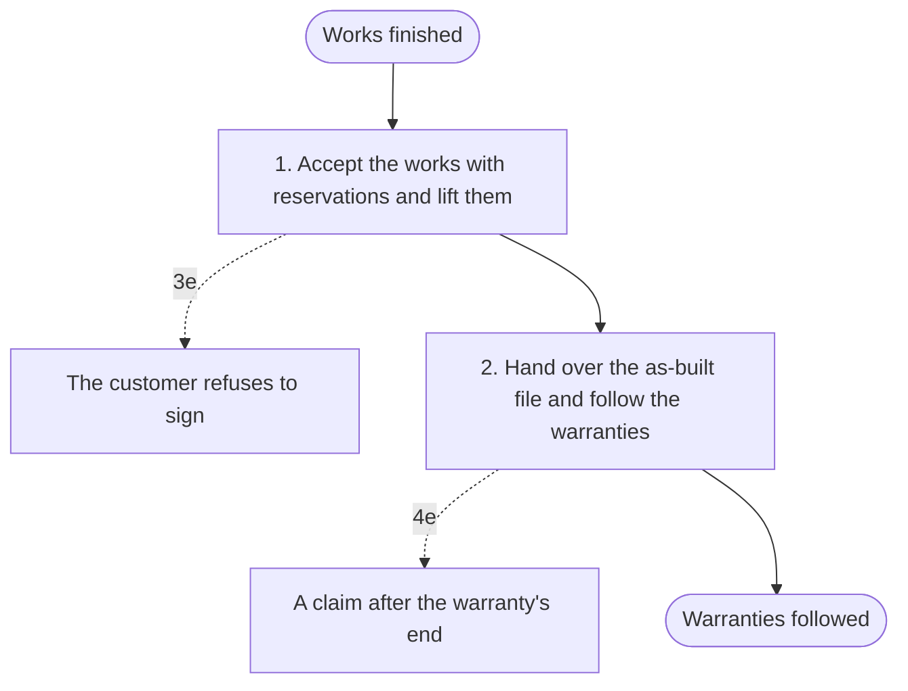

🏠 [Specs](../../../README.md) › 🏷️ [Sectors](../../README.md) › 🏗️ [SC01 Construction](../README.md) ›
🔀 [Flows](README.md) › 🔀 FL-SC01-05 Hand over and follow up

# 🔀 FL-SC01-05 Hand over and follow up

**Status:** ✅ specified

## Summary

At the end: acceptance with its reservations, the as-built file and the warranties. It covers
[UC-SC01-10 Accept the works with reservations and lift them](../use-cases/05-hand-over-and-follow-up/uc-sc01-10-accept-the-works-with-reservations-and-lift-them.md),
[UC-SC01-11 Hand over the as-built file and follow the warranties](../use-cases/05-hand-over-and-follow-up/uc-sc01-11-hand-over-the-as-built-file-and-follow-the-warranties.md).

## Personas

- [U09 Customer](../../../01-users/personas/u09-customer.md)
- [U22 Site manager](../../../01-users/personas/u22-site-manager.md)

## Flowchart

## Sequence diagram

See each use case.

## Steps

| Step | Persona | Screen | Use case | What happens |
|---|---|---|---|---|
| 1 | U22, U09 | [S-SC01-10](../screens/05-hand-over-and-follow-up/s-sc01-10-acceptance.md) | [UC-SC01-10](../use-cases/05-hand-over-and-follow-up/uc-sc01-10-accept-the-works-with-reservations-and-lift-them.md) | The site manager walks the site with the customer, records the acceptance with its reservations and photos, has it signed, then lifts each reservation as it is fixed |
| 2 | U22, U09 | [S-SC01-11](../screens/05-hand-over-and-follow-up/s-sc01-11-warranties.md) | [UC-SC01-11](../use-cases/05-hand-over-and-follow-up/uc-sc01-11-hand-over-the-as-built-file-and-follow-the-warranties.md) | The site manager assembles the as-built file, hands it to the customer, and follows the one-, two- and ten-year warranties and the claims made under them |

### Entities and screens

| Entity | States in this flow | Shown at step and screen | Aggregated view |
|---|---|---|---|
| [E-SC01-01 Construction site](../data/e-sc01-01-construction-site.md) | Planned, Running, Accepted, Closed | Shown elsewhere: [S-SC01-01 Site](../screens/01-win-the-work/s-sc01-01-site.md) | Construction sites |
| [E-SC01-10 Acceptance record](../data/e-sc01-10-acceptance-record.md) | Recorded | 1 [S-SC01-10](../screens/05-hand-over-and-follow-up/s-sc01-10-acceptance.md); 2 [S-SC01-11](../screens/05-hand-over-and-follow-up/s-sc01-11-warranties.md) | Acceptance records |
| [E-SC01-13 As-built file](../data/e-sc01-13-as-built-file.md) | Active | 2 [S-SC01-11](../screens/05-hand-over-and-follow-up/s-sc01-11-warranties.md) | As-built files |
| [E-SC01-11 Warranty](../data/e-sc01-11-warranty.md) | Active | 1 [S-SC01-10](../screens/05-hand-over-and-follow-up/s-sc01-10-acceptance.md); 2 [S-SC01-11](../screens/05-hand-over-and-follow-up/s-sc01-11-warranties.md) | Warranties |

## Errors

- [UC-SC01-10](../use-cases/05-hand-over-and-follow-up/uc-sc01-10-accept-the-works-with-reservations-and-lift-them.md)
  3e. The customer refuses to sign: the refusal and its reason are recorded and the site manager is told to follow up.
- [UC-SC01-10](../use-cases/05-hand-over-and-follow-up/uc-sc01-10-accept-the-works-with-reservations-and-lift-them.md)
  4e. A reservation not lifted at its due date: the site manager is reminded and the retention stays held
  ([BR-SC01-11](../business-rules/br-sc01-11-retention-released-when-due.md)).
-
  [UC-SC01-11](../use-cases/05-hand-over-and-follow-up/uc-sc01-11-hand-over-the-as-built-file-and-follow-the-warranties.md)
  4e. A claim after the warranty's end: it is refused with the end date.
-
  [UC-SC01-11](../use-cases/05-hand-over-and-follow-up/uc-sc01-11-hand-over-the-as-built-file-and-follow-the-warranties.md)
  1e. A document missing: the file shows the missing list and cannot be handed over.

## Images

Every step and error, for each persona taking part, in light and dark mode (D120). Steps are numbered as in the Steps
table; E rows are the error cases.

| Step | Persona | Device | Light | Dark |
|---|---|---|---|---|
| 1 | U22 | phone | [light](../images/05-hand-over-and-follow-up/u22-site-manager/1-acceptance-phone-light.png) | [dark](../images/05-hand-over-and-follow-up/u22-site-manager/1-acceptance-phone-dark.png) |
| 1 | U22 | desktop | [light](../images/05-hand-over-and-follow-up/u22-site-manager/1-acceptance-desktop-light.png) | [dark](../images/05-hand-over-and-follow-up/u22-site-manager/1-acceptance-desktop-dark.png) |
| 1 | U22 | tablet | [light](../images/05-hand-over-and-follow-up/u22-site-manager/1-acceptance-tablet-light.png) | [dark](../images/05-hand-over-and-follow-up/u22-site-manager/1-acceptance-tablet-dark.png) |
| 1 | U09 | phone | [light](../images/05-hand-over-and-follow-up/u09-customer/1-acceptance-phone-light.png) | [dark](../images/05-hand-over-and-follow-up/u09-customer/1-acceptance-phone-dark.png) |
| 2 | U09 | phone | [light](../images/05-hand-over-and-follow-up/u09-customer/2-warranties-phone-light.png) | [dark](../images/05-hand-over-and-follow-up/u09-customer/2-warranties-phone-dark.png) |
| 2 | U22 | desktop | [light](../images/05-hand-over-and-follow-up/u22-site-manager/2-warranties-desktop-light.png) | [dark](../images/05-hand-over-and-follow-up/u22-site-manager/2-warranties-desktop-dark.png) |
| 2 | U22 | phone | [light](../images/05-hand-over-and-follow-up/u22-site-manager/2-warranties-phone-light.png) | [dark](../images/05-hand-over-and-follow-up/u22-site-manager/2-warranties-phone-dark.png) |
| 2 | U22 | tablet | [light](../images/05-hand-over-and-follow-up/u22-site-manager/2-warranties-tablet-light.png) | [dark](../images/05-hand-over-and-follow-up/u22-site-manager/2-warranties-tablet-dark.png) |
| E1 | U09 | phone | [light](../images/05-hand-over-and-follow-up/u09-customer/e1-claim-late-phone-light.png) | [dark](../images/05-hand-over-and-follow-up/u09-customer/e1-claim-late-phone-dark.png) |

## Open questions

None.

---

⬅️ [FL-SC01-04 Bill and subcontract](fl-sc01-04-bill-and-subcontract.md) · ⬆️ [Up](README.md) ·
➡️ [FL-SC01-06 Price revision, off-plan sales, BIM and grants](fl-sc01-06-revision-developers-bim-and-grants.md)
