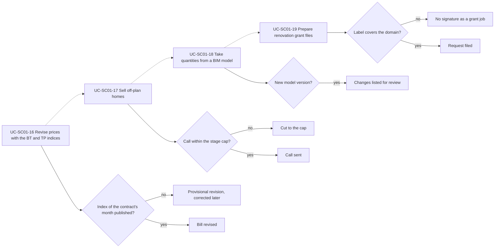
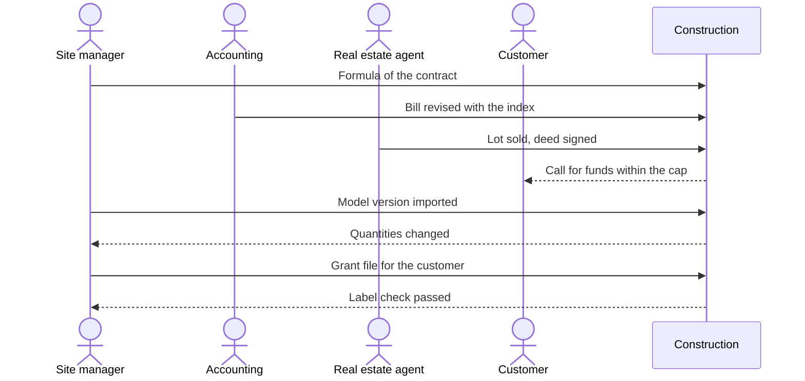

🏠 [Specs](../../../README.md) › 🏷️ [Sectors](../../README.md) › 🏗️ [SC01 Construction](../README.md) ›
🔀 [Flows](README.md) › 🔀 FL-SC01-06 Price revision, off-plan sales, BIM and grants

# 🔀 FL-SC01-06 Price revision, off-plan sales, BIM and grants

**Status:** ✅ specified

## Summary

Four situations of construction companies that site suites handle: revising prices with the building and public works
indices, selling homes off-plan with legal caps on the calls for funds, taking quantities from a building model, and
preparing renovation grant files for customers of a company holding the RGE label
([D545](../../../06-decisions/sectors/d545-benchmark-gaps-sc01-construction.md)).

## Personas

- [U22 Site manager](../../../01-users/personas/u22-site-manager.md), who revises, imports and prepares
- [U05 Accounting](../../../01-users/personas/u05-accounting.md), who confirms formulas and bills
- [U35 Real-estate agent](../../../01-users/personas/u35-real-estate-agent.md), who sells the lots
- [U09 Customer](../../../01-users/personas/u09-customer.md), who follows their lot and their grant file

## Flowchart

## Sequence diagram

## Steps

| Step | Persona | Screen | Use case | What happens |
|---|---|---|---|---|
| 1 | [U22](../../../01-users/personas/u22-site-manager.md) | [S-SC01-16](../screens/06-revision-developers-bim-and-grants/s-sc01-16-price-revision.md) | [UC-SC01-16](../use-cases/06-revision-developers-bim-and-grants/uc-sc01-16-revise-prices-with-the-bt-and-tp-indices.md) | The site manager enters the revision formula of a contract and accounting issues revised bills |
| 2 | [U35](../../../01-users/personas/u35-real-estate-agent.md) | [S-SC01-17](../screens/06-revision-developers-bim-and-grants/s-sc01-17-off-plan-sales.md) | [UC-SC01-17](../use-cases/06-revision-developers-bim-and-grants/uc-sc01-17-sell-off-plan-homes.md) | The real estate agent sells a lot and the buyer follows the stages and pays each call on the phone |
| 3 | [U22](../../../01-users/personas/u22-site-manager.md) | [S-SC01-18](../screens/06-revision-developers-bim-and-grants/s-sc01-18-bim-quantities.md) | [UC-SC01-18](../use-cases/06-revision-developers-bim-and-grants/uc-sc01-18-take-quantities-from-a-bim-model.md) | The site manager imports a model and reviews the quantities that moved between versions |
| 4 | [U22](../../../01-users/personas/u22-site-manager.md) | [S-SC01-19](../screens/06-revision-developers-bim-and-grants/s-sc01-19-renovation-grants.md) | [UC-SC01-19](../use-cases/06-revision-developers-bim-and-grants/uc-sc01-19-prepare-renovation-grant-files.md) | The site manager prepares the grant file and the customer adds their documents on the phone |

### Entities and screens

| Entity | States in this flow | Shown at step and screen | Aggregated view |
|---|---|---|---|
| [E-SC01-15 Revision formula](../data/e-sc01-15-revision-formula.md) | Draft, Active, Closed | 1 [S-SC01-16](../screens/06-revision-developers-bim-and-grants/s-sc01-16-price-revision.md) | Revision formulas |
| [E-SC01-16 Off-plan lot](../data/e-sc01-16-off-plan-lot.md) | Available, Reserved, Sold, Delivered | 2 [S-SC01-17](../screens/06-revision-developers-bim-and-grants/s-sc01-17-off-plan-sales.md) | Off-plan lots |
| [E-SC01-17 BIM import](../data/e-sc01-17-bim-import.md) | Draft, Mapped, Applied, Superseded | 3 [S-SC01-18](../screens/06-revision-developers-bim-and-grants/s-sc01-18-bim-quantities.md) | BIM imports |
| [E-SC01-18 Grant file](../data/e-sc01-18-grant-file.md) | Draft, Filed, Accepted, Refused, Paid | 4 [S-SC01-19](../screens/06-revision-developers-bim-and-grants/s-sc01-19-renovation-grants.md) | Grant files |
| [E-SC01-06 Progress bill](../data/e-sc01-06-progress-bill.md) | Draft, Sent | Shown elsewhere: [S-SC01-06 Progress bill](../screens/04-bill-and-subcontract/s-sc01-06-progress-bill.md) | Progress bills |
| [E-SC01-02 Quote lot](../data/e-sc01-02-quote-lot.md) | Active | Shown elsewhere: [S-SC01-02 Quote by lots](../screens/01-win-the-work/s-sc01-02-quote-by-lots.md) | Quote lots |

## Errors

- **E1 The index is not published.** The bill is revised provisionally with the last published index and corrected when
  the real one appears ([BR-SC01-16](../business-rules/br-sc01-16-revisions-use-the-index-of-the-contracts-month.md),
  step 1).

## Images

Every step and error, for each persona taking part, in light and dark mode (D120). Steps are numbered as in the Steps
table; E rows are the error cases.

| Step | Persona | Device | Light | Dark |
|---|---|---|---|---|
| 1 | U22 | desktop | [light](../images/06-revision-developers-bim-and-grants/u22-site-manager/1-price-revision-desktop-light.png) | [dark](../images/06-revision-developers-bim-and-grants/u22-site-manager/1-price-revision-desktop-dark.png) |
| 1 | U05 | desktop | [light](../images/06-revision-developers-bim-and-grants/u05-accounting/1-price-revision-desktop-light.png) | [dark](../images/06-revision-developers-bim-and-grants/u05-accounting/1-price-revision-desktop-dark.png) |
| 1 | U22 | phone | [light](../images/06-revision-developers-bim-and-grants/u22-site-manager/1-price-revision-phone-light.png) | [dark](../images/06-revision-developers-bim-and-grants/u22-site-manager/1-price-revision-phone-dark.png) |
| 1 | U22 | tablet | [light](../images/06-revision-developers-bim-and-grants/u22-site-manager/1-price-revision-tablet-light.png) | [dark](../images/06-revision-developers-bim-and-grants/u22-site-manager/1-price-revision-tablet-dark.png) |
| 2 | U35 | desktop | [light](../images/06-revision-developers-bim-and-grants/u35-real-estate-agent/2-off-plan-sales-desktop-light.png) | [dark](../images/06-revision-developers-bim-and-grants/u35-real-estate-agent/2-off-plan-sales-desktop-dark.png) |
| 2 | U09 | phone | [light](../images/06-revision-developers-bim-and-grants/u09-customer/2-off-plan-sales-phone-light.png) | [dark](../images/06-revision-developers-bim-and-grants/u09-customer/2-off-plan-sales-phone-dark.png) |
| 2 | U35 | phone | [light](../images/06-revision-developers-bim-and-grants/u35-real-estate-agent/2-off-plan-sales-phone-light.png) | [dark](../images/06-revision-developers-bim-and-grants/u35-real-estate-agent/2-off-plan-sales-phone-dark.png) |
| 2 | U35 | tablet | [light](../images/06-revision-developers-bim-and-grants/u35-real-estate-agent/2-off-plan-sales-tablet-light.png) | [dark](../images/06-revision-developers-bim-and-grants/u35-real-estate-agent/2-off-plan-sales-tablet-dark.png) |
| 3 | U22 | desktop | [light](../images/06-revision-developers-bim-and-grants/u22-site-manager/3-bim-quantities-desktop-light.png) | [dark](../images/06-revision-developers-bim-and-grants/u22-site-manager/3-bim-quantities-desktop-dark.png) |
| 3 | U22 | phone | [light](../images/06-revision-developers-bim-and-grants/u22-site-manager/3-bim-quantities-phone-light.png) | [dark](../images/06-revision-developers-bim-and-grants/u22-site-manager/3-bim-quantities-phone-dark.png) |
| 3 | U22 | tablet | [light](../images/06-revision-developers-bim-and-grants/u22-site-manager/3-bim-quantities-tablet-light.png) | [dark](../images/06-revision-developers-bim-and-grants/u22-site-manager/3-bim-quantities-tablet-dark.png) |
| 4 | U22 | desktop | [light](../images/06-revision-developers-bim-and-grants/u22-site-manager/4-renovation-grants-desktop-light.png) | [dark](../images/06-revision-developers-bim-and-grants/u22-site-manager/4-renovation-grants-desktop-dark.png) |
| 4 | U09 | phone | [light](../images/06-revision-developers-bim-and-grants/u09-customer/4-renovation-grants-phone-light.png) | [dark](../images/06-revision-developers-bim-and-grants/u09-customer/4-renovation-grants-phone-dark.png) |
| 4 | U22 | phone | [light](../images/06-revision-developers-bim-and-grants/u22-site-manager/4-renovation-grants-phone-light.png) | [dark](../images/06-revision-developers-bim-and-grants/u22-site-manager/4-renovation-grants-phone-dark.png) |
| 4 | U22 | tablet | [light](../images/06-revision-developers-bim-and-grants/u22-site-manager/4-renovation-grants-tablet-light.png) | [dark](../images/06-revision-developers-bim-and-grants/u22-site-manager/4-renovation-grants-tablet-dark.png) |
| E1 | U22 | desktop | [light](../images/06-revision-developers-bim-and-grants/u22-site-manager/e1-the-index-is-not-published-desktop-light.png) | [dark](../images/06-revision-developers-bim-and-grants/u22-site-manager/e1-the-index-is-not-published-desktop-dark.png) |
| E1 | U22 | phone | [light](../images/06-revision-developers-bim-and-grants/u22-site-manager/e1-the-index-is-not-published-phone-light.png) | [dark](../images/06-revision-developers-bim-and-grants/u22-site-manager/e1-the-index-is-not-published-phone-dark.png) |
| E1 | U22 | tablet | [light](../images/06-revision-developers-bim-and-grants/u22-site-manager/e1-the-index-is-not-published-tablet-light.png) | [dark](../images/06-revision-developers-bim-and-grants/u22-site-manager/e1-the-index-is-not-published-tablet-dark.png) |

## Open questions

None.

---

⬅️ [FL-SC01-05 Hand over and follow up](fl-sc01-05-hand-over-and-follow-up.md) · ⬆️ [Up](README.md)
