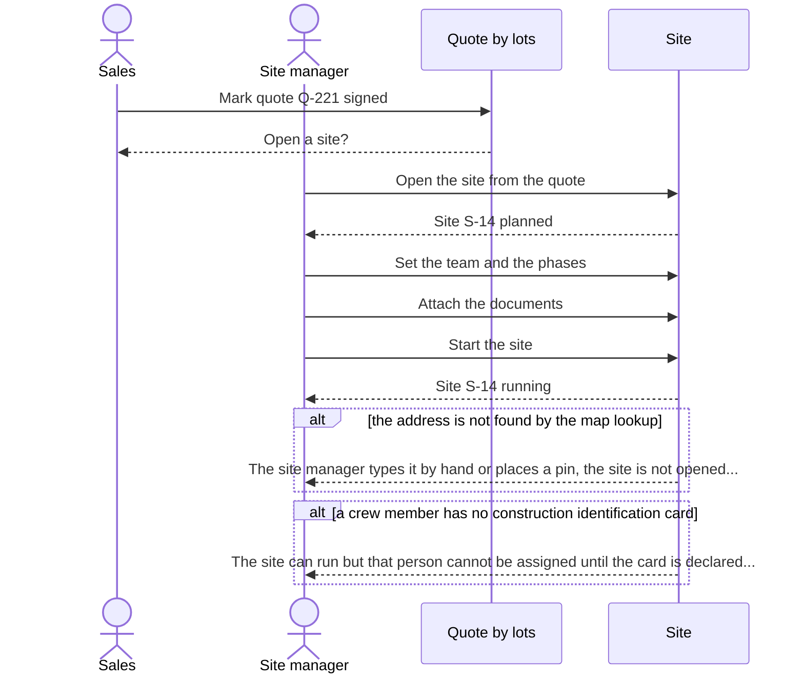

🏠 [Specs](../../../../README.md) › 🏷️ [Sectors](../../../README.md) › 🏗️ [SC01 Construction](../../README.md) ›
📝 [Use cases](../README.md) › 📝 [Use cases: FL-SC01-01 Win the work](README.md) › 📝 UC-SC01-01 Open a site

# 📝 UC-SC01-01 Open a site

**Status:** ✅ specified

## Summary

The site manager opens a site from a signed quote, with its customer, address, lots, budget, team and documents, so that
every hour, purchase and bill can be charged to it.

## Personas

- [U22 Site manager](../../../../01-users/personas/u22-site-manager.md)
- [U03 Sales](../../../../01-users/personas/u03-sales.md)

## Goal

A running site whose budget per lot comes from the signed quote and whose team can record on it.

## Trigger

A quote is signed, or an internal works order is decided.

## Frequency

Each new contract: a few sites a month in a company of 20 to 100 people.

## Preconditions

- The SC01 sector pack is installed for the company,
  [UC-F14-02](../../../../02-functional/f14-plugin-store/use-cases/01-find-and-install/uc-f14-02-install-a-plugin-or-sector-pack.md),
  and its users have their roles,
  [UC-F1-06](../../../../02-functional/f01-administration/use-cases/04-edit-a-role/uc-f01-06-edit-a-role-and-its-record-rules.md).
- The quote is signed by the customer,
  [UC-F6-04](../../../../02-functional/f06-customers-and-sales/use-cases/02-quote-to-order/uc-f06-04-accept-or-sign-a-quote.md),
  or the works are internal.

## Postconditions

- **Success:** the site is running, its lots and budget copied from the quote, its team assigned and its folder shared.
- **Failed:** no site is created; the quote stays signed and can be opened again.

## Main flow

1. Sales marks the quote signed on [S-SC01-02 Quote by lots](../../screens/01-win-the-work/s-sc01-02-quote-by-lots.md);
   simple-ERP proposes to open a site from it.
2. The site manager opens the site on [S-SC01-01 Site](../../screens/01-win-the-work/s-sc01-01-site.md): reference,
   name, customer and address come from the quote, and its lots and amounts become the site's budget per lot.
3. The site manager assigns the crew and a foreman and sets the planned start and end dates.
4. The site manager attaches the plans, the insurance certificate and the safety documents to the site folder,
   [UC-F2-13](../../../../02-functional/f02-no-code-configuration/use-cases/07-benchmark-additions/uc-f02-13-manage-documents-in-a-workspace.md).
5. The site manager sets the site to running; the crew sees it in today's sites on their phone.

## Alternative flows

- 2a. Internal works without a quote: the site is opened by hand with a budget and no customer; its costs go to the
  company's own account.
- 2b. The quote has options the customer did not take: only the lots taken become the budget.
- 4a. A document is missing at the start: the site opens and a task to add it is given to the site manager.

## Error flows

- 2e. The address is not found by the map lookup: the site manager types it by hand or places a pin; the site is not
  opened without an address.
- 3e. A crew member has no construction identification card: the site can run but that person cannot be assigned until
  the card is declared ([BR-SC01-07](../../business-rules/br-sc01-07-site-workers-have-their-card.md)).
- Any step: a call to a service or an outside system fails: it is retried first
  ([BR-F3-32](../../../../02-functional/f03-assistant/business-rules/br-f03-32-retry-before-an-error.md)), then the
  error message pattern ([D122](../../../../06-decisions/ux/d122-error-message-standard.md)) says what failed; what was
  typed is kept.

## Business rules

- [BR-SC01-09 Time and materials per site](../../business-rules/br-sc01-09-time-and-materials-per-site.md)
- [BR-SC01-07 Site workers have their card](../../business-rules/br-sc01-07-site-workers-have-their-card.md)
- [BR-SC01-01 Construction follows the country pack](../../business-rules/br-sc01-01-construction-follows-the-country-pack.md)

## Entities

- [E-SC01-01 Construction site](../../data/e-sc01-01-construction-site.md)
- [E-SC01-02 Quote lot](../../data/e-sc01-02-quote-lot.md)

## Permissions

The site manager and sales roles; the record rules of their role and site apply,
[UC-F1-06](../../../../02-functional/f01-administration/use-cases/04-edit-a-role/uc-f01-06-edit-a-role-and-its-record-rules.md).

## Notifications

- Each crew member gets the new site in today's sites on the phone.
- The customer gets a start notice with the site manager's contact on the customer portal,
  [UC-F6-11](../../../../02-functional/f06-customers-and-sales/use-cases/02-quote-to-order/uc-f06-11-use-the-customer-portal.md).

## Audit events

Every creation, change and state change of site, quote lot records, with who, when and the values before and after (T3).

## AI involvement

The AI assistant answers questions on the site, quote lot records of this use case, with links, and prepares them as
drafts the user confirms. It works within the user's rights,
[BR-F3-34](../../../../02-functional/f03-assistant/business-rules/br-f03-34-every-capability-is-reachable-from-the-assistant.md),
and never deletes or does anything irreversible without the user's confirmation,
[BR-F3-07](../../../../02-functional/f03-assistant/business-rules/br-f03-07-no-deletes-no-irreversible-acts.md).

## API, MCP and A2A exposure

Through the API and webhooks (T5) and the MCP and A2A gateway (T6), with the caller's rights,
[BR-F3-34](../../../../02-functional/f03-assistant/business-rules/br-f03-34-every-capability-is-reachable-from-the-assistant.md),
reading, creating and changing the records of this use case; nothing irreversible without a person's confirmation.

## Screens

- [S-SC01-02 Quote by lots](../../screens/01-win-the-work/s-sc01-02-quote-by-lots.md)
- [S-SC01-01 Site](../../screens/01-win-the-work/s-sc01-01-site.md)

## Flowchart

See [FL-SC01-01 Win the work](../../flows/fl-sc01-01-win-the-work.md#flowchart).

## Sequence diagram

## Acceptance criteria

1. **Given** the example construction company's signed quote Q-221 for Villa Martin, J. Martin, Lyon, 4 lots at 182,000
   EUR **when** the site manager opens a site from it **then** site S-14 is created, planned, with the 4 lots and
   182,000 EUR as its budget per lot.
2. **Given** site S-14 planned with its crew of 4 **when** it is set to running **then** the 4 crew members see S-14 in
   today's sites on their phone.
3. **Given** an internal works order for the yard roof **when** the site manager opens a site without a quote **then**
   the site is opened by hand with a budget and no customer; its costs go to the company's own account.
4. **Given** quote Q-221 with an unchosen option lot 5 at 9,000 EUR **when** the site is opened **then** only the lots
   taken become the budget.
5. **Given** the address "lot 7, ZA des Peupliers" not found **when** the site is opened **then** the site manager types
   it by hand or places a pin; the site is not opened without an address.
6. **Given** worker P. L. without a declared card **when** the site manager assigns him **then** the site can run but
   that person cannot be assigned until the card is declared
   ([BR-SC01-07](../../business-rules/br-sc01-07-site-workers-have-their-card.md)).

## Non-functional notes

[D408](../../../../06-decisions/technical/d408-performance-and-profiles.md)'s targets
([performance](../../../../05-non-functional/performance.md)): 95 % of screens within 1 second; lists paged on the
server, the first page within 1 second; reports within 5 seconds or in the background. WCAG 2.2 AA and RGAA
([D46](../../../../06-decisions/ux/d46-accessibility-standard.md)).

## Regulatory references

Legal values from the France country pack:
[CR-FR-087 Construction identification card (carte BTP)](../../../../10-country-packs/france/construction/cr-fr-087-btp-identification-card.md).

## Related use cases

- [UC-SC01-02 Quote by lots and unit-price schedules](uc-sc01-02-quote-by-lots-and-unit-price-schedules.md)
- [UC-SC01-03 Plan the site](../02-prepare-the-site/uc-sc01-03-plan-the-site.md)
- [UC-SC01-04 Record time and materials per site](../03-run-the-site/uc-sc01-04-record-time-and-materials-per-site.md)

## Open questions

None.

---

⬆️ [Up](README.md) ·
➡️ [UC-SC01-02 Quote by lots and unit-price schedules](uc-sc01-02-quote-by-lots-and-unit-price-schedules.md)
