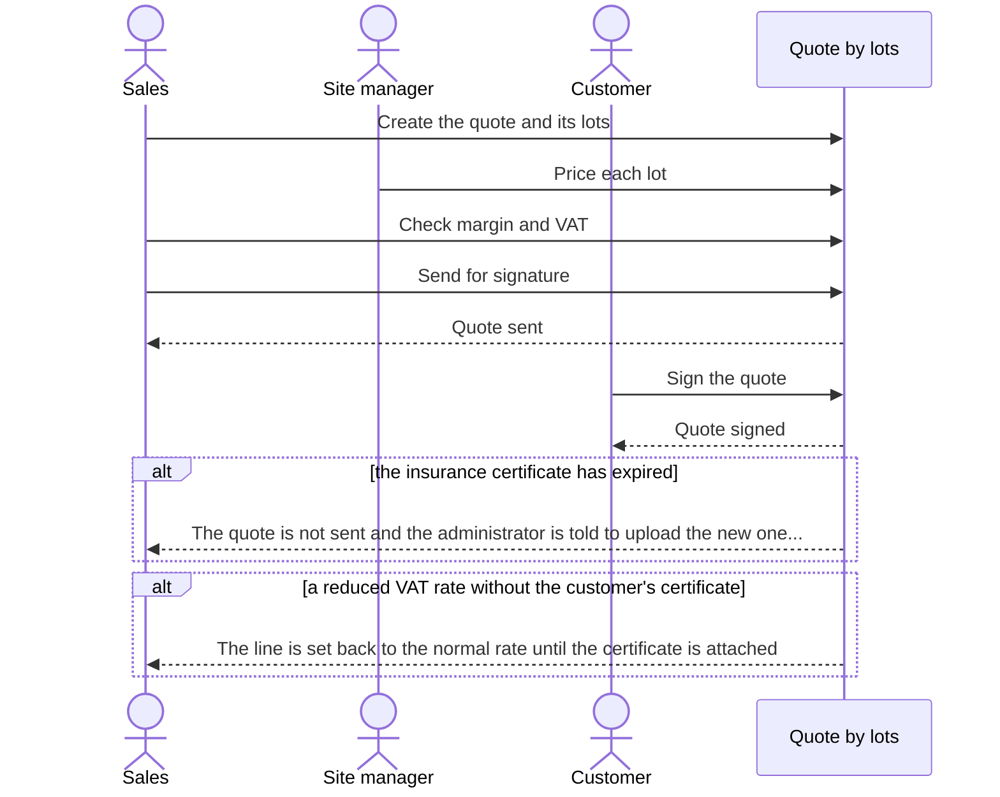

🏠 [Specs](../../../../README.md) › 🏷️ [Sectors](../../../README.md) › 🏗️ [SC01 Construction](../../README.md) ›
📝 [Use cases](../README.md) › 📝 [Use cases: FL-SC01-01 Win the work](README.md) ›
📝 UC-SC01-02 Quote by lots and unit-price schedules

# 📝 UC-SC01-02 Quote by lots and unit-price schedules

**Status:** ✅ specified

## Summary

Sales and the site manager build a works quote split into lots, each with unit-price lines and quantities, with the
ten-year insurance certificate attached, and send it for signature.

## Personas

- [U03 Sales](../../../../01-users/personas/u03-sales.md)
- [U22 Site manager](../../../../01-users/personas/u22-site-manager.md)
- [U09 Customer](../../../../01-users/personas/u09-customer.md)

## Goal

A signed quote whose lots become the site's budget.

## Trigger

A customer's request or a tender to answer.

## Frequency

Several quotes a week; a quote can hold hundreds of lines.

## Preconditions

- The SC01 sector pack is installed for the company,
  [UC-F14-02](../../../../02-functional/f14-plugin-store/use-cases/01-find-and-install/uc-f14-02-install-a-plugin-or-sector-pack.md),
  and its users have their roles,
  [UC-F1-06](../../../../02-functional/f01-administration/use-cases/04-edit-a-role/uc-f01-06-edit-a-role-and-its-record-rules.md).
- The company's ten-year insurance certificate is valid
  ([BR-SC01-02](../../business-rules/br-sc01-02-insurance-certificate-on-quotes-and-invoices.md)).

## Postconditions

- **Success:** the quote is sent with its lots, totals, VAT and certificate, then signed or refused.
- **Failed:** the quote stays a draft; nothing is sent.

## Main flow

1. Sales creates the quote on [S-SC01-02 Quote by lots](../../screens/01-win-the-work/s-sc01-02-quote-by-lots.md),
   [UC-F6-03](../../../../02-functional/f06-customers-and-sales/use-cases/01-lead-to-quote/uc-f06-03-create-and-send-a-quote.md),
   and adds the lots: groundwork, masonry, roofing, finishing.
2. The site manager fills each lot with unit-price lines from the price schedule: unit, quantity and unit price;
   SimpleERP totals each lot.
3. Sales checks the margin per lot and the VAT rate of each line; a reduced rate needs the customer's certificate
   ([BR-SC01-05](../../business-rules/br-sc01-05-reduced-vat-needs-the-certificate.md)).
4. Sales sends the quote with the insurance certificate attached for e-signature,
   [UC-F2-14](../../../../02-functional/f02-no-code-configuration/use-cases/07-benchmark-additions/uc-f02-14-send-documents-for-e-signature.md).
5. The customer signs; the quote is accepted and a site can be opened ([UC-SC01-01](uc-sc01-01-open-a-site.md)).

## Alternative flows

- 2a. Options and variants: an option lot is priced apart and counts in the total only once the customer chooses it.
- 2b. A line copied from an earlier quote: its prices are updated from the current schedule.

## Error flows

- 4e. The insurance certificate has expired: the quote is not sent and the administrator is told to upload the new one
  ([BR-SC01-02](../../business-rules/br-sc01-02-insurance-certificate-on-quotes-and-invoices.md)).
- 3e. A reduced VAT rate without the customer's certificate: the line is set back to the normal rate until the
  certificate is attached.
- Any step: a call to a service or an outside system fails: it is retried first
  ([BR-F3-32](../../../../02-functional/f03-assistant/business-rules/br-f03-32-retry-before-an-error.md)), then the
  error message pattern ([D122](../../../../06-decisions/ux/d122-error-message-standard.md)) says what failed; what was
  typed is kept.

## Business rules

- [BR-SC01-02 Insurance certificate on quotes and invoices](../../business-rules/br-sc01-02-insurance-certificate-on-quotes-and-invoices.md)
- [BR-SC01-05 Reduced VAT needs the certificate](../../business-rules/br-sc01-05-reduced-vat-needs-the-certificate.md)
- [BR-SC01-01 Construction follows the country pack](../../business-rules/br-sc01-01-construction-follows-the-country-pack.md)

## Entities

- [E-SC01-02 Quote lot](../../data/e-sc01-02-quote-lot.md)

## Permissions

The sales, site manager and customer roles; the record rules of their role and site apply,
[UC-F1-06](../../../../02-functional/f01-administration/use-cases/04-edit-a-role/uc-f01-06-edit-a-role-and-its-record-rules.md).

## Notifications

- The customer gets the quote by email with the signing link.
- Sales is told when the customer signs or refuses.

## Audit events

Every creation, change and state change of quote lot records, with who, when and the values before and after (T3).

## AI involvement

The AI assistant answers questions on the quote lot records of this use case, with links, and prepares them as drafts
the user confirms. It works within the user's rights,
[BR-F3-34](../../../../02-functional/f03-assistant/business-rules/br-f03-34-every-capability-is-reachable-from-the-assistant.md),
and never deletes or does anything irreversible without the user's confirmation,
[BR-F3-07](../../../../02-functional/f03-assistant/business-rules/br-f03-07-no-deletes-no-irreversible-acts.md).

## API, MCP and A2A exposure

Through the API and webhooks (T5) and the MCP and A2A gateway (T6), with the caller's rights,
[BR-F3-34](../../../../02-functional/f03-assistant/business-rules/br-f03-34-every-capability-is-reachable-from-the-assistant.md),
reading, creating and changing the records of this use case; nothing irreversible without a person's confirmation.

## Screens

- [S-SC01-02 Quote by lots](../../screens/01-win-the-work/s-sc01-02-quote-by-lots.md)

## Flowchart

See [FL-SC01-01 Win the work](../../flows/fl-sc01-01-win-the-work.md#flowchart).

## Sequence diagram

## Acceptance criteria

1. **Given** the example construction company's quote Q-221 with lot 2 of 18 m3 of concrete at 140 EUR **when** the lot
   is totalled **then** lot 2 shows 2,520 EUR excluding VAT.
2. **Given** a valid certificate and 4 lots priced **when** sales sends the quote **then** the customer receives the
   quote with the certificate attached and a signing link.
3. **Given** lot 5 "heat pump" set as an option at 9,000 EUR **when** the customer signs without choosing it **then** an
   option lot is priced apart and counts in the total only once the customer chooses it.
4. **Given** a certificate that expired on 31 October **when** sales sends a quote on 4 November **then** the quote is
   not sent and the administrator is told to upload the new one
   ([BR-SC01-02](../../business-rules/br-sc01-02-insurance-certificate-on-quotes-and-invoices.md)).
5. **Given** a line at 10 % on a renovation without certificate **when** the quote is checked **then** the line is set
   back to the normal rate until the certificate is attached.

## Non-functional notes

[D408](../../../../06-decisions/technical/d408-performance-and-profiles.md)'s targets
([performance](../../../../05-non-functional/performance.md)): 95 % of screens within 1 second; lists paged on the
server, the first page within 1 second; reports within 5 seconds or in the background. WCAG 2.2 AA and RGAA
([D46](../../../../06-decisions/ux/d46-accessibility-standard.md)).

## Regulatory references

Legal values from the France country pack:
[CR-FR-082 Ten-year liability insurance](../../../../10-country-packs/france/construction/cr-fr-082-ten-year-insurance.md),
[CR-FR-084 Reduced VAT on housing renovation](../../../../10-country-packs/france/tax-and-vat/cr-fr-084-renovation-reduced-vat.md).

## Related use cases

- [UC-SC01-12 Sell renovation to consumers](uc-sc01-12-sell-renovation-to-consumers.md)
- [UC-SC01-13 Answer public tenders and invoice through Chorus Pro](uc-sc01-13-answer-public-tenders-and-invoice-through-chorus-pro.md)
- [UC-SC01-01 Open a site](uc-sc01-01-open-a-site.md)

## Open questions

None.

---

⬅️ [UC-SC01-01 Open a site](uc-sc01-01-open-a-site.md) · ⬆️ [Up](README.md) ·
➡️ [UC-SC01-03 Plan the site](../02-prepare-the-site/uc-sc01-03-plan-the-site.md)
