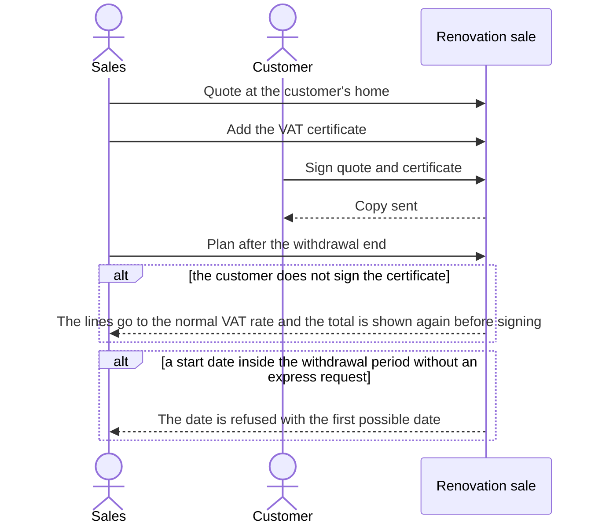

🏠 [Specs](../../../../README.md) › 🏷️ [Sectors](../../../README.md) › 🏗️ [SC01 Construction](../../README.md) ›
📝 [Use cases](../README.md) › 📝 [Use cases: FL-SC01-01 Win the work](README.md) ›
📝 UC-SC01-12 Sell renovation to consumers

# 📝 UC-SC01-12 Sell renovation to consumers

**Status:** ✅ specified

## Summary

Sales visits a private customer's home, quotes the renovation with the reduced VAT certificate, and schedules the works
after the consumer's withdrawal period.

## Personas

- [U03 Sales](../../../../01-users/personas/u03-sales.md)
- [U09 Customer](../../../../01-users/personas/u09-customer.md)

## Goal

A signed renovation quote at the right VAT rate, with the withdrawal right respected.

## Trigger

A private customer asks for a renovation.

## Frequency

Several a week in a renovation trade.

## Preconditions

- The SC01 sector pack is installed for the company,
  [UC-F14-02](../../../../02-functional/f14-plugin-store/use-cases/01-find-and-install/uc-f14-02-install-a-plugin-or-sector-pack.md),
  and its users have their roles,
  [UC-F1-06](../../../../02-functional/f01-administration/use-cases/04-edit-a-role/uc-f01-06-edit-a-role-and-its-record-rules.md).
- The customer is a consumer and the dwelling is over two years old for the reduced rate (the certificate says so).

## Postconditions

- **Success:** the quote and the VAT certificate are signed; the works are scheduled after the withdrawal period.
- **Failed:** the quote is refused or withdrawn; no works are planned, and a deposit taken from day 8 is refunded.

## Main flow

1. Sales builds the quote at the customer's home on the tablet on
   [S-SC01-12 Renovation sale](../../screens/01-win-the-work/s-sc01-12-renovation-sale.md) with lots and lines.
2. Sales adds the reduced VAT certificate for the customer to sign with the quote
   ([BR-SC01-05](../../business-rules/br-sc01-05-reduced-vat-needs-the-certificate.md)).
3. The customer signs both on the tablet; the withdrawal form is given and the withdrawal period starts
   ([BR-SC01-13](../../business-rules/br-sc01-13-consumer-works-off-premises.md)). No deposit can be asked for 7 days
   from the signature.
4. Sales sees the earliest start date, the day after the withdrawal period ends, and books the works in
   [S-SC01-03 Site planning](../../screens/02-prepare-the-site/s-sc01-03-site-planning.md).

## Alternative flows

- 3a. The customer asks in writing for works to start earlier: the express request is recorded and signed and the works
  can be planned before the end.
- 3b. The customer withdraws within the period: the quote is cancelled and a deposit taken from day 8 is refunded,
  [UC-F6-09](../../../../02-functional/f06-customers-and-sales/use-cases/03-invoice-and-get-paid/uc-f06-09-credit-note-and-refund.md).

## Error flows

- 3e. A deposit asked within 7 days of the signature: it is refused with the first day it may be taken.
- 2e. The customer does not sign the certificate: the lines go to the normal VAT rate and the total is shown again
  before signing.
- 4e. A start date inside the withdrawal period without an express request: the date is refused with the first possible
  date.
- Any step: a call to a service or an outside system fails: it is retried first
  ([BR-F3-32](../../../../02-functional/f03-assistant/business-rules/br-f03-32-retry-before-an-error.md)), then the
  error message pattern ([D122](../../../../06-decisions/ux/d122-error-message-standard.md)) says what failed; what was
  typed is kept.

## Business rules

- [BR-SC01-05 Reduced VAT needs the certificate](../../business-rules/br-sc01-05-reduced-vat-needs-the-certificate.md)
- [BR-SC01-13 Consumer works signed off premises](../../business-rules/br-sc01-13-consumer-works-off-premises.md)

## Entities

- [E-SC01-02 Quote lot](../../data/e-sc01-02-quote-lot.md)

## Permissions

The sales and customer roles; the record rules of their role and site apply,
[UC-F1-06](../../../../02-functional/f01-administration/use-cases/04-edit-a-role/uc-f01-06-edit-a-role-and-its-record-rules.md).

## Notifications

- The customer gets a copy of the signed quote, the certificate and the withdrawal form by email.

## Audit events

Every creation, change and state change of quote lot records, with who, when and the values before and after (T3).

## AI involvement

The AI assistant answers questions on the quote lot records of this use case, with links, and prepares them as drafts
the user confirms. It works within the user's rights,
[BR-F3-34](../../../../02-functional/f03-assistant/business-rules/br-f03-34-every-capability-is-reachable-from-the-assistant.md),
and never deletes or does anything irreversible without the user's confirmation,
[BR-F3-07](../../../../02-functional/f03-assistant/business-rules/br-f03-07-no-deletes-no-irreversible-acts.md).

## API, MCP and A2A exposure

Through the API and webhooks (T5) and the MCP and A2A gateway (T6), with the caller's rights,
[BR-F3-34](../../../../02-functional/f03-assistant/business-rules/br-f03-34-every-capability-is-reachable-from-the-assistant.md),
reading, creating and changing the records of this use case; nothing irreversible without a person's confirmation.

## Screens

- [S-SC01-12 Renovation sale](../../screens/01-win-the-work/s-sc01-12-renovation-sale.md)

## Flowchart

See [FL-SC01-01 Win the work](../../flows/fl-sc01-01-win-the-work.md#flowchart).

## Sequence diagram

## Acceptance criteria

1. **Given** the example construction company's renovation quote of 12,000 EUR at 10 % signed with its certificate off
   premises on 3 November **when** sales plans it **then** the earliest start offered is 18 November, after 14 days.
2. **Given** an express request signed on 10 November **when** the works are planned on 12 November **then** the express
   request is recorded and signed and the works can be planned before the end.
3. **Given** a 10 % quote of 12,000 EUR without certificate **when** the customer signs only the quote **then** the
   lines go to the normal VAT rate and the total is shown again before signing.
4. **Given** a quote signed off premises on 3 November **when** sales books the works on 10 November **then** the date
   is refused with the first possible date.
5. **Given** a quote signed off premises on 3 November **when** sales asks for a deposit on 7 November **then** it is
   refused and 11 November is offered as the first day.

## Non-functional notes

[D408](../../../../06-decisions/technical/d408-performance-and-profiles.md)'s targets
([performance](../../../../05-non-functional/performance.md)): 95 % of screens within 1 second; lists paged on the
server, the first page within 1 second; reports within 5 seconds or in the background. WCAG 2.2 AA and RGAA
([D46](../../../../06-decisions/ux/d46-accessibility-standard.md)).

## Regulatory references

Legal values from the France country pack:
[CR-FR-084 Reduced VAT on housing renovation](../../../../10-country-packs/france/tax-and-vat/cr-fr-084-renovation-reduced-vat.md),
[CR-FR-036 Consumer withdrawal right](../../../../10-country-packs/france/consumer/cr-fr-036-withdrawal-right.md):
14 days to withdraw, no payment for 7 days from the signature (Code de la consommation L221-10), and no withdrawal right
for urgent repair work the consumer expressly asked for (L221-28), as the owner chose ([D575](../../../../06-decisions/foundations/d575-answers-of-2026-11-27-on-the-last-open-points.md)).

## Related use cases

- [UC-SC01-02 Quote by lots and unit-price schedules](uc-sc01-02-quote-by-lots-and-unit-price-schedules.md)
- [UC-SC01-03 Plan the site](../02-prepare-the-site/uc-sc01-03-plan-the-site.md)

## Open questions

None.

---

⬅️ [UC-SC01-11](../05-hand-over-and-follow-up/uc-sc01-11-hand-over-the-as-built-file-and-follow-the-warranties.md) ·
⬆️ [Up](README.md) · ➡️ [UC-SC01-13](uc-sc01-13-answer-public-tenders-and-invoice-through-chorus-pro.md)
