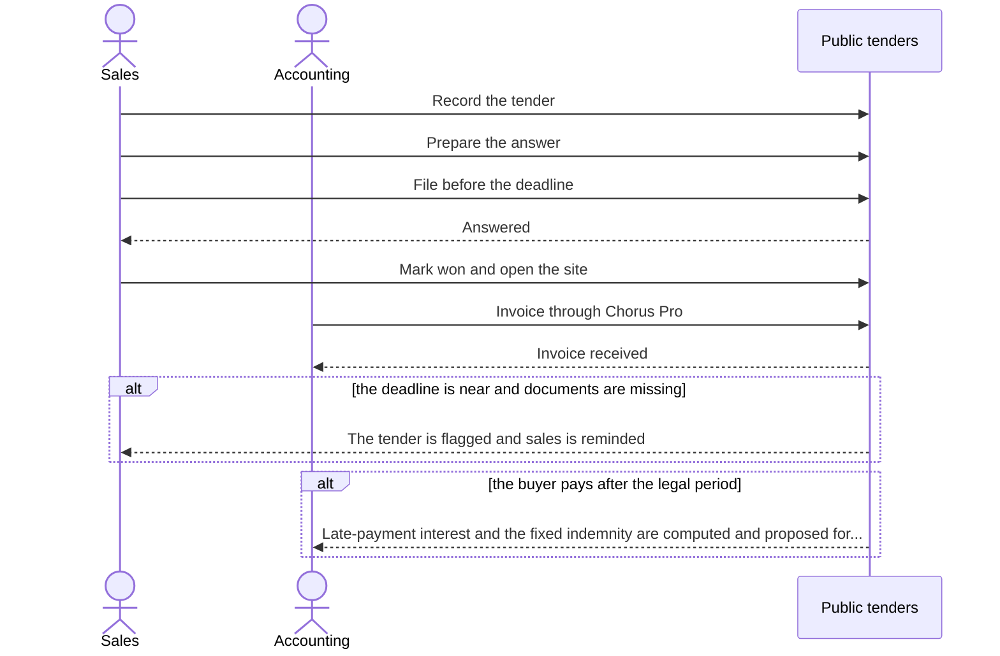

🏠 [Specs](../../../../README.md) › 🏷️ [Sectors](../../../README.md) › 🏗️ [SC01 Construction](../../README.md) ›
📝 [Use cases](../README.md) › 📝 [Use cases: FL-SC01-01 Win the work](README.md) ›
📝 UC-SC01-13 Answer public tenders and invoice through Chorus Pro

# 📝 UC-SC01-13 Answer public tenders and invoice through Chorus Pro

**Status:** ✅ specified

## Summary

Sales follows public tenders with their documents and deadlines, answers them, and once won, accounting invoices the
public buyer through Chorus Pro and follows the payment period.

## Personas

- [U03 Sales](../../../../01-users/personas/u03-sales.md)
- [U05 Accounting](../../../../01-users/personas/u05-accounting.md)

## Goal

Tenders answered on time and public invoices paid within the legal period.

## Trigger

A tender is published or found; a won tender is billed.

## Frequency

A few tenders a month; progress bills monthly on a public site.

## Preconditions

- The SC01 sector pack is installed for the company,
  [UC-F14-02](../../../../02-functional/f14-plugin-store/use-cases/01-find-and-install/uc-f14-02-install-a-plugin-or-sector-pack.md),
  and its users have their roles,
  [UC-F1-06](../../../../02-functional/f01-administration/use-cases/04-edit-a-role/uc-f01-06-edit-a-role-and-its-record-rules.md).
- The public buyer's references are known: SIRET, service code, commitment number,
  [UC-F6-19](../../../../02-functional/f06-customers-and-sales/use-cases/07-special-invoicing/uc-f06-19-invoice-a-public-buyer-through-chorus-pro.md).

## Postconditions

- **Success:** the answer is filed before the deadline; once won, the invoices reach Chorus Pro and their payment is
  followed.
- **Failed:** the tender is lost or not answered; it is closed with its reason.

## Main flow

1. Sales records the tender on [S-SC01-13 Public tenders](../../screens/01-win-the-work/s-sc01-13-public-tenders.md):
   buyer, reference, lots, deadline and documents asked.
2. Sales builds the priced schedule as a quote by lots
   ([UC-SC01-02](uc-sc01-02-quote-by-lots-and-unit-price-schedules.md)) and gathers the administrative documents.
3. Sales files the answer on the buyer's platform and records it; the tender becomes answered.
4. Once won, sales marks the tender won and opens the site ([UC-SC01-01](uc-sc01-01-open-a-site.md)).
5. Accounting sends each progress bill through Chorus Pro with the buyer's references,
   [UC-F6-19](../../../../02-functional/f06-customers-and-sales/use-cases/07-special-invoicing/uc-f06-19-invoice-a-public-buyer-through-chorus-pro.md),
   and follows the payment period.

## Alternative flows

- 2a. A joint tender with a partner: the partner and its share are recorded; each invoices its own part.
- 5a. A subcontractor paid directly by the buyer: its amount is left out of the company's bill and shown apart
  ([UC-SC01-07](../04-bill-and-subcontract/uc-sc01-07-subcontract.md)).

## Error flows

- 3e. The deadline is near and documents are missing: the tender is flagged and sales is reminded.
- 5e. The buyer pays after the legal period: late-payment interest and the fixed indemnity are computed and proposed for
  invoicing ([BR-SC01-12](../../business-rules/br-sc01-12-public-invoices-through-chorus-pro.md)).
- Any step: a call to a service or an outside system fails: it is retried first
  ([BR-F3-32](../../../../02-functional/f03-assistant/business-rules/br-f03-32-retry-before-an-error.md)), then the
  error message pattern ([D122](../../../../06-decisions/ux/d122-error-message-standard.md)) says what failed; what was
  typed is kept.

## Business rules

- [BR-SC01-12 Public invoices through Chorus Pro](../../business-rules/br-sc01-12-public-invoices-through-chorus-pro.md)
- [BR-F6-12 Public invoices go through Chorus Pro with their references](../../../../02-functional/f06-customers-and-sales/business-rules/br-f06-12-public-invoices-go-through-chorus-pro-with-their-references.md)

## Entities

- [E-SC01-12 Public tender](../../data/e-sc01-12-public-tender.md)
- [E-SC01-06 Progress bill](../../data/e-sc01-06-progress-bill.md)

## Permissions

The sales and accounting roles; the record rules of their role and site apply,
[UC-F1-06](../../../../02-functional/f01-administration/use-cases/04-edit-a-role/uc-f01-06-edit-a-role-and-its-record-rules.md).

## Notifications

- Sales is reminded before each tender deadline.
- Accounting is told when Chorus Pro rejects or the buyer pays an invoice.

## Audit events

Every creation, change and state change of public tender, progress bill records, with who, when and the values before
and after (T3).

## AI involvement

The AI assistant answers questions on the public tender, progress bill records of this use case, with links, and
prepares them as drafts the user confirms. It works within the user's rights,
[BR-F3-34](../../../../02-functional/f03-assistant/business-rules/br-f03-34-every-capability-is-reachable-from-the-assistant.md),
and never deletes or does anything irreversible without the user's confirmation,
[BR-F3-07](../../../../02-functional/f03-assistant/business-rules/br-f03-07-no-deletes-no-irreversible-acts.md).

## API, MCP and A2A exposure

Through the API and webhooks (T5) and the MCP and A2A gateway (T6), with the caller's rights,
[BR-F3-34](../../../../02-functional/f03-assistant/business-rules/br-f03-34-every-capability-is-reachable-from-the-assistant.md),
reading, creating and changing the records of this use case; nothing irreversible without a person's confirmation.

## Screens

- [S-SC01-13 Public tenders](../../screens/01-win-the-work/s-sc01-13-public-tenders.md)

## Flowchart

See [FL-SC01-01 Win the work](../../flows/fl-sc01-01-win-the-work.md#flowchart).

## Sequence diagram

## Acceptance criteria

1. **Given** the example construction company's tender 2026-118 for the Town of Lyon won **when** accounting sends
   progress bill 3 **then** it is filed in Chorus Pro with the buyer's SIRET, service code and commitment number.
2. **Given** tender 2026-118 for the Town of Lyon due on 15 December with one document missing **when** it is 12
   December **then** the tender is flagged and sales is reminded.
3. **Given** a public invoice unpaid after its legal period **when** the period ends **then** late-payment interest and
   the fixed indemnity are computed and proposed for invoicing
   ([BR-SC01-12](../../business-rules/br-sc01-12-public-invoices-through-chorus-pro.md)).

## Non-functional notes

[D408](../../../../06-decisions/technical/d408-performance-and-profiles.md)'s targets
([performance](../../../../05-non-functional/performance.md)): 95 % of screens within 1 second; lists paged on the
server, the first page within 1 second; reports within 5 seconds or in the background. WCAG 2.2 AA and RGAA
([D46](../../../../06-decisions/ux/d46-accessibility-standard.md)).

## Regulatory references

Legal values from the France country pack:
[CR-FR-091 Public contracts: payment period and Chorus Pro](../../../../10-country-packs/france/invoicing/cr-fr-091-public-contracts-payment-and-chorus-pro.md),
[CR-FR-016 Electronic invoicing](../../../../10-country-packs/france/invoicing/cr-fr-016-electronic-invoicing.md).

## Related use cases

- [UC-SC01-02 Quote by lots and unit-price schedules](uc-sc01-02-quote-by-lots-and-unit-price-schedules.md)
- [UC-SC01-06 Bill progress with the retention guarantee](../04-bill-and-subcontract/uc-sc01-06-bill-progress-with-the-retention-guarantee.md)
- [UC-SC01-07 Subcontract](../04-bill-and-subcontract/uc-sc01-07-subcontract.md)

## Open questions

None.

---

⬅️ [UC-SC01-12 Sell renovation to consumers](uc-sc01-12-sell-renovation-to-consumers.md) · ⬆️ [Up](README.md) ·
➡️ [UC-SC01-14 Follow site profitability](../04-bill-and-subcontract/uc-sc01-14-follow-site-profitability.md)
