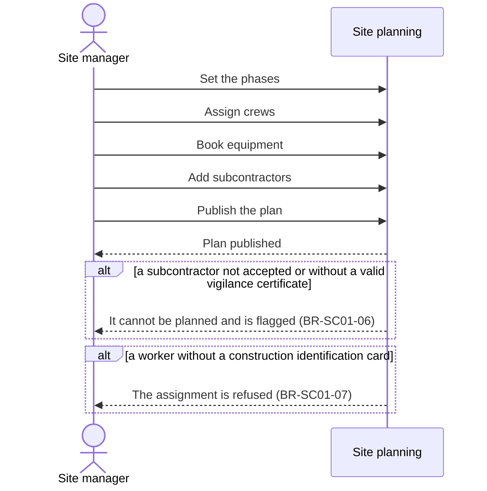

🏠 [Specs](../../../../README.md) › 🏷️ [Sectors](../../../README.md) › 🏗️ [SC01 Construction](../../README.md) ›
📝 [Use cases](../README.md) › 📝 [Use cases: FL-SC01-02 Prepare the site](README.md) › 📝 UC-SC01-03 Plan the site

# 📝 UC-SC01-03 Plan the site

**Status:** ✅ specified

## Summary

The site manager splits the site into phases and puts crews, equipment and subcontractors on a timeline, then publishes
the plan to the team.

## Personas

- [U22 Site manager](../../../../01-users/personas/u22-site-manager.md)

## Goal

A plan every crew member and subcontractor can follow, with no one booked twice.

## Trigger

A site is opened, or its dates change.

## Frequency

At the start of each site, then weekly.

## Preconditions

- The SC01 sector pack is installed for the company,
  [UC-F14-02](../../../../02-functional/f14-plugin-store/use-cases/01-find-and-install/uc-f14-02-install-a-plugin-or-sector-pack.md),
  and its users have their roles,
  [UC-F1-06](../../../../02-functional/f01-administration/use-cases/04-edit-a-role/uc-f01-06-edit-a-role-and-its-record-rules.md).
- The site is opened ([UC-SC01-01](../01-win-the-work/uc-sc01-01-open-a-site.md)).

## Postconditions

- **Success:** the phases are planned and published; each person sees their days on the phone.
- **Failed:** the plan stays a draft; the team keeps the last published one.

## Main flow

1. The site manager sets the phases on
   [S-SC01-03 Site planning](../../screens/02-prepare-the-site/s-sc01-03-site-planning.md): foundations, walls, roof,
   finishing, each with its dates and lot.
2. The site manager assigns workers to each phase; simple-ERP shows each one's other sites and leave,
   [UC-F9-15](../../../../02-functional/f09-hr-and-projects/use-cases/06-plan-and-deliver-work/uc-f09-15-plan-shifts.md).
3. The site manager books the equipment the phase needs ([UC-SC01-08](uc-sc01-08-rent-and-track-equipment-on-sites.md)).
4. The site manager adds the subcontractors with their dates; only accepted ones can be planned
   ([BR-SC01-06](../../business-rules/br-sc01-06-subcontractor-documents-before-work.md)).
5. The site manager publishes; each person gets their days.

## Alternative flows

- 1a. A weather delay: the site manager moves the phase; the following phases move with it and the people concerned are
  told.
- 2a. A crew member already on another site: the conflict is shown and the site manager chooses.

## Error flows

- 4e. A subcontractor not accepted or without a valid vigilance certificate: it cannot be planned and is flagged
  ([BR-SC01-06](../../business-rules/br-sc01-06-subcontractor-documents-before-work.md)).
- 2e. A worker without a construction identification card: the assignment is refused
  ([BR-SC01-07](../../business-rules/br-sc01-07-site-workers-have-their-card.md)).
- Any step: a call to a service or an outside system fails: it is retried first
  ([BR-F3-32](../../../../02-functional/f03-assistant/business-rules/br-f03-32-retry-before-an-error.md)), then the
  error message pattern ([D122](../../../../06-decisions/ux/d122-error-message-standard.md)) says what failed; what was
  typed is kept.

## Business rules

- [BR-SC01-06 Subcontractor documents before work](../../business-rules/br-sc01-06-subcontractor-documents-before-work.md)
- [BR-SC01-07 Site workers have their card](../../business-rules/br-sc01-07-site-workers-have-their-card.md)
- [BR-SC01-08 Declarations before digging](../../business-rules/br-sc01-08-declarations-before-digging.md)

## Entities

- [E-SC01-03 Site phase](../../data/e-sc01-03-site-phase.md)
- [E-SC01-08 Equipment assignment](../../data/e-sc01-08-equipment-assignment.md)

## Permissions

The site manager roles; the record rules of their role and site apply,
[UC-F1-06](../../../../02-functional/f01-administration/use-cases/04-edit-a-role/uc-f01-06-edit-a-role-and-its-record-rules.md).

## Notifications

- Each person gets their planned days, and any change, on the phone.

## Audit events

Every creation, change and state change of site phase, equipment assignment records, with who, when and the values
before and after (T3).

## AI involvement

The AI assistant answers questions on the site phase, equipment assignment records of this use case, with links, and
prepares them as drafts the user confirms. It works within the user's rights,
[BR-F3-34](../../../../02-functional/f03-assistant/business-rules/br-f03-34-every-capability-is-reachable-from-the-assistant.md),
and never deletes or does anything irreversible without the user's confirmation,
[BR-F3-07](../../../../02-functional/f03-assistant/business-rules/br-f03-07-no-deletes-no-irreversible-acts.md).

## API, MCP and A2A exposure

Through the API and webhooks (T5) and the MCP and A2A gateway (T6), with the caller's rights,
[BR-F3-34](../../../../02-functional/f03-assistant/business-rules/br-f03-34-every-capability-is-reachable-from-the-assistant.md),
reading, creating and changing the records of this use case; nothing irreversible without a person's confirmation.

## Screens

- [S-SC01-03 Site planning](../../screens/02-prepare-the-site/s-sc01-03-site-planning.md)

## Flowchart

See [FL-SC01-02 Prepare the site](../../flows/fl-sc01-02-prepare-the-site.md#flowchart).

## Sequence diagram

## Acceptance criteria

1. **Given** the example construction company's site S-14 with phase foundations from 2 to 20 December, 4 workers and
   digger D2 **when** the plan is published **then** each of the 4 workers sees S-14 foundations on each of those days.
2. **Given** rain on 3 December delaying foundations **when** the phase is moved by 2 days **then** the site manager
   moves the phase; the following phases move with it and the people concerned are told.
3. **Given** Elec Pro with a vigilance certificate from April **when** it is planned in December **then** it cannot be
   planned and is flagged ([BR-SC01-06](../../business-rules/br-sc01-06-subcontractor-documents-before-work.md)).
4. **Given** worker P. L. without a declared card **when** he is assigned to foundations **then** the assignment is
   refused ([BR-SC01-07](../../business-rules/br-sc01-07-site-workers-have-their-card.md)).

## Non-functional notes

[D408](../../../../06-decisions/technical/d408-performance-and-profiles.md)'s targets
([performance](../../../../05-non-functional/performance.md)): 95 % of screens within 1 second; lists paged on the
server, the first page within 1 second; reports within 5 seconds or in the background. WCAG 2.2 AA and RGAA
([D46](../../../../06-decisions/ux/d46-accessibility-standard.md)).

## Regulatory references

Legal values from the France country pack:
[CR-FR-085 Vigilance over subcontractors](../../../../10-country-packs/france/construction/cr-fr-085-subcontractor-vigilance.md),
[CR-FR-087 Construction identification card (carte BTP)](../../../../10-country-packs/france/construction/cr-fr-087-btp-identification-card.md).

## Related use cases

- [UC-SC01-08 Rent and track equipment on sites](uc-sc01-08-rent-and-track-equipment-on-sites.md)
- [UC-SC01-09 Declare works near networks and keep the safety documents](uc-sc01-09-declare-works-near-networks-and-keep-the-safety-documents.md)
- [UC-SC01-04 Record time and materials per site](../03-run-the-site/uc-sc01-04-record-time-and-materials-per-site.md)

## Open questions

None.

---

⬅️ [UC-SC01-02](../01-win-the-work/uc-sc01-02-quote-by-lots-and-unit-price-schedules.md) · ⬆️ [Up](README.md) ·
➡️ [UC-SC01-04](../03-run-the-site/uc-sc01-04-record-time-and-materials-per-site.md)
