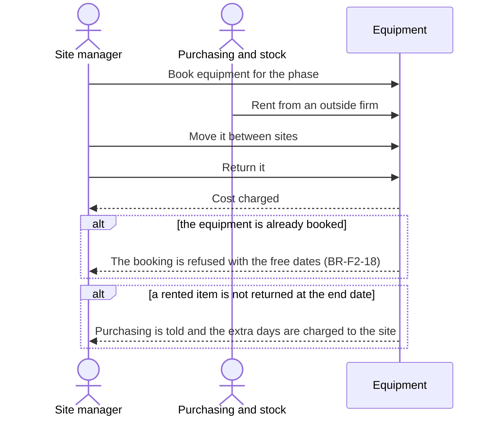

🏠 [Specs](../../../../README.md) › 🏷️ [Sectors](../../../README.md) › 🏗️ [SC01 Construction](../../README.md) ›
📝 [Use cases](../README.md) › 📝 [Use cases: FL-SC01-02 Prepare the site](README.md) ›
📝 UC-SC01-08 Rent and track equipment on sites

# 📝 UC-SC01-08 Rent and track equipment on sites

**Status:** ✅ specified

## Summary

The site manager books the company's own or rented equipment for a site's phase through the booking engine; purchasing
rents from outside firms; each day of use is charged to the site.

## Personas

- [U22 Site manager](../../../../01-users/personas/u22-site-manager.md)
- [U04 Purchasing and stock](../../../../01-users/personas/u04-purchasing.md)

## Goal

Equipment where it is needed, never booked twice, its cost on the right site.

## Trigger

A phase needs equipment.

## Frequency

Weekly on each site.

## Preconditions

- The SC01 sector pack is installed for the company,
  [UC-F14-02](../../../../02-functional/f14-plugin-store/use-cases/01-find-and-install/uc-f14-02-install-a-plugin-or-sector-pack.md),
  and its users have their roles,
  [UC-F1-06](../../../../02-functional/f01-administration/use-cases/04-edit-a-role/uc-f01-06-edit-a-role-and-its-record-rules.md).
- Each piece of own equipment is a bookable resource,
  [UC-F2-18](../../../../02-functional/f02-no-code-configuration/use-cases/08-views-and-bookings/uc-f02-18-make-a-record-type-bookable.md).

## Postconditions

- **Success:** the equipment is booked for the dates and its daily cost is charged to the site and lot.
- **Failed:** nothing is booked; the phase shows the missing equipment.

## Main flow

1. The site manager books the equipment on
   [S-SC01-08 Equipment](../../screens/02-prepare-the-site/s-sc01-08-equipment.md) through the booking engine,
   [UC-F2-19](../../../../02-functional/f02-no-code-configuration/use-cases/08-views-and-bookings/uc-f02-19-book-a-resource.md),
   for the phase's dates.
2. If none is free, purchasing orders a rental from a hire firm,
   [UC-F7-02](../../../../02-functional/f07-purchasing-and-stock/use-cases/01-procure/uc-f07-02-order-from-a-supplier.md),
   with its daily price.
3. The site manager records a move to another site; the booking follows.
4. The site manager records the return; the days used are charged to the site and lot
   ([BR-SC01-09](../../business-rules/br-sc01-09-time-and-materials-per-site.md)).

## Alternative flows

- 2a. A rental extended: the hire order and the booking are extended together.

## Error flows

- 1e. The equipment is already booked: the booking is refused with the free dates,
  [BR-F2-18](../../../../02-functional/f02-no-code-configuration/business-rules/br-f02-18-one-booking-per-resource-and-slot.md).
- 4e. A rented item is not returned at the end date: purchasing is told and the extra days are charged to the site.
- Any step: a call to a service or an outside system fails: it is retried first
  ([BR-F3-32](../../../../02-functional/f03-assistant/business-rules/br-f03-32-retry-before-an-error.md)), then the
  error message pattern ([D122](../../../../06-decisions/ux/d122-error-message-standard.md)) says what failed; what was
  typed is kept.

## Business rules

- [BR-SC01-09 Time and materials per site](../../business-rules/br-sc01-09-time-and-materials-per-site.md)
- [BR-F2-18 One booking per resource and slot](../../../../02-functional/f02-no-code-configuration/business-rules/br-f02-18-one-booking-per-resource-and-slot.md)

## Entities

- [E-SC01-08 Equipment assignment](../../data/e-sc01-08-equipment-assignment.md)

## Permissions

The site manager and purchasing and stock roles; the record rules of their role and site apply,
[UC-F1-06](../../../../02-functional/f01-administration/use-cases/04-edit-a-role/uc-f01-06-edit-a-role-and-its-record-rules.md).

## Notifications

- Purchasing is told when a rental is due back.

## Audit events

Every creation, change and state change of equipment assignment records, with who, when and the values before and after
(T3).

## AI involvement

The AI assistant answers questions on the equipment assignment records of this use case, with links, and prepares them
as drafts the user confirms. It works within the user's rights,
[BR-F3-34](../../../../02-functional/f03-assistant/business-rules/br-f03-34-every-capability-is-reachable-from-the-assistant.md),
and never deletes or does anything irreversible without the user's confirmation,
[BR-F3-07](../../../../02-functional/f03-assistant/business-rules/br-f03-07-no-deletes-no-irreversible-acts.md).

## API, MCP and A2A exposure

Through the API and webhooks (T5) and the MCP and A2A gateway (T6), with the caller's rights,
[BR-F3-34](../../../../02-functional/f03-assistant/business-rules/br-f03-34-every-capability-is-reachable-from-the-assistant.md),
reading, creating and changing the records of this use case; nothing irreversible without a person's confirmation.

## Screens

- [S-SC01-08 Equipment](../../screens/02-prepare-the-site/s-sc01-08-equipment.md)

## Flowchart

See [FL-SC01-02 Prepare the site](../../flows/fl-sc01-02-prepare-the-site.md#flowchart).

## Sequence diagram

## Acceptance criteria

1. **Given** the example construction company's rented digger D2 on site S-14 from 2 to 6 December at 320 EUR a day
   **when** it is returned on 6 December **then** 1,600 EUR is charged to S-14 for 5 days.
2. **Given** digger D2 rented 2 to 6 December at 320 EUR a day **when** it is extended to 9 December **then** the hire
   order and the booking are extended together.
3. **Given** digger D2 booked on S-14 from 2 to 6 December **when** another site books it on 4 December **then** the
   booking is refused with the free dates,
   [BR-F2-18](../../../../02-functional/f02-no-code-configuration/business-rules/br-f02-18-one-booking-per-resource-and-slot.md).

## Non-functional notes

[D408](../../../../06-decisions/technical/d408-performance-and-profiles.md)'s targets
([performance](../../../../05-non-functional/performance.md)): 95 % of screens within 1 second; lists paged on the
server, the first page within 1 second; reports within 5 seconds or in the background. WCAG 2.2 AA and RGAA
([D46](../../../../06-decisions/ux/d46-accessibility-standard.md)).

## Regulatory references

None specific to this use case; the sector's legal rules are listed in [SC01 regulatory](../../regulatory.md).

## Related use cases

- [UC-SC01-03 Plan the site](uc-sc01-03-plan-the-site.md)
- [UC-SC01-14 Follow site profitability](../04-bill-and-subcontract/uc-sc01-14-follow-site-profitability.md)

## Open questions

None.

---

⬅️ [UC-SC01-07 Subcontract](../04-bill-and-subcontract/uc-sc01-07-subcontract.md) · ⬆️ [Up](README.md) ·
➡️ [UC-SC01-09](uc-sc01-09-declare-works-near-networks-and-keep-the-safety-documents.md)
