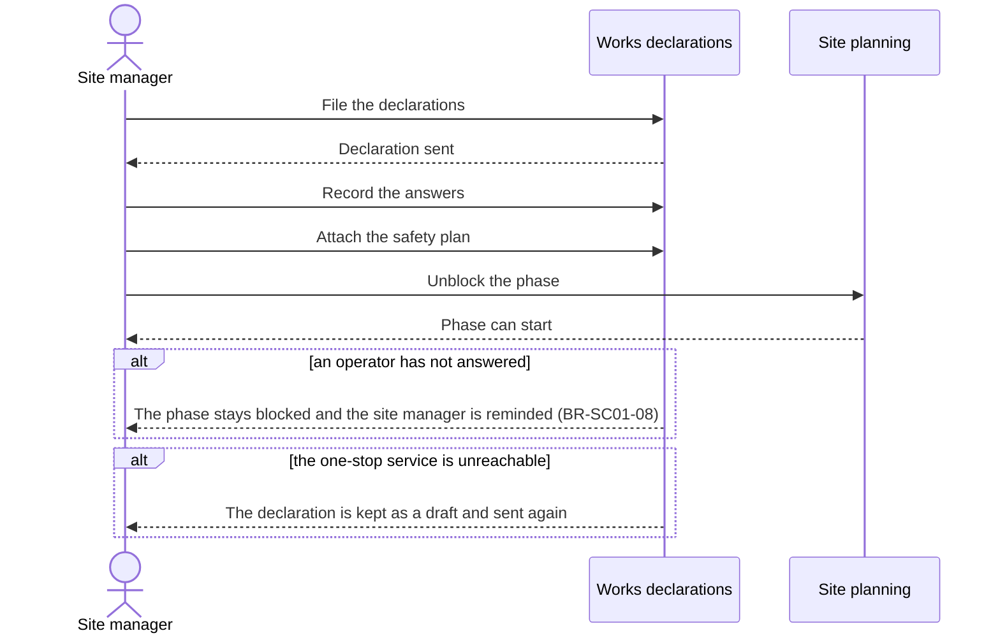

🏠 [Specs](../../../../README.md) › 🏷️ [Sectors](../../../README.md) › 🏗️ [SC01 Construction](../../README.md) ›
📝 [Use cases](../README.md) › 📝 [Use cases: FL-SC01-02 Prepare the site](README.md) ›
📝 UC-SC01-09 Declare works near networks and keep the safety documents

# 📝 UC-SC01-09 Declare works near networks and keep the safety documents

**Status:** ✅ specified

## Summary

Before digging, the site manager files the works declarations with the network operators, records their answers, and
keeps the safety plan and documents in the site folder.

## Personas

- [U22 Site manager](../../../../01-users/personas/u22-site-manager.md)

## Goal

No digging phase starts without the operators' answers and the safety documents.

## Trigger

A phase digs or works near networks.

## Frequency

Once per site with groundwork, more if the works change.

## Preconditions

- The SC01 sector pack is installed for the company,
  [UC-F14-02](../../../../02-functional/f14-plugin-store/use-cases/01-find-and-install/uc-f14-02-install-a-plugin-or-sector-pack.md),
  and its users have their roles,
  [UC-F1-06](../../../../02-functional/f01-administration/use-cases/04-edit-a-role/uc-f01-06-edit-a-role-and-its-record-rules.md).
- The site and its digging phases are planned ([UC-SC01-03](uc-sc01-03-plan-the-site.md)).

## Postconditions

- **Success:** every operator's answer is recorded and the phase can start.
- **Failed:** the phase stays blocked until the answers are recorded.

## Main flow

1. The site manager files the declarations on
   [S-SC01-09 Works declarations](../../screens/02-prepare-the-site/s-sc01-09-works-declarations.md) through the
   national one-stop service connector (T12).
2. As operators answer, the site manager records each answer with its plans and requirements.
3. The site manager attaches the safety plan and the site register to the site folder.
4. Once every answer is in, the digging phase is unblocked on
   [S-SC01-03 Site planning](../../screens/02-prepare-the-site/s-sc01-03-site-planning.md)
   ([BR-SC01-08](../../business-rules/br-sc01-08-declarations-before-digging.md)).

## Alternative flows

- 1a. Urgent works: the urgent declaration is recorded and the phase starts with the urgency noted.

## Error flows

- 2e. An operator has not answered: the phase stays blocked and the site manager is reminded
  ([BR-SC01-08](../../business-rules/br-sc01-08-declarations-before-digging.md)).
- 1e. The one-stop service is unreachable: the declaration is kept as a draft and sent again.
- Any step: a call to a service or an outside system fails: it is retried first
  ([BR-F3-32](../../../../02-functional/f03-assistant/business-rules/br-f03-32-retry-before-an-error.md)), then the
  error message pattern ([D122](../../../../06-decisions/ux/d122-error-message-standard.md)) says what failed; what was
  typed is kept.

## Business rules

- [BR-SC01-08 Declarations before digging](../../business-rules/br-sc01-08-declarations-before-digging.md)

## Entities

- [E-SC01-09 Works declaration](../../data/e-sc01-09-works-declaration.md)
- [E-SC01-14 Site safety document](../../data/e-sc01-14-site-safety-document.md)

## Permissions

The site manager roles; the record rules of their role and site apply,
[UC-F1-06](../../../../02-functional/f01-administration/use-cases/04-edit-a-role/uc-f01-06-edit-a-role-and-its-record-rules.md).

## Notifications

- The site manager is reminded of missing answers before the phase's start.

## Audit events

Every creation, change and state change of works declaration records, with who, when and the values before and after
(T3).

## AI involvement

The AI assistant answers questions on the works declaration records of this use case, with links, and prepares them as
drafts the user confirms. It works within the user's rights,
[BR-F3-34](../../../../02-functional/f03-assistant/business-rules/br-f03-34-every-capability-is-reachable-from-the-assistant.md),
and never deletes or does anything irreversible without the user's confirmation,
[BR-F3-07](../../../../02-functional/f03-assistant/business-rules/br-f03-07-no-deletes-no-irreversible-acts.md).

## API, MCP and A2A exposure

Through the API and webhooks (T5) and the MCP and A2A gateway (T6), with the caller's rights,
[BR-F3-34](../../../../02-functional/f03-assistant/business-rules/br-f03-34-every-capability-is-reachable-from-the-assistant.md),
reading, creating and changing the records of this use case; nothing irreversible without a person's confirmation.

## Screens

- [S-SC01-09 Works declarations](../../screens/02-prepare-the-site/s-sc01-09-works-declarations.md)
- [S-SC01-03 Site planning](../../screens/02-prepare-the-site/s-sc01-03-site-planning.md)

## Flowchart

See [FL-SC01-02 Prepare the site](../../flows/fl-sc01-02-prepare-the-site.md#flowchart).

## Sequence diagram

## Acceptance criteria

1. **Given** the example construction company's site S-14 with 4 of 4 answers recorded **when** the site manager opens
   the plan **then** the foundations phase can start.
2. **Given** a burst pipe repaired the same day **when** the site manager records an urgent declaration **then** the
   urgent declaration is recorded and the phase starts with the urgency noted.
3. **Given** 3 answers of 4 received for the DICT sent on 20 November **when** foundations are due to start on 2
   December **then** the phase stays blocked and the site manager is reminded
   ([BR-SC01-08](../../business-rules/br-sc01-08-declarations-before-digging.md)).

## Non-functional notes

[D408](../../../../06-decisions/technical/d408-performance-and-profiles.md)'s targets
([performance](../../../../05-non-functional/performance.md)): 95 % of screens within 1 second; lists paged on the
server, the first page within 1 second; reports within 5 seconds or in the background. WCAG 2.2 AA and RGAA
([D46](../../../../06-decisions/ux/d46-accessibility-standard.md)).

## Regulatory references

Legal values from the France country pack:
[CR-FR-089 Works near networks (DT-DICT)](../../../../10-country-packs/france/construction/cr-fr-089-works-near-networks.md).

## Related use cases

- [UC-SC01-03 Plan the site](uc-sc01-03-plan-the-site.md)

## Open questions

None.

---

⬅️ [UC-SC01-08 Rent and track equipment on sites](uc-sc01-08-rent-and-track-equipment-on-sites.md) ·
⬆️ [Up](README.md) ·
➡️ [UC-SC01-10](../05-hand-over-and-follow-up/uc-sc01-10-accept-the-works-with-reservations-and-lift-them.md)
