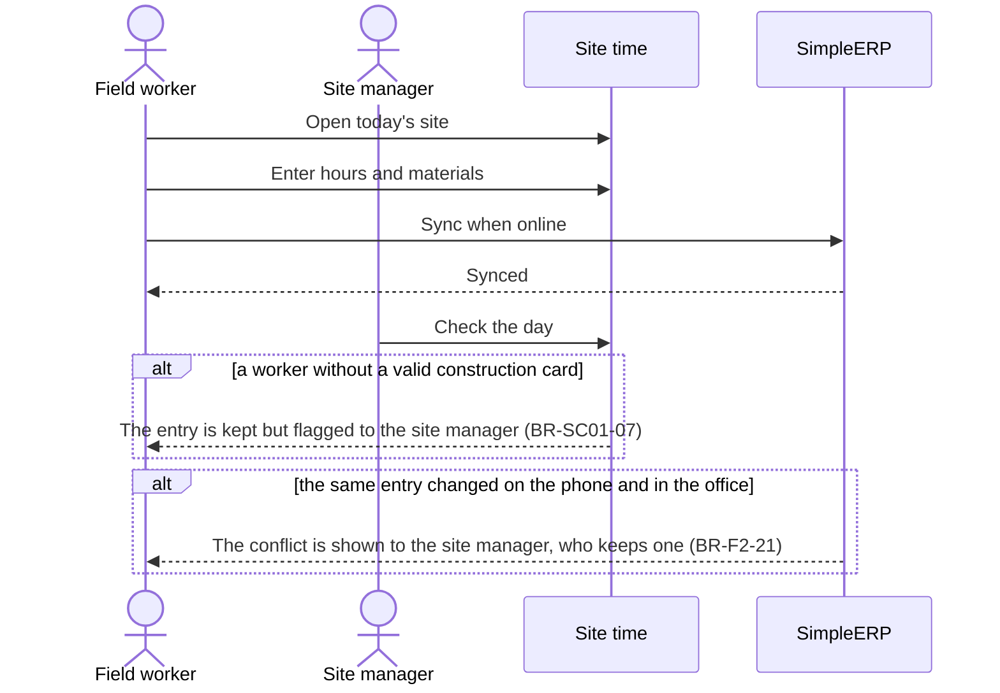

🏠 [Specs](../../../../README.md) › 🏷️ [Sectors](../../../README.md) › 🏗️ [SC01 Construction](../../README.md) ›
📝 [Use cases](../README.md) › 📝 [Use cases: FL-SC01-03 Run the site](README.md) ›
📝 UC-SC01-04 Record time and materials per site

# 📝 UC-SC01-04 Record time and materials per site

**Status:** ✅ specified

## Summary

Field workers record their hours, materials and photos per site and lot on the phone, offline when needed, through the
offline phone forms; the site manager checks them.

## Personas

- [U14 Field worker](../../../../01-users/personas/u14-field-worker.md)
- [U22 Site manager](../../../../01-users/personas/u22-site-manager.md)

## Goal

Every hour and material charged to a site and lot, even without network.

## Trigger

The end of a working day or the use of materials.

## Frequency

Daily for every worker on a site.

## Preconditions

- The SC01 sector pack is installed for the company,
  [UC-F14-02](../../../../02-functional/f14-plugin-store/use-cases/01-find-and-install/uc-f14-02-install-a-plugin-or-sector-pack.md),
  and its users have their roles,
  [UC-F1-06](../../../../02-functional/f01-administration/use-cases/04-edit-a-role/uc-f01-06-edit-a-role-and-its-record-rules.md).
- The worker is planned on the site ([UC-SC01-03](../02-prepare-the-site/uc-sc01-03-plan-the-site.md)).
- The time form is set to work offline,
  [UC-F2-21](../../../../02-functional/f02-no-code-configuration/use-cases/09-portals-and-offline-forms/uc-f02-21-make-a-phone-form-work-offline.md).

## Postconditions

- **Success:** the entries are synced, checked by the site manager and charged to the site and lot.
- **Failed:** the entries wait on the phone until the network is back; nothing is lost.

## Main flow

1. The field worker opens today's site on [S-SC01-04 Site time](../../screens/03-run-the-site/s-sc01-04-site-time.md) on
   the phone, even without network,
   [UC-F2-22](../../../../02-functional/f02-no-code-configuration/use-cases/09-portals-and-offline-forms/uc-f02-22-fill-a-form-offline-on-the-phone.md).
2. The field worker enters hours per lot and the materials used, with photos.
3. The phone syncs the entries in order when the network is back,
   [BR-F2-21](../../../../02-functional/f02-no-code-configuration/business-rules/br-f02-21-offline-forms-keep-only-what-is-needed-and-sync-in-order.md).
4. The site manager checks the crew's day and validates it; validated hours go to timesheets,
   [UC-F9-16](../../../../02-functional/f09-hr-and-projects/use-cases/03-time/uc-f09-16-record-and-validate-timesheets.md),
   and pay inputs,
   [UC-F13-03](../../../../02-functional/f13-payroll/use-cases/02-monthly-pay-run/uc-f13-03-collect-pay-inputs-from-f9.md).

## Alternative flows

- 2a. The foreman enters for the team: one entry per worker is created from the team's hours.
- 2b. Materials taken from the van's stock: the van's stock goes down,
  [UC-F7-05](../../../../02-functional/f07-purchasing-and-stock/use-cases/03-replenish/uc-f07-05-replenish-stock.md).

## Error flows

- 2e. A worker without a valid construction card: the entry is kept but flagged to the site manager
  ([BR-SC01-07](../../business-rules/br-sc01-07-site-workers-have-their-card.md)).
- 3e. The same entry changed on the phone and in the office: the conflict is shown to the site manager, who keeps one,
  [BR-F2-21](../../../../02-functional/f02-no-code-configuration/business-rules/br-f02-21-offline-forms-keep-only-what-is-needed-and-sync-in-order.md).
- Any step: a call to a service or an outside system fails: it is retried first
  ([BR-F3-32](../../../../02-functional/f03-assistant/business-rules/br-f03-32-retry-before-an-error.md)), then the
  error message pattern ([D122](../../../../06-decisions/ux/d122-error-message-standard.md)) says what failed; what was
  typed is kept.

## Business rules

- [BR-SC01-09 Time and materials per site](../../business-rules/br-sc01-09-time-and-materials-per-site.md)
- [BR-SC01-07 Site workers have their card](../../business-rules/br-sc01-07-site-workers-have-their-card.md)
- [BR-SC01-15 Leave through the fund](../../business-rules/br-sc01-15-leave-through-the-fund.md)
- [BR-F2-21 Offline forms keep only what is needed and sync in order](../../../../02-functional/f02-no-code-configuration/business-rules/br-f02-21-offline-forms-keep-only-what-is-needed-and-sync-in-order.md)

## Entities

- [E-SC01-04 Site time and material entry](../../data/e-sc01-04-site-time-and-material-entry.md)

## Permissions

The field worker and site manager roles; the record rules of their role and site apply,
[UC-F1-06](../../../../02-functional/f01-administration/use-cases/04-edit-a-role/uc-f01-06-edit-a-role-and-its-record-rules.md).

## Notifications

- The site manager is told when a day is waiting for validation.

## Audit events

Every creation, change and state change of site time and material entry records, with who, when and the values before
and after (T3).

## AI involvement

The AI assistant answers questions on the site time and material entry records of this use case, with links, and
prepares them as drafts the user confirms. It works within the user's rights,
[BR-F3-34](../../../../02-functional/f03-assistant/business-rules/br-f03-34-every-capability-is-reachable-from-the-assistant.md),
and never deletes or does anything irreversible without the user's confirmation,
[BR-F3-07](../../../../02-functional/f03-assistant/business-rules/br-f03-07-no-deletes-no-irreversible-acts.md).

## API, MCP and A2A exposure

Through the API and webhooks (T5) and the MCP and A2A gateway (T6), with the caller's rights,
[BR-F3-34](../../../../02-functional/f03-assistant/business-rules/br-f03-34-every-capability-is-reachable-from-the-assistant.md),
reading, creating and changing the records of this use case; nothing irreversible without a person's confirmation.

## Screens

- [S-SC01-04 Site time](../../screens/03-run-the-site/s-sc01-04-site-time.md)

## Flowchart

See [FL-SC01-03 Run the site](../../flows/fl-sc01-03-run-the-site.md#flowchart).

## Sequence diagram

## Acceptance criteria

1. **Given** the example construction company's worker P. L. on site S-14 with no network **when** he enters 8 h on lot
   2 and 1 m3 of concrete **then** the entry is kept on the phone, marked to sync.
2. **Given** that entry kept offline **when** the network is back **then** it syncs and S-14 lot 2 shows 8 h and 1 m3.
3. **Given** foreman P. L. entering 8 h for 4 workers on lot 2 **when** he saves **then** one entry per worker is
   created from the team's hours.
4. **Given** 8 h on the phone and 7 h in the office for P. L. **when** the phone syncs **then** the conflict is shown to
   the site manager, who keeps one,
   [BR-F2-21](../../../../02-functional/f02-no-code-configuration/business-rules/br-f02-21-offline-forms-keep-only-what-is-needed-and-sync-in-order.md).

## Non-functional notes

Works offline on the phone for the days the form keeps,
[UC-F2-21](../../../../02-functional/f02-no-code-configuration/use-cases/09-portals-and-offline-forms/uc-f02-21-make-a-phone-form-work-offline.md).
[D408](../../../../06-decisions/technical/d408-performance-and-profiles.md)'s targets
([performance](../../../../05-non-functional/performance.md)): 95 % of screens within 1 second; lists paged on the
server, the first page within 1 second; reports within 5 seconds or in the background. WCAG 2.2 AA and RGAA
([D46](../../../../06-decisions/ux/d46-accessibility-standard.md)).

## Regulatory references

Legal values from the France country pack:
[CR-FR-087 Construction identification card (carte BTP)](../../../../10-country-packs/france/construction/cr-fr-087-btp-identification-card.md),
[CR-FR-088 Construction paid-leave fund](../../../../10-country-packs/france/labour/cr-fr-088-btp-paid-leave-fund.md).

## Related use cases

- [UC-SC01-05 Keep the site diary](uc-sc01-05-keep-the-site-diary.md)
- [UC-SC01-14 Follow site profitability](../04-bill-and-subcontract/uc-sc01-14-follow-site-profitability.md)

## Open questions

None.

---

⬅️ [UC-SC01-03 Plan the site](../02-prepare-the-site/uc-sc01-03-plan-the-site.md) · ⬆️ [Up](README.md) ·
➡️ [UC-SC01-05 Keep the site diary](uc-sc01-05-keep-the-site-diary.md)
