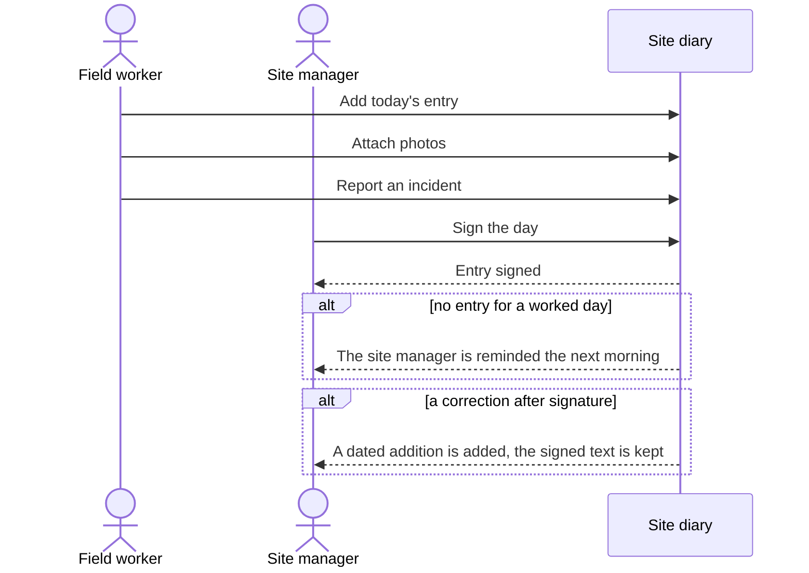

🏠 [Specs](../../../../README.md) › 🏷️ [Sectors](../../../README.md) › 🏗️ [SC01 Construction](../../README.md) ›
📝 [Use cases](../README.md) › 📝 [Use cases: FL-SC01-03 Run the site](README.md) › 📝 UC-SC01-05 Keep the site diary

# 📝 UC-SC01-05 Keep the site diary

**Status:** ✅ specified

## Summary

The site manager or foreman writes the site diary each worked day on the phone: weather, events, visitors, deliveries,
photos and incidents, offline when needed, and signs it.

## Personas

- [U14 Field worker](../../../../01-users/personas/u14-field-worker.md)
- [U22 Site manager](../../../../01-users/personas/u22-site-manager.md)

## Goal

A signed diary entry for every worked day, kept as the site's record.

## Trigger

Each worked day on a site.

## Frequency

Daily per site.

## Preconditions

- The SC01 sector pack is installed for the company,
  [UC-F14-02](../../../../02-functional/f14-plugin-store/use-cases/01-find-and-install/uc-f14-02-install-a-plugin-or-sector-pack.md),
  and its users have their roles,
  [UC-F1-06](../../../../02-functional/f01-administration/use-cases/04-edit-a-role/uc-f01-06-edit-a-role-and-its-record-rules.md).
- The diary form is set to work offline,
  [UC-F2-21](../../../../02-functional/f02-no-code-configuration/use-cases/09-portals-and-offline-forms/uc-f02-21-make-a-phone-form-work-offline.md).

## Postconditions

- **Success:** the day's entry is signed and synced; it can no longer be changed, only added to.
- **Failed:** the entry stays a draft on the phone and the site manager is reminded.

## Main flow

1. The foreman adds today's entry on [S-SC01-05 Site diary](../../screens/03-run-the-site/s-sc01-05-site-diary.md),
   [UC-F2-22](../../../../02-functional/f02-no-code-configuration/use-cases/09-portals-and-offline-forms/uc-f02-22-fill-a-form-offline-on-the-phone.md),
   weather, people present, deliveries and events.
2. The foreman attaches photos taken on the phone.
3. An incident is flagged; the site manager is told at once.
4. The site manager signs the day; the entry is locked.

## Alternative flows

- 1a. Dictated entry: the AI assistant turns the dictation into the entry, which the foreman checks
  ([UC-SC01-15](uc-sc01-15-ask-the-assistant-about-a-site.md)).

## Error flows

- 4e. No entry for a worked day: the site manager is reminded the next morning.
- 4f. A correction after signature: a dated addition is added; the signed text is kept.
- Any step: a call to a service or an outside system fails: it is retried first
  ([BR-F3-32](../../../../02-functional/f03-assistant/business-rules/br-f03-32-retry-before-an-error.md)), then the
  error message pattern ([D122](../../../../06-decisions/ux/d122-error-message-standard.md)) says what failed; what was
  typed is kept.

## Business rules

- [BR-SC01-09 Time and materials per site](../../business-rules/br-sc01-09-time-and-materials-per-site.md)
- [BR-F2-21 Offline forms keep only what is needed and sync in order](../../../../02-functional/f02-no-code-configuration/business-rules/br-f02-21-offline-forms-keep-only-what-is-needed-and-sync-in-order.md)

## Entities

- [E-SC01-05 Site diary entry](../../data/e-sc01-05-site-diary-entry.md)

## Permissions

The field worker and site manager roles; the record rules of their role and site apply,
[UC-F1-06](../../../../02-functional/f01-administration/use-cases/04-edit-a-role/uc-f01-06-edit-a-role-and-its-record-rules.md).

## Notifications

- The site manager is told at once of an incident.
- A missing day is reminded the next morning.

## Audit events

Every creation, change and state change of site diary entry records, with who, when and the values before and after
(T3).

## AI involvement

The AI assistant answers questions on the site diary entry records of this use case, with links, and prepares them as
drafts the user confirms. It works within the user's rights,
[BR-F3-34](../../../../02-functional/f03-assistant/business-rules/br-f03-34-every-capability-is-reachable-from-the-assistant.md),
and never deletes or does anything irreversible without the user's confirmation,
[BR-F3-07](../../../../02-functional/f03-assistant/business-rules/br-f03-07-no-deletes-no-irreversible-acts.md).

## API, MCP and A2A exposure

Through the API and webhooks (T5) and the MCP and A2A gateway (T6), with the caller's rights,
[BR-F3-34](../../../../02-functional/f03-assistant/business-rules/br-f03-34-every-capability-is-reachable-from-the-assistant.md),
reading, creating and changing the records of this use case; nothing irreversible without a person's confirmation.

## Screens

- [S-SC01-05 Site diary](../../screens/03-run-the-site/s-sc01-05-site-diary.md)

## Flowchart

See [FL-SC01-03 Run the site](../../flows/fl-sc01-03-run-the-site.md#flowchart).

## Sequence diagram

## Acceptance criteria

1. **Given** the example construction company's site S-14 on 2 December, rain, a late delivery and 6 photos **when** the
   site manager signs **then** the entry is locked with its 6 photos and shows in the site's diary.
2. **Given** S-14 worked on 2 December with no entry **when** it is 3 December at 8:00 **then** the site manager is
   reminded the next morning.

## Non-functional notes

[D408](../../../../06-decisions/technical/d408-performance-and-profiles.md)'s targets
([performance](../../../../05-non-functional/performance.md)): 95 % of screens within 1 second; lists paged on the
server, the first page within 1 second; reports within 5 seconds or in the background. WCAG 2.2 AA and RGAA
([D46](../../../../06-decisions/ux/d46-accessibility-standard.md)).

## Regulatory references

None specific to this use case; the sector's legal rules are listed in [SC01 regulatory](../../regulatory.md).

## Related use cases

- [UC-SC01-04 Record time and materials per site](uc-sc01-04-record-time-and-materials-per-site.md)
- [UC-SC01-10 Accept the works with reservations and lift them](../05-hand-over-and-follow-up/uc-sc01-10-accept-the-works-with-reservations-and-lift-them.md)

## Open questions

None.

---

⬅️ [UC-SC01-04 Record time and materials per site](uc-sc01-04-record-time-and-materials-per-site.md) ·
⬆️ [Up](README.md) ·
➡️ [UC-SC01-06](../04-bill-and-subcontract/uc-sc01-06-bill-progress-with-the-retention-guarantee.md)
