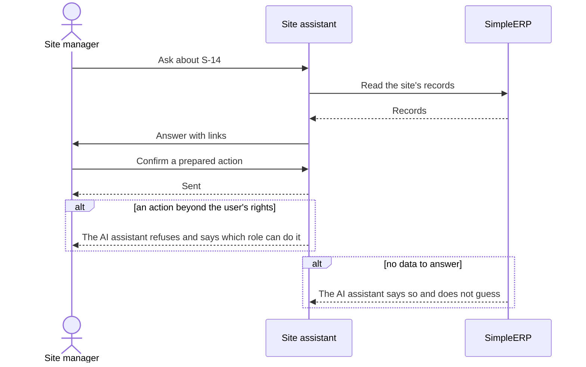

🏠 [Specs](../../../../README.md) › 🏷️ [Sectors](../../../README.md) › 🏗️ [SC01 Construction](../../README.md) ›
📝 [Use cases](../README.md) › 📝 [Use cases: FL-SC01-03 Run the site](README.md) ›
📝 UC-SC01-15 Ask the AI assistant about a site

# 📝 UC-SC01-15 Ask the AI assistant about a site

**Status:** ✅ specified

## Summary

The site manager or a field worker asks the AI assistant about a site, its progress, margin, next phase or missing
documents, or asks it to prepare an action, within their role's rights.

## Personas

- [U22 Site manager](../../../../01-users/personas/u22-site-manager.md)
- [U14 Field worker](../../../../01-users/personas/u14-field-worker.md)

## Goal

Answers from the site's data and prepared actions, without hunting through screens.

## Trigger

A question or a request to the AI assistant.

## Frequency

Several times a day.

## Preconditions

- The SC01 sector pack is installed for the company,
  [UC-F14-02](../../../../02-functional/f14-plugin-store/use-cases/01-find-and-install/uc-f14-02-install-a-plugin-or-sector-pack.md),
  and its users have their roles,
  [UC-F1-06](../../../../02-functional/f01-administration/use-cases/04-edit-a-role/uc-f01-06-edit-a-role-and-its-record-rules.md).

## Postconditions

- **Success:** the answer cites the site's records, or the prepared action is confirmed and done.
- **Failed:** the AI assistant says it cannot answer or act, and why.

## Main flow

1. The site manager asks on [S-SC01-15 Site assistant](../../screens/03-run-the-site/s-sc01-15-site-assistant.md),
   [UC-F3-01](../../../../02-functional/f03-assistant/use-cases/01-ask-the-assistant/uc-f03-01-ask-a-question-about-the-company-s-data.md),
   "What is missing before acceptance of S-14?".
2. The AI assistant reads the site's records within the user's rights,
   [BR-F3-34](../../../../02-functional/f03-assistant/business-rules/br-f03-34-every-capability-is-reachable-from-the-assistant.md).
3. The AI assistant answers with links to the records: 2 reservations open, the as-built file incomplete.
4. The site manager asks to remind the subcontractor; the AI assistant prepares the message and sends it once confirmed,
   [UC-F3-03](../../../../02-functional/f03-assistant/use-cases/03-act-through-the-assistant/uc-f03-03-have-the-assistant-create-or-change-records.md).

## Alternative flows

- 1a. A field worker dictates the diary: the AI assistant fills the diary entry for him to check
  ([UC-SC01-05](uc-sc01-05-keep-the-site-diary.md)).

## Error flows

- 4e. An action beyond the user's rights: the AI assistant refuses and says which role can do it.
- 2e. No data to answer: the AI assistant says so and does not guess.
- Any step: a call to a service or an outside system fails: it is retried first
  ([BR-F3-32](../../../../02-functional/f03-assistant/business-rules/br-f03-32-retry-before-an-error.md)), then the
  error message pattern ([D122](../../../../06-decisions/ux/d122-error-message-standard.md)) says what failed; what was
  typed is kept.

## Business rules

- [BR-SC01-01 Construction follows the country pack](../../business-rules/br-sc01-01-construction-follows-the-country-pack.md)
- [BR-F3-34 All capabilities via the AI assistant](../../../../02-functional/f03-assistant/business-rules/br-f03-34-every-capability-is-reachable-from-the-assistant.md)
- [BR-F3-07 No deletes, no irreversible acts](../../../../02-functional/f03-assistant/business-rules/br-f03-07-no-deletes-no-irreversible-acts.md)

## Entities

- [E-SC01-01 Construction site](../../data/e-sc01-01-construction-site.md)
- [E-SC01-05 Site diary entry](../../data/e-sc01-05-site-diary-entry.md)

## Permissions

The site manager and field worker roles; the record rules of their role and site apply,
[UC-F1-06](../../../../02-functional/f01-administration/use-cases/04-edit-a-role/uc-f01-06-edit-a-role-and-its-record-rules.md).

## Notifications

None beyond the in-app updates of the records concerned.

## Audit events

Every creation, change and state change of site, site diary entry records, with who, when and the values before and
after (T3).

## AI involvement

The AI assistant answers from the site's records with links, prepares diary entries, reminders and orders as drafts, and
never invents a figure. It works within the user's rights,
[BR-F3-34](../../../../02-functional/f03-assistant/business-rules/br-f03-34-every-capability-is-reachable-from-the-assistant.md),
and never deletes or does anything irreversible without the user's confirmation,
[BR-F3-07](../../../../02-functional/f03-assistant/business-rules/br-f03-07-no-deletes-no-irreversible-acts.md).

## API, MCP and A2A exposure

Through the API and webhooks (T5) and the MCP and A2A gateway (T6), with the caller's rights,
[BR-F3-34](../../../../02-functional/f03-assistant/business-rules/br-f03-34-every-capability-is-reachable-from-the-assistant.md),
reading, creating and changing the records of this use case; nothing irreversible without a person's confirmation.

## Screens

- [S-SC01-15 Site assistant](../../screens/03-run-the-site/s-sc01-15-site-assistant.md)

## Flowchart

See [FL-SC01-03 Run the site](../../flows/fl-sc01-03-run-the-site.md#flowchart).

## Sequence diagram

## Acceptance criteria

1. **Given** the example construction company's site S-14 with 2 reservations open **when** the site manager asks what
   is missing before closing **then** the AI assistant answers with the 2 reservations, each linked.
2. **Given** a foreman dictating "rain all morning, concrete delivered at 11" **when** he asks the AI assistant **then**
   the AI assistant fills the diary entry for him to check ([UC-SC01-05](uc-sc01-05-keep-the-site-diary.md)).
3. **Given** a field worker asking for S-14's margin **when** he asks the AI assistant **then** the AI assistant refuses
   and says which role can do it.

## Non-functional notes

[D408](../../../../06-decisions/technical/d408-performance-and-profiles.md)'s targets
([performance](../../../../05-non-functional/performance.md)): 95 % of screens within 1 second; lists paged on the
server, the first page within 1 second; reports within 5 seconds or in the background. WCAG 2.2 AA and RGAA
([D46](../../../../06-decisions/ux/d46-accessibility-standard.md)).

## Regulatory references

None specific to this use case; the sector's legal rules are listed in [SC01 regulatory](../../regulatory.md).

## Related use cases

- [UC-SC01-05 Keep the site diary](uc-sc01-05-keep-the-site-diary.md)
- [UC-SC01-14 Follow site profitability](../04-bill-and-subcontract/uc-sc01-14-follow-site-profitability.md)

## Open questions

None.

---

⬅️ [UC-SC01-14 Follow site profitability](../04-bill-and-subcontract/uc-sc01-14-follow-site-profitability.md) ·
⬆️ [Up](README.md) ·
➡️ [UC-SC01-16](../06-revision-developers-bim-and-grants/uc-sc01-16-revise-prices-with-the-bt-and-tp-indices.md)
