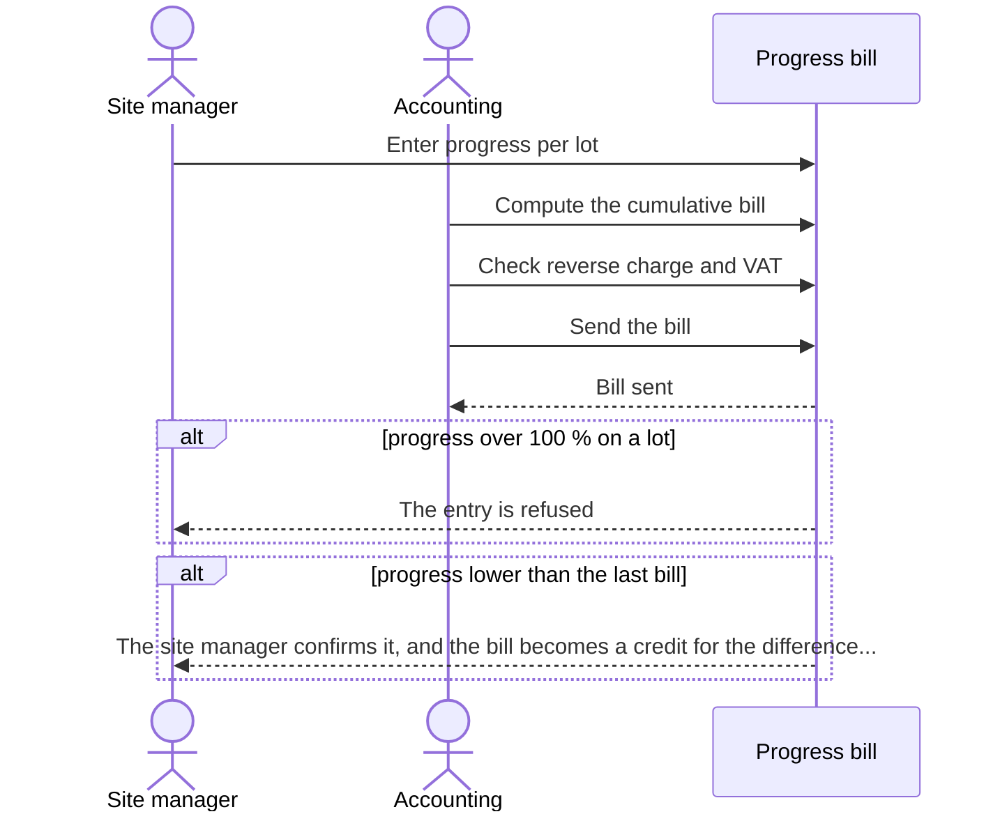

🏠 [Specs](../../../../README.md) › 🏷️ [Sectors](../../../README.md) › 🏗️ [SC01 Construction](../../README.md) ›
📝 [Use cases](../README.md) › 📝 [Use cases: FL-SC01-04 Bill and subcontract](README.md) ›
📝 UC-SC01-06 Bill progress with the retention guarantee

# 📝 UC-SC01-06 Bill progress with the retention guarantee

**Status:** ✅ specified

## Summary

The site manager enters the progress of each lot; accounting checks the cumulative progress bill, with earlier bills and
deposits deducted and the retention held back, and sends it.

## Personas

- [U22 Site manager](../../../../01-users/personas/u22-site-manager.md)
- [U05 Accounting](../../../../01-users/personas/u05-accounting.md)

## Goal

A progress bill matching the work done, with the retention held back.

## Trigger

The billing date agreed in the contract, usually month end.

## Frequency

Monthly per site.

## Preconditions

- The SC01 sector pack is installed for the company,
  [UC-F14-02](../../../../02-functional/f14-plugin-store/use-cases/01-find-and-install/uc-f14-02-install-a-plugin-or-sector-pack.md),
  and its users have their roles,
  [UC-F1-06](../../../../02-functional/f01-administration/use-cases/04-edit-a-role/uc-f01-06-edit-a-role-and-its-record-rules.md).
- The site has a signed quote with its lots
  ([UC-SC01-02](../01-win-the-work/uc-sc01-02-quote-by-lots-and-unit-price-schedules.md)).

## Postconditions

- **Success:** the progress bill is sent and posted; the retention is recorded until its release.
- **Failed:** the bill stays a draft.

## Main flow

1. The site manager enters each lot's progress in per cent on
   [S-SC01-06 Progress bill](../../screens/04-bill-and-subcontract/s-sc01-06-progress-bill.md).
2. SimpleERP computes the cumulative amount, deducts the earlier bills and deposits and holds back the retention,
   [UC-F6-06](../../../../02-functional/f06-customers-and-sales/use-cases/03-invoice-and-get-paid/uc-f06-06-invoice-deposits-progress-and-final.md),
   [BR-F6-06](../../../../02-functional/f06-customers-and-sales/business-rules/br-f06-06-progress-invoices-and-retention.md).
3. Accounting checks the VAT; works subcontracted for a VAT-registered customer go without VAT
   ([BR-SC01-04](../../business-rules/br-sc01-04-reverse-charge-for-subcontracted-works.md)).
4. Accounting sends the bill, through Chorus Pro for a public buyer
   ([UC-SC01-13](../01-win-the-work/uc-sc01-13-answer-public-tenders-and-invoice-through-chorus-pro.md)).

## Alternative flows

- 2a. A bank guarantee instead of the retention: no retention is held back and the guarantee is recorded with its end
  date.
- 1a. An agreed extra: a new line is added to the lot and billed with its progress.

## Error flows

- 1e. Progress over 100 % on a lot: the entry is refused.
- 1f. Progress lower than the last bill: the site manager confirms it, and the bill becomes a credit for the difference,
  [UC-F6-09](../../../../02-functional/f06-customers-and-sales/use-cases/03-invoice-and-get-paid/uc-f06-09-credit-note-and-refund.md).
- Any step: a call to a service or an outside system fails: it is retried first
  ([BR-F3-32](../../../../02-functional/f03-assistant/business-rules/br-f03-32-retry-before-an-error.md)), then the
  error message pattern ([D122](../../../../06-decisions/ux/d122-error-message-standard.md)) says what failed; what was
  typed is kept.

## Business rules

- [BR-SC01-03 Progress bills follow progress](../../business-rules/br-sc01-03-progress-bills-follow-progress.md)
- [BR-SC01-04 Reverse charge for subcontracted works](../../business-rules/br-sc01-04-reverse-charge-for-subcontracted-works.md)
- [BR-SC01-11 Retention released when due](../../business-rules/br-sc01-11-retention-released-when-due.md)
- [BR-F6-06 Progress invoices and retention](../../../../02-functional/f06-customers-and-sales/business-rules/br-f06-06-progress-invoices-and-retention.md)

## Entities

- [E-SC01-06 Progress bill](../../data/e-sc01-06-progress-bill.md)

## Permissions

The site manager and accounting roles; the record rules of their role and site apply,
[UC-F1-06](../../../../02-functional/f01-administration/use-cases/04-edit-a-role/uc-f01-06-edit-a-role-and-its-record-rules.md).

## Notifications

- The customer gets the bill by email or through Chorus Pro.

## Audit events

Every creation, change and state change of progress bill records, with who, when and the values before and after (T3).

## AI involvement

The AI assistant answers questions on the progress bill records of this use case, with links, and prepares them as
drafts the user confirms. It works within the user's rights,
[BR-F3-34](../../../../02-functional/f03-assistant/business-rules/br-f03-34-every-capability-is-reachable-from-the-assistant.md),
and never deletes or does anything irreversible without the user's confirmation,
[BR-F3-07](../../../../02-functional/f03-assistant/business-rules/br-f03-07-no-deletes-no-irreversible-acts.md).

## API, MCP and A2A exposure

Through the API and webhooks (T5) and the MCP and A2A gateway (T6), with the caller's rights,
[BR-F3-34](../../../../02-functional/f03-assistant/business-rules/br-f03-34-every-capability-is-reachable-from-the-assistant.md),
reading, creating and changing the records of this use case; nothing irreversible without a person's confirmation.

## Screens

- [S-SC01-06 Progress bill](../../screens/04-bill-and-subcontract/s-sc01-06-progress-bill.md)

## Flowchart

See [FL-SC01-04 Bill and subcontract](../../flows/fl-sc01-04-bill-and-subcontract.md#flowchart).

## Sequence diagram

## Acceptance criteria

1. **Given** the example construction company's site S-14 with lot 2 at 60 %, 72,000 EUR billed before and a 5 %
   retention **when** progress bill 3 is computed **then** it shows the cumulative amount, deducts 72,000 EUR and holds
   back 5 % of the cumulative amount.
2. **Given** a bank guarantee of 9,100 EUR on S-14 **when** progress bill 3 is computed **then** no retention is held
   back and the guarantee is recorded with its end date.
3. **Given** lot 2 entered at 105 % **when** the site manager saves **then** the entry is refused.

## Non-functional notes

[D408](../../../../06-decisions/technical/d408-performance-and-profiles.md)'s targets
([performance](../../../../05-non-functional/performance.md)): 95 % of screens within 1 second; lists paged on the
server, the first page within 1 second; reports within 5 seconds or in the background. WCAG 2.2 AA and RGAA
([D46](../../../../06-decisions/ux/d46-accessibility-standard.md)).

## Regulatory references

Legal values from the France country pack:
[CR-FR-021 Construction retention guarantee](../../../../10-country-packs/france/invoicing/cr-fr-021-construction-retention-guarantee.md),
[CR-FR-083 Reverse charge on construction subcontracting](../../../../10-country-packs/france/tax-and-vat/cr-fr-083-construction-subcontracting-reverse-charge.md).

## Related use cases

- [UC-SC01-13 Answer public tenders and invoice through Chorus Pro](../01-win-the-work/uc-sc01-13-answer-public-tenders-and-invoice-through-chorus-pro.md)
- [UC-SC01-10 Accept the works with reservations and lift them](../05-hand-over-and-follow-up/uc-sc01-10-accept-the-works-with-reservations-and-lift-them.md)
- [UC-SC01-14 Follow site profitability](uc-sc01-14-follow-site-profitability.md)

## Open questions

None.

---

⬅️ [UC-SC01-05 Keep the site diary](../03-run-the-site/uc-sc01-05-keep-the-site-diary.md) · ⬆️ [Up](README.md) ·
➡️ [UC-SC01-07 Subcontract](uc-sc01-07-subcontract.md)
