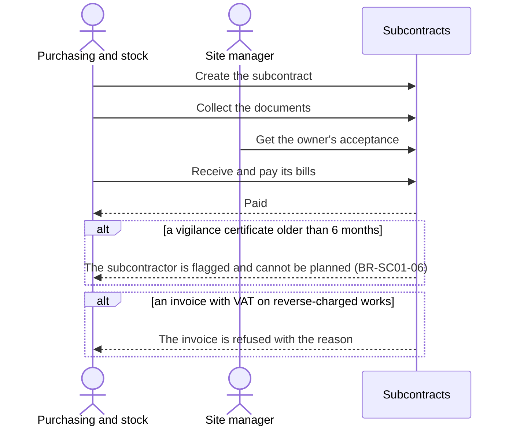

🏠 [Specs](../../../../README.md) › 🏷️ [Sectors](../../../README.md) › 🏗️ [SC01 Construction](../../README.md) ›
📝 [Use cases](../README.md) › 📝 [Use cases: FL-SC01-04 Bill and subcontract](README.md) › 📝 UC-SC01-07 Subcontract

# 📝 UC-SC01-07 Subcontract

**Status:** ✅ specified

## Summary

The site manager and purchasing contract a subcontractor for a site, collect its documents, have it accepted by the
project owner, and receive and pay its reverse-charge invoices.

## Personas

- [U22 Site manager](../../../../01-users/personas/u22-site-manager.md)
- [U04 Purchasing and stock](../../../../01-users/personas/u04-purchasing.md)

## Goal

Subcontractors who work legally on the site and are paid on time.

## Trigger

A lot or part of a lot is given to another firm.

## Frequency

A few per site.

## Preconditions

- The SC01 sector pack is installed for the company,
  [UC-F14-02](../../../../02-functional/f14-plugin-store/use-cases/01-find-and-install/uc-f14-02-install-a-plugin-or-sector-pack.md),
  and its users have their roles,
  [UC-F1-06](../../../../02-functional/f01-administration/use-cases/04-edit-a-role/uc-f01-06-edit-a-role-and-its-record-rules.md).
- The subcontractor exists as a supplier with its SIREN.

## Postconditions

- **Success:** the subcontract is signed and accepted, its documents valid, its invoices received and paid.
- **Failed:** the subcontractor cannot be planned; the lot stays to be given.

## Main flow

1. Purchasing creates the subcontract on
   [S-SC01-07 Subcontracts](../../screens/04-bill-and-subcontract/s-sc01-07-subcontracts.md) with its lot, amount and
   payment terms,
   [UC-F9-32](../../../../02-functional/f09-hr-and-projects/use-cases/11-capacity-rounds-and-partners/uc-f09-32-work-with-subcontractors-and-freelancers-on-projects.md).
2. Purchasing collects the vigilance certificate and insurance; SimpleERP checks their dates,
   [BR-F9-24](../../../../02-functional/f09-hr-and-projects/business-rules/br-f09-24-no-work-without-vigilance-documents.md).
3. The site manager records the project owner's acceptance and the payment guarantee.
4. Purchasing receives the subcontractor's invoices without VAT under reverse charge
   ([BR-SC01-04](../../business-rules/br-sc01-04-reverse-charge-for-subcontracted-works.md)) and pays them,
   [UC-F8-04](../../../../02-functional/f08-accounting/use-cases/02-purchase-to-pay/uc-f08-04-pay-suppliers.md).

## Alternative flows

- 4a. Direct payment by the public buyer: the subcontractor's invoices are approved by the company and paid by the
  buyer; they are left out of the company's own bill.

## Error flows

- 2e. A vigilance certificate older than 6 months: the subcontractor is flagged and cannot be planned
  ([BR-SC01-06](../../business-rules/br-sc01-06-subcontractor-documents-before-work.md)).
- 4e. An invoice with VAT on reverse-charged works: the invoice is refused with the reason.
- Any step: a call to a service or an outside system fails: it is retried first
  ([BR-F3-32](../../../../02-functional/f03-assistant/business-rules/br-f03-32-retry-before-an-error.md)), then the
  error message pattern ([D122](../../../../06-decisions/ux/d122-error-message-standard.md)) says what failed; what was
  typed is kept.

## Business rules

- [BR-SC01-04 Reverse charge for subcontracted works](../../business-rules/br-sc01-04-reverse-charge-for-subcontracted-works.md)
- [BR-SC01-06 Subcontractor documents before work](../../business-rules/br-sc01-06-subcontractor-documents-before-work.md)
- [BR-F9-24 No work without vigilance documents](../../../../02-functional/f09-hr-and-projects/business-rules/br-f09-24-no-work-without-vigilance-documents.md)

## Entities

- [E-SC01-07 Subcontract](../../data/e-sc01-07-subcontract.md)

## Permissions

The site manager and purchasing and stock roles; the record rules of their role and site apply,
[UC-F1-06](../../../../02-functional/f01-administration/use-cases/04-edit-a-role/uc-f01-06-edit-a-role-and-its-record-rules.md).

## Notifications

- Purchasing is reminded before a certificate passes 6 months.

## Audit events

Every creation, change and state change of subcontract records, with who, when and the values before and after (T3).

## AI involvement

The AI assistant answers questions on the subcontract records of this use case, with links, and prepares them as drafts
the user confirms. It works within the user's rights,
[BR-F3-34](../../../../02-functional/f03-assistant/business-rules/br-f03-34-every-capability-is-reachable-from-the-assistant.md),
and never deletes or does anything irreversible without the user's confirmation,
[BR-F3-07](../../../../02-functional/f03-assistant/business-rules/br-f03-07-no-deletes-no-irreversible-acts.md).

## API, MCP and A2A exposure

Through the API and webhooks (T5) and the MCP and A2A gateway (T6), with the caller's rights,
[BR-F3-34](../../../../02-functional/f03-assistant/business-rules/br-f03-34-every-capability-is-reachable-from-the-assistant.md),
reading, creating and changing the records of this use case; nothing irreversible without a person's confirmation.

## Screens

- [S-SC01-07 Subcontracts](../../screens/04-bill-and-subcontract/s-sc01-07-subcontracts.md)

## Flowchart

See [FL-SC01-04 Bill and subcontract](../../flows/fl-sc01-04-bill-and-subcontract.md#flowchart).

## Sequence diagram

## Acceptance criteria

1. **Given** the example construction company's subcontract with Elec Pro on S-14 for 24,000 EUR, certificate dated
   2026-11-02 **when** it is planned in December **then** the plan accepts it.
2. **Given** Elec Pro paid directly for 24,000 EUR on a public site **when** progress bill 3 is computed **then** the
   subcontractor's invoices are approved by the company and paid by the buyer; they are left out of the company's own
   bill.
3. **Given** Elec Pro's certificate dated 2026-05-02 **when** it is 4 November **then** the subcontractor is flagged and
   cannot be planned ([BR-SC01-06](../../business-rules/br-sc01-06-subcontractor-documents-before-work.md)).

## Non-functional notes

[D408](../../../../06-decisions/technical/d408-performance-and-profiles.md)'s targets
([performance](../../../../05-non-functional/performance.md)): 95 % of screens within 1 second; lists paged on the
server, the first page within 1 second; reports within 5 seconds or in the background. WCAG 2.2 AA and RGAA
([D46](../../../../06-decisions/ux/d46-accessibility-standard.md)).

## Regulatory references

Legal values from the France country pack:
[CR-FR-085 Vigilance over subcontractors](../../../../10-country-packs/france/construction/cr-fr-085-subcontractor-vigilance.md),
[CR-FR-086 Subcontractor acceptance and payment guarantee](../../../../10-country-packs/france/construction/cr-fr-086-subcontractor-acceptance-and-payment-guarantee.md),
[CR-FR-083 Reverse charge on construction subcontracting](../../../../10-country-packs/france/tax-and-vat/cr-fr-083-construction-subcontracting-reverse-charge.md).

## Related use cases

- [UC-SC01-03 Plan the site](../02-prepare-the-site/uc-sc01-03-plan-the-site.md)
- [UC-SC01-06 Bill progress with the retention guarantee](uc-sc01-06-bill-progress-with-the-retention-guarantee.md)

## Open questions

None.

---

⬅️ [UC-SC01-06 Bill progress with the retention guarantee](uc-sc01-06-bill-progress-with-the-retention-guarantee.md) ·
⬆️ [Up](README.md) · ➡️ [UC-SC01-08](../02-prepare-the-site/uc-sc01-08-rent-and-track-equipment-on-sites.md)
