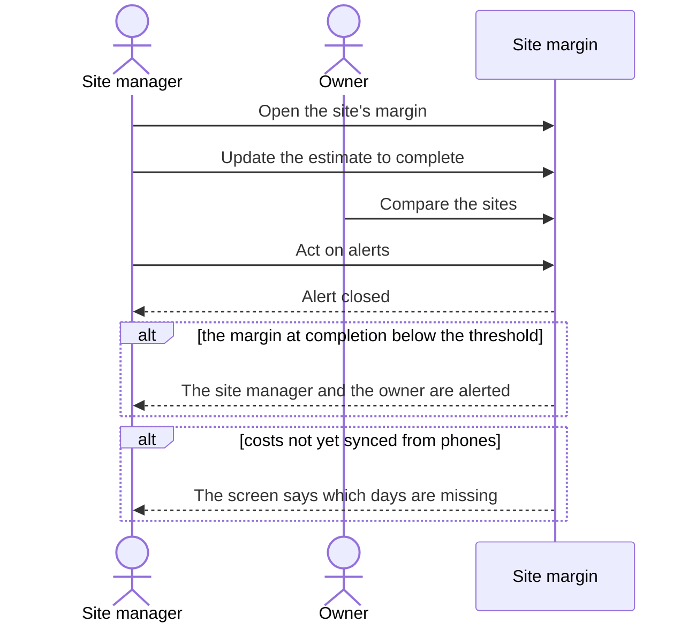

🏠 [Specs](../../../../README.md) › 🏷️ [Sectors](../../../README.md) › 🏗️ [SC01 Construction](../../README.md) ›
📝 [Use cases](../README.md) › 📝 [Use cases: FL-SC01-04 Bill and subcontract](README.md) ›
📝 UC-SC01-14 Follow site profitability

# 📝 UC-SC01-14 Follow site profitability

**Status:** ✅ specified

## Summary

The site manager and the owner follow each site's budget against actual costs, update the estimate to complete, and act
when the margin at completion drops below the threshold.

## Personas

- [U22 Site manager](../../../../01-users/personas/u22-site-manager.md)
- [U13 Owner](../../../../01-users/personas/u13-owner.md)

## Goal

No site loses money unnoticed.

## Trigger

The weekly site review, or a margin alert.

## Frequency

Weekly per site; monthly across sites for the owner.

## Preconditions

- The SC01 sector pack is installed for the company,
  [UC-F14-02](../../../../02-functional/f14-plugin-store/use-cases/01-find-and-install/uc-f14-02-install-a-plugin-or-sector-pack.md),
  and its users have their roles,
  [UC-F1-06](../../../../02-functional/f01-administration/use-cases/04-edit-a-role/uc-f01-06-edit-a-role-and-its-record-rules.md).

## Postconditions

- **Success:** the margin at completion is up to date and alerts are handled.
- **Failed:** the estimate is not updated; the last one stays shown with its date.

## Main flow

1. The site manager opens [S-SC01-14 Site margin](../../screens/04-bill-and-subcontract/s-sc01-14-site-margin.md):
   budget per lot, actual hours, materials, equipment and subcontracts.
2. The site manager enters the estimate to complete per lot; SimpleERP computes the margin at completion
   ([BR-SC01-14](../../business-rules/br-sc01-14-margin-at-completion.md)).
3. The owner compares the margins of all sites,
   [UC-F8-20](../../../../02-functional/f08-accounting/use-cases/06-benchmark-additions/uc-f08-20-analyse-profitability.md).
4. The site manager handles an alert: an agreed extra to bill or a cost to cut.

## Alternative flows

- 3a. A site closed: its final margin is frozen and kept for comparison.

## Error flows

- 2e. The margin at completion below the threshold: the site manager and the owner are alerted (the threshold
  is 5 points under the quoted margin).
- 1e. Costs not yet synced from phones: the screen says which days are missing.
- Any step: a call to a service or an outside system fails: it is retried first
  ([BR-F3-32](../../../../02-functional/f03-assistant/business-rules/br-f03-32-retry-before-an-error.md)), then the
  error message pattern ([D122](../../../../06-decisions/ux/d122-error-message-standard.md)) says what failed; what was
  typed is kept.

## Business rules

- [BR-SC01-14 Margin at completion](../../business-rules/br-sc01-14-margin-at-completion.md)

## Entities

- [E-SC01-01 Construction site](../../data/e-sc01-01-construction-site.md)
- [E-SC01-06 Progress bill](../../data/e-sc01-06-progress-bill.md)

## Permissions

The site manager and owner roles; the record rules of their role and site apply,
[UC-F1-06](../../../../02-functional/f01-administration/use-cases/04-edit-a-role/uc-f01-06-edit-a-role-and-its-record-rules.md).

## Notifications

- The site manager and the owner are alerted when a margin drops below the threshold.

## Audit events

Every creation, change and state change of site, progress bill records, with who, when and the values before and after
(T3).

## AI involvement

The AI assistant answers questions on the site, progress bill records of this use case, with links, and prepares them as
drafts the user confirms. It works within the user's rights,
[BR-F3-34](../../../../02-functional/f03-assistant/business-rules/br-f03-34-every-capability-is-reachable-from-the-assistant.md),
and never deletes or does anything irreversible without the user's confirmation,
[BR-F3-07](../../../../02-functional/f03-assistant/business-rules/br-f03-07-no-deletes-no-irreversible-acts.md).

## API, MCP and A2A exposure

Through the API and webhooks (T5) and the MCP and A2A gateway (T6), with the caller's rights,
[BR-F3-34](../../../../02-functional/f03-assistant/business-rules/br-f03-34-every-capability-is-reachable-from-the-assistant.md),
reading, creating and changing the records of this use case; nothing irreversible without a person's confirmation.

## Screens

- [S-SC01-14 Site margin](../../screens/04-bill-and-subcontract/s-sc01-14-site-margin.md)

## Flowchart

See [FL-SC01-04 Bill and subcontract](../../flows/fl-sc01-04-bill-and-subcontract.md#flowchart).

## Sequence diagram

## Acceptance criteria

1. **Given** the example construction company's site S-14 with 182,000 EUR contract, 120,000 EUR spent and 40,000 EUR to
   complete **when** the margin is computed **then** the margin at completion is 22,000 EUR.
2. **Given** S-14 quoted at 18 % and now at 11 % **when** the estimate is saved **then** the site manager and the owner
   are alerted (the threshold is 5 points under the quoted margin).

## Non-functional notes

[D408](../../../../06-decisions/technical/d408-performance-and-profiles.md)'s targets
([performance](../../../../05-non-functional/performance.md)): 95 % of screens within 1 second; lists paged on the
server, the first page within 1 second; reports within 5 seconds or in the background. WCAG 2.2 AA and RGAA
([D46](../../../../06-decisions/ux/d46-accessibility-standard.md)).

## Regulatory references

None specific to this use case; the sector's legal rules are listed in [SC01 regulatory](../../regulatory.md).

## Related use cases

- [UC-SC01-04 Record time and materials per site](../03-run-the-site/uc-sc01-04-record-time-and-materials-per-site.md)
- [UC-SC01-06 Bill progress with the retention guarantee](uc-sc01-06-bill-progress-with-the-retention-guarantee.md)

## Open questions

None open.

---

⬅️ [UC-SC01-13](../01-win-the-work/uc-sc01-13-answer-public-tenders-and-invoice-through-chorus-pro.md) ·
⬆️ [Up](README.md) ·
➡️ [UC-SC01-15 Ask the AI assistant about a site](../03-run-the-site/uc-sc01-15-ask-the-assistant-about-a-site.md)
